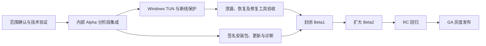
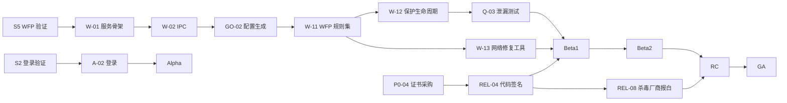

# BlueGrass：实施计划

- 整理日期：2026-10-10，Asia/Hong_Kong。
- 依据：[主设计](../specs/2026-10-10-sunipip-client-design.md)、[设计审阅报告](../reviews/2026-10-10-sunipip-client-design-review.md)、[补充设计](../specs/2026-10-10-sunipip-client-design-addendum.md)。
- 前提：D-01 至 D-19 已记录；正式名称为 BlueGrass，Android 包标识为 `com.bluegrass.client`。独立 Go API 已完成代码与测试，客户端工程及端到端验收尚未完成；排期按实际验证结果调整。
- 取数前提：2026-10-11 的 [D-19](../../adr/0019-independent-client-api.md) 将首版接入改为独立 API，保留 D-05 的统一接口、按需分页和连接前刷新。接口与长期会话规则见[接入开发文档](../../development/client-api-integration.md)，B-05 转为验证游标分页与单条详情；短信、完整资产和多协议缺口不能自动关闭。
- 排期起点：假设本周完成审阅确认，W1 从 2026-10-19（周一）开始。2027 年春节（2 月 6 日）前后约一周不安排工作，具体以官方放假安排为准。
- 本文是项目级计划，覆盖阶段、里程碑、任务、估算、依赖、测试和风险。**每个阶段开始前，再为该阶段编写工程级任务计划**（精确到文件、测试和提交），存放在本目录。
- 估算单位为人日，是 Phase 0 之前的参考值。M1 时根据 Spike 结果复核一次。
- D-03 已确认 SOCKS5、SS、VMess、VLESS、Trojan、HTTP/HTTPS 代理、Hysteria2、TUIC、AnyTLS，见 [ADR 0003](../../adr/0003-first-release-protocol-scope.md)。任务范围已补入多协议验证、配置和测试；354 人日、Phase 0 的 3 周及下述里程碑仍是原 SOCKS5 基线估算，须按 S12 的参数矩阵和实际人员容量重新估算后再确定日期。
- D-06 已确认 Windows 首轮 Beta 包含 TUN 与断线保护，见 [ADR 0006](../../adr/0006-first-beta-network-protection.md)。Beta1 必须等待保护、泄漏与恢复验收；Beta1、Beta2、RC、GA 日期待重排，文内其他 W 周次仅保留为原工作包基线。
- 编号约定：本文的任务编号前缀为 `P0-`、`S`、`DM-`（领域层）、`A-`（数据层）、`U-`（界面）、`GO-`（Go 共享层）、`W-`（Windows）、`N-`（Android）、`REL-`（发布工程）、`Q-`（测试）、`K-`（风险）、`M`（里程碑）。以 `R-`、`G-`、`C-`、`B-`、`D-` 开头的编号均指审阅报告中的条目。

## 1. 里程碑

| 里程碑 | 周次 | 日期 | 退出条件 |
| --- | --- | --- | --- |
| M0 决策记录与验证准备 | 决策已完成，准备待落实 | 2026-10-10（决策记录） | D-01 至 D-18 已确认并同步；后端依赖清单已整理，实际对接与验证准备另行落实 |
| M1 技术验证完成 | W3（原基线，待重排） | 2026-11-06（原参考） | Spike S1–S12 结论成文；关键 ADR 与协议参数矩阵定稿；主设计按审阅报告 §8 修订；P0 级后端依赖有书面答复 |
| M2 内部 Alpha | W9 | 2026-12-18 | Windows 系统代理模式和安卓 VPN 都能连接真实线路，检测并显示出口 |
| M3 封闭 Beta1 | 待重排 | 待确定 | Windows 系统代理、TUN、断线保护与修复工具通过验收；签名安装包、更新、远程配置和诊断就绪；安卓 VPN 可用 |
| M4 Beta2 | Beta1 之后，待重排 | 待确定 | 扩大用户和设备覆盖；保护回归持续通过，完善兼容性、性能和安卓系统保护引导 |
| M5 RC | Beta2 之后，待重排 | 待确定 | 量化门禁全部通过（§13）；杀毒软件报白完成；B-01 已落实 |
| M6 GA | RC 验收后 | 待确定 | 正式发布，开始灰度 |
| M7 Win7 实施规划 | 主力版与安卓版发布后 | 另行确定 | 落实 Win7 独立交付的技术路线、验证方案与排期；系统代理、TUN 和断线保护目标已确认（D-01） |



## 2. 团队与角色（参考配置）

| 角色 | 人数 | 主要职责 | 投入期 |
| --- | --- | --- | --- |
| 产品 / 项目经理 | 0.5 | 决策、后端对接、法务协调、Beta 运营、客服培训 | 全程 |
| Flutter 工程师 A（领域与数据） | 1 | `packages/domain`、`packages/data_api_v2`、会话管理、契约测试、远程配置 | W1 起 |
| Flutter 工程师 B（界面，兼 DevOps） | 1 | 界面、托盘、通知、Windows 界面侧原生插件、CI、安装包 | W4 起 |
| Go / Windows 原生工程师 | 1 | `native/core`、Windows 服务、WFP、TUN、网络修复工具 | W1 起 |
| Android 原生工程师 | 1 | VpnService、libbox 封装、系统集成；Phase 1 有余量时支援界面开发 | W1 起 |
| 测试工程师 | 1 | 测试计划、模拟服务、故障注入、泄漏测试、设备矩阵 | W4 起 |
| UI 设计 | 0.3 | 线框、视觉、图标 | W1–W8 |
| 太阳IP后端对接人 | 0.2 | 后端依赖 B-01 至 B-12 | W1 起 |
| 法务顾问（外部） | 按需 | GPL 合规、隐私政策、用户协议、分发合规 | W2–W18 |

**容量核算**：总工作量约 354 人日，约合 71 人周（§9）。参考配置下 W1–W22 的可用产能大致相当（按 70% 有效工时计算）。

**瓶颈**：Go / Windows 工程师处在关键路径上，Phase 2 和 Phase 3 有重叠负载。如果条件允许，建议在 W8–W18 增加一名 Windows 方向的外包或兼职工程师，承担安装包和网络修复工具。

**人手较少时**：可评估先发 Windows Beta、安卓顺延，但 Windows Beta1 的 TUN 和保护验收要求不降低。平台顺序及 GA 日期须结合实际容量重新排定，原 W32–W36 估算不能直接沿用。

## 3. Phase 0：准备与技术验证（W1–W3）

**目标**：在写产品代码之前，消除会导致返工的不确定性，并把关键技术选择写成 ADR。

### 3.1 管理与准备任务

| 编号 | 任务 | 负责 | 估算 | 依赖 |
| --- | --- | --- | --- | --- |
| P0-01 | D-01 至 D-19 已记录，独立 API 决策与接入文档已同步；原审阅结果保留历史基线 | 用户决策与文档记录 | 已完成（原估算 1） | — |
| P0-02 | 整理 B-01 至 B-13：跟进后端资料、自建崩溃接收服务及 API 能力缺口；B-05 由客户端验证独立 API 定位能力 | 产品经理 | 3（原基线，待复核） | — |
| P0-03 | 准备测试账号和各状态的资源样本（B-09） | 产品经理 + 后端 | 2 | P0-02 |
| P0-04 | 启动代码签名证书采购（含硬件令牌或云签名服务）；制定 Ed25519 密钥方案 | 产品经理 | 1 + 等待 | — |
| P0-05 | 名称 BlueGrass、包标识 `com.bluegrass.client` 和内部命名已定；继续完成图标视觉稿与跨平台资产交付（D-18） | 产品经理 + 设计 | 1（原基线，剩余工作待复核） | — |
| P0-06 | 按补充设计 §18 的页面清单绘制线框 | 设计 + 产品经理 | 5 | P0-01 |
| P0-07 | 初始化仓库：目录结构（§11）、CI 骨架、代码规范、ADR 模板 | Flutter A | 2 | — |
| P0-08 | 汇总 Spike 报告和 ADR；按审阅报告 §8 修订主设计 | 全员 | 3 | 全部 Spike |
| P0-09 | 启动法务咨询（GPL、隐私政策、分发合规） | 产品经理 | 1 | — |

### 3.2 技术验证（Spike）

| 编号 | 要回答的问题 | 方法 | 退出标准 | 负责 | 估算 |
| --- | --- | --- | --- | --- | --- |
| S1 | 独立 API 如何映射资源，哪些产品状态仍缺契约？ | 在测试环境验证游标列表、空页仍有下一页、按订阅 ID 查询详情、归属和资格变化、UTC/null 到期；记录完整资产/分组/筛选缺口，样本脱敏存入 `contracts/fixtures/raw/` | 节点映射与详情刷新有契约测试；未提供的 B-09 状态明确列为待补齐；编写 `contracts/enums.yaml` 初稿 | Flutter A | 3（原基线，待复核） |
| S2 | 独立登录如何长期续期并跨崩溃恢复，短信还缺什么？ | 验证密码登录、同设备并发续期合并、相同请求恢复、迟到响应、原子存储、改密/停用、多设备及 429/503；独立短信契约补齐后验证发送/校验及可能的人机验证，覆盖系统代理、TUN、保护与 Android VPN | 密码与续期具备平台证据；短信缺口持续跟踪，不能以服务端测试替代客户端验收或取消 D-16 | Flutter A | 2（原基线，待重估） |
| S3 | 中转具备哪些能力？服务端如何执行权限？ | 测试 SOCKS5 域名地址类型、UDP、IPv6、并发；验证到期、停用和撤销后的新认证及已有连接处置，记录生效时延，不用客户端拦截代替服务端验证 | 中转能力表；B-01 的服务端证据（D-15） | Go | 2（原基线，待复核） |
| S4 | 已选 Go 内嵌路线如何满足两种模式与生命周期要求？ | 按 D-11 锁定 Go、sing-box 版本与构建选项；验证创建/启动/停止、资源清理、D-07 转发门槛和 D-08 暂停监听；验证系统代理与 TUN、出站物理绑定、最低 Windows 版本和包体积；与 S12 的协议矩阵衔接 | 两种模式可实际连接并验证出口，内嵌生命周期和暂停/恢复有证据，共享与平台边界成文 | Go | 4（原基线，待复核） |
| S5 | WFP 断线保护是否可靠？ | 规则原型；注入内核错误或 panic、终止服务、拔网线、切换 Wi-Fi、重启，各 10 次抓包；验证内嵌内核与服务同进程时的保护，制作独立修复工具原型 | 不允许的数据包为 0；重启保护与网络恢复通过；修复工具有效 | Go | 5（原基线，待复核） |
| S6 | 界面与服务如何通信？ | 对比 Flutter 平台通道（C++）和 FFI 两种方式访问命名管道；实现调用方签名校验 | 选型 ADR；一次往返 < 50 ms | Flutter A + Go | 3 |
| S7 | 安卓数据面能否稳定运行？ | libbox + VpnService（`:vpn` 进程）+ `protect`；比较 App 自身排除在 VPN 外和 `protect` 两种方案；Wi-Fi 与蜂窝切换；IPv6 阻断；前台服务类型；始终开启 VPN 的拉起路径；在 3 台国产 ROM 设备上测试；建立内存和耗电基线 | 连接、切换、系统拉起全部可用；前台服务类型 ADR | Android | 6 |
| S8 | 内核解析如何满足指定 DNS 与容错要求？ | 按 D-04 优先验证内核：指定单个/多个 DNS、端口、首选/备用切换、全部失效、配置持久化与运行中更新、物理网络绑定；抓包确认自定义模式不查询列表外 DNS | 指定 DNS 和故障切换证据；内核缺口及原生补足方案；更新 ADR 0004 的实现细节 | Go + Android | 2（原基线，待验证复核） |
| S9 | 业务 DNS 方案是否可行？ | FakeIP + 域名透传；抓包确认没有 DNS 泄漏；在不支持 UDP 的条件下验证 QUIC 能回退到 TCP | 配置方案 + 抓包证据 | Go | 2 |
| S10 | 会不会被杀毒软件误报？ | 用测试签名的构建上传多引擎扫描；用 360、火绒、腾讯电脑管家、Microsoft Defender 在本地扫描 | 误报清单与处理计划 | Go | 1 |
| S11 | 出口检测端点和验证门槛如何落实？ | 商定自建与备用端点、返回格式；按 D-07 验证受控探测与普通业务隔离，以及全部端点失效时的重试路径 | 端点契约、受控检测路径与失败阻断方案 | 产品经理 + Go | 1（原基线，待复核） |
| S12 | D-03 所选全部协议如何取得配置并完成连接与验收？ | 锁定内核版本与构建选项；逐协议验证配置来源、资源及资格关联、认证、TLS/SNI、DNS、UDP/IPv6；在 Windows 和安卓准备真实或受控测试线路 | 全部协议均有配置样本与连接证据；版本、传输和安全参数矩阵定稿；映射、测试及工作量调整成文 | Go + Flutter A + Android | 待按参数矩阵估算 |

### 3.3 Phase 0 退出条件（M1）

1. S1–S12 都有书面结论，存放在 `docs/superpowers/spikes/`；S12 锁定 D-03 各协议的参数与测试矩阵。
2. B-01、B-02、B-03、B-06、B-07、B-09 有书面答复；B-05 由 S1 验证独立 API 的游标列表、单条详情和字段映射，并单独记录完整资产能力缺口。B-01 如果在 W3 前无法确认，标记为 GA 阻断项，其余工作继续推进。
3. 以下设计定稿：IPC 方案、D-04 指定 DNS 策略的内核实现及原生补足部分、业务 DNS 方案、安卓 App 自身的排除方案、sing-box 锁定版本、安卓前台服务类型；对应 ADR 保存结论。
4. 主设计已按审阅报告 §8 修订，补充设计已合并或标注为已采纳。
5. 根据 Spike 结果复核本计划的估算；偏差超过 20% 时，重新排期并通知相关人员。

## 4. Phase 1：基础能力与 MVP（W4–W11）

**目标**：两个平台都完成“登录 → 我的 IP → 资格判断 → 连接 → 出口检测 → 断开”的端到端流程，先达到内部 Alpha。Phase 1 结束代表基础功能就绪；对外 Beta1 还须完成 Phase 2 的 Windows 保护与恢复验收及 Phase 3 的发布能力（D-06）。

### 4.1 领域层 `packages/domain`

| 编号 | 任务 | 负责 | 估算 | 依赖 |
| --- | --- | --- | --- | --- |
| DM-01 | 统一账号、资源、资格、分页及连接配置模型与规范枚举；网页原始字段映射留在数据适配层 | Flutter A | 4（原基线，待复核） | S1 |
| DM-02 | 资格判定（补充设计 §5）+ 共享测试向量执行器 | Flutter A | 4 | DM-01 |
| DM-03 | 会话、连接、保护三个状态机，以及超时与重试参数 | Flutter A | 5 | DM-02 |
| DM-04 | 错误码清单 `contracts/error-codes.yaml` 及文案 | Flutter A + 产品经理 | 2 | — |
| DM-05 | 服务器时间偏移与到期调度 | Flutter A | 2 | DM-01 |

### 4.2 数据源契约与独立 API 适配 `packages/data_api_v2`

服务端 `client-api/` 已完成的测试见[验证记录](../../../client-api/docs/verification.md)，Hytron 测试 API 已启动并通过公网健康检查，见[运行记录](../../../client-api/docs/OPERATIONS.md)。以下 A 系列仍是客户端待实现任务；Windows 本地 Go 服务不承担业务登录或持有令牌。

| 编号 | 任务 | 负责 | 估算 | 依赖 |
| --- | --- | --- | --- | --- |
| A-00 | 定义 `CustomerDataSource`、归一化分页/错误、数据源选择及能力声明；由 `ApiV2DataSource` 接入 Go API v1，不隐式回退官网 | Flutter A | 待与 DM-01、A-03 去重估算 | DM-01 |
| A-01 | HTTP 客户端：显式直连、超时、退避、429 处理、客户端标识 | Flutter A | 3 | P0-07 |
| A-02 | 独立密码登录、唯一会话管理器、串行续期、持久化请求 UUID、原子保存令牌及恢复/错误映射；短信与必要人机验证待独立契约补齐后完成（D-16、D-19） | Flutter A | 5（原基线，待重估） | S2、A-00、A-01 |
| A-03 | Go API 节点映射、游标分页、订阅 ID 去重、连接前详情刷新；明确完整资产/分组/筛选及其他协议尚缺服务端能力，不伪造资格字段 | Flutter A | 4（原基线，待重估） | A-00、A-01、S1、D-19、S12 |
| A-04 | 刷新调度（补充设计 §12.3）与到期提醒 | Flutter A | 3 | A-03、DM-05 |
| A-05 | Go API 模拟服务 `tools/mock-api` 与客户端契约测试：并发/超时/崩溃续期恢复、账号与环境隔离、游标空页、详情变更、资格、配置及错误；与服务端测试分开记录 | 测试 + Flutter A | 4（原基线，待重估） | S1、S2、A-00 |

### 4.3 界面 `app/`

| 编号 | 任务 | 负责 | 估算 | 依赖 |
| --- | --- | --- | --- | --- |
| U-01 | 应用骨架、路由、主题、字符串外置 | Flutter B | 3 | P0-06 |
| U-02 | 密码/短信登录页、验证码发送与等待反馈、受控网页验证及保护状态下的操作引导（D-16） | Flutter B | 3（原基线，待复核） | U-01、A-02 |
| U-03 | 首页与连接卡片 | Flutter B | 4 | U-01、DM-03 |
| U-04 | 我的 IP、筛选、资源详情、不可连接原因 | Flutter B | 5 | A-03、DM-02 |
| U-05 | 设置页，含入口 DNS 自动/自定义模式、服务器列表、顺序与端口、持久化和恢复自动 | Flutter B | 2（原基线，待复核） | U-01、S8 |
| U-06 | D-17 Windows 单实例、关闭隐藏到托盘、一次性提示、状态与退出菜单、托盘恢复；主动退出与窗口隐藏分开处理 | Flutter B | 3（原基线，待复核） | U-01、DM-03、W-04 |
| U-07 | 到期提醒与通知 | Android（支援） | 2 | A-04 |
| U-08 | D-10 启动设置：独立开关与一次性提示、Windows 用户登录自启登记、后台状态同步、历史资源按账号/数据源隔离，自动连接执行资格与出口验证 | Flutter B + Flutter A（Android 配合） | 待与 U-05、U-06 去重估算 | U-05、U-06、DM-03、A-03、GO-04 |

### 4.4 Go 共享层 `native/core`

| 编号 | 任务 | 负责 | 估算 | 依赖 |
| --- | --- | --- | --- | --- |
| GO-01 | ConnectRequest 结构与校验（`contracts/ipc`） | Go | 2 | P0-08 |
| GO-02 | D-03 全部协议的 sing-box 配置生成、字段校验、TLS/SNI 和传输参数映射，以及 golden 测试 | Go | 5（原基线，待重估） | S4、S9、S12 |
| GO-03 | 通用内核适配接口与 sing-box 实现：生命周期、状态与流量事件；首版不实现 Xray 适配（D-02） | Go | 4 | GO-02 |
| GO-04 | 受控出口检测与业务放行门槛：多端点、错误分类、失败阻断和重试；校验会话身份与有效期，拒绝迟到结果（D-07） | Go | 2（原基线，待重估） | S11、GO-03 |
| GO-05 | 内核优先的入口解析、结构化 DNS 策略与运行中更新、配置校验、缓存失效和保护规则同步，原生层补齐 S8 确认的缺口 | Go | 3（原基线，待复核） | S8 |

### 4.5 Windows

| 编号 | 任务 | 负责 | 估算 | 依赖 |
| --- | --- | --- | --- | --- |
| W-01 | 服务骨架：注册到服务控制管理器、自动启动、失败恢复、日志；保护服务启动独立于 D-10 的界面自启开关 | Go | 3 | S4 |
| W-02 | IPC 服务端：DACL、调用方校验、方法实现、输入校验 | Go | 5 | S6、GO-01 |
| W-03 | 界面侧 IPC 客户端（平台通道或 FFI） | Flutter B | 3 | W-02 |
| W-04 | 系统代理设置、快照和归属判断；自动暂停保留设置及拒绝转发入口，主动恢复时按归属还原；残留恢复（D-08） | Flutter B（Go 支援） | 4（原基线，待复核） | W-03、GO-03 |
| W-05 | 确保控制面请求显式直连 | Flutter A | 1 | A-01 |

### 4.6 Android

| 编号 | 任务 | 负责 | 估算 | 依赖 |
| --- | --- | --- | --- | --- |
| N-01 | VpnService（`:vpn` 进程）+ libbox 集成 + 配置下发 | Android | 6 | S7、GO-02 |
| N-02 | 界面与 VPN 进程的通信（绑定服务、事件流） | Android | 3 | N-01 |
| N-03 | 前台通知、通知权限、前台服务类型 | Android | 2 | N-01 |
| N-04 | VPN 授权、冲突与撤销处理 | Android | 2 | N-01 |
| N-05 | 基于 Keystore 的加密存储（令牌、会话记录、缓存配置） | Android | 2 | — |

### 4.7 Phase 1 检查点

- **M2 内部 Alpha（W9）**：两个平台都能完成“密码登录 → 列表 → 连接真实线路 → 显示出口 IP → 断开并恢复设置”；共享测试向量全部通过；没有 P0 缺陷。
- **Phase 1 结束（原 W11）**：短信登录、筛选、到期提醒、托盘和通知完成，继续内部验证；达到基础功能检查点不等于满足对外 Beta1 门槛。

## 5. Phase 2：全局接管与断线保护（W8–W16）

**目标**：Windows 全局接管和断线保护达到“故障时不泄漏、正常时不锁网”；安卓网络切换和系统级保护达到设计要求。

| 编号 | 任务 | 负责 | 估算 | 依赖 |
| --- | --- | --- | --- | --- |
| W-10 | TUN 模式：wintun、自动路由、严格路由、局域网排除、界面进程直连规则 | Go | 5 | GO-02 |
| W-11 | WFP 规则集，以及入口放行规则的动态更新 | Go | 8 | S5、W-01 |
| W-12 | 保护生命周期：意图记录、服务重启后恢复、残留检测 | Go | 4 | W-11 |
| W-13 | 网络修复工具 | Go | 3 | W-11 |
| W-14 | 网络变化处理，重连同一资源 | Go | 4 | W-10 |
| W-15 | 模式切换与失败回滚 | Go | 3 | W-10、W-12 |
| N-10 | 网络切换：更新底层网络、重新解析、重连 | Android | 4 | N-01 |
| N-11 | IPv6 阻断与 UDP 能力处理 | Android | 2 | N-01、S3 |
| N-12 | 系统级保护状态的核实与引导 | Android | 3 | N-01 |
| N-13 | 系统拉起路径与首次解锁前的处理 | Android | 3 | N-05 |
| N-14 | 国产 ROM 后台保活引导 | Android | 2 | N-01 |
| GO-10 | 业务 DNS：FakeIP、域名透传、非 A/AAAA 查询的处理 | Go | 4 | S9、GO-02 |
| GO-11 | 重连退避及已知 `validUntil` 检查；接收同一会话的有效期和时间校正更新；不因缓存复核年龄额外断开（D-15） | Go | 2（原基线，待复核） | GO-03、DM-05 |
| DM-10 | 到期或撤销后的自动暂停与主动断开分流；系统代理暂停提示、续费/换资源再验证及手动恢复（D-08） | Flutter A + Go | 3（原基线，待复核） | DM-03、W-04、GO-04 |
| U-10 | 全局接管开关、保护状态界面、解除保护和续费流程 | Flutter B | 5 | W-12 |
| U-11 | 异常退出后的恢复入口 | Flutter B | 2 | W-12 |

**Phase 2 检查点（原 W16，待重排）**：补充设计 §19 中 Windows 保护泄漏指标达标，网络修复工具与异常恢复通过；与 Phase 3 发布能力共同满足 Beta1 前置条件后，才开始首轮对外测试。

## 6. Phase 3：发布工程、诊断与合规（W6–W18）

| 编号 | 任务 | 负责 | 估算 | 依赖 |
| --- | --- | --- | --- | --- |
| REL-01 | CI：Dart 和 Go 测试、Android 和 Windows 构建、许可证扫描 | Flutter B | 4 | P0-07 |
| REL-02 | 锁定 sing-box 版本，从源码构建（构建标签），生成 SBOM | Go | 3 | S4 |
| REL-03 | 官网 Windows 安装包：服务注册、wintun、保护状态下维护升级、失败恢复、卸载清理；安装器选型 ADR（D-13） | Flutter B（Go 支援） | 6（原基线，待复核） | W-01、W-12、W-13 |
| REL-04 | 接入代码签名（硬件令牌或云签名） | Flutter B | 3 | P0-04 |
| REL-05 | 官网 Android APK 签名、按 ABI 拆分与通用包构建，包身份和覆盖安装验证（D-13） | Android | 2（原基线，待复核） | N-01 |
| REL-06 | 远程配置：签名 JSON、多镜像、内置默认值、白名单 | Flutter A + Go | 4 | B-11 |
| REL-07 | 官网下载入口与应用内更新共用发行清单；签名、通道/架构匹配、灰度、下载与包身份校验、安装恢复及发布脚本（D-13） | Flutter A + Flutter B + Android | 8（原基线，待重估） | REL-03、REL-04、REL-05、REL-06、B-11 |
| REL-08 | 向杀毒厂商报白（360、火绒、腾讯电脑管家、Microsoft Defender） | 产品经理 | 3 + 等待 | REL-04 |
| REL-09 | 开源发布流程：源码对应、第三方声明、sing-box 名称条款检查 | 产品经理 + Go | 4 | REL-02 |
| REL-10 | 诊断：一键检测、诊断包、导出前预览、脱敏扫描测试 | Flutter B + Go | 6 | GO-04、W-02、N-02 |
| REL-11 | 日志系统：结构化、轮转、脱敏过滤 | Flutter A + Go | 2 | — |
| REL-12 | 隐私政策、用户协议、关于页 | 产品经理 + 法务 | 3 | P0-09 |
| REL-13 | 默认关闭的自建崩溃上报：用户开关、白名单摘要、原生摘要收集、队列与重试、关闭清理；不采集使用行为；脱敏与网络验收（D-09） | Flutter A + Go + Android | 3（原基线，待重估） | REL-10、REL-11、REL-14 |
| REL-14 | 自建崩溃接收服务 B-13：锁定接收契约，部署 HTTPS、大小/限频限制、幂等、访问控制与保留策略，国内网络可达性验收 | 后端/运维（需落实） | 待估 | D-09 |

时间要求：

- **证书采购**在 W1 启动。证书私钥必须存放在硬件中，CI 签名方案受此约束，必须在 Beta1 前就绪。
- **杀毒厂商报白**在拿到签名构建后立即开始（约 W10），各厂商的处理周期不同，不能拖到 RC 再做。
- **SmartScreen 信誉**需要随下载量逐步积累，不应假设某种证书类型能立即消除警告。Beta 期间就使用正式签名，提前积累信誉。

## 7. Phase 4：测试、Beta 与 GA（W4–W22）

### 7.1 测试任务

| 编号 | 任务 | 负责 | 估算 | 时间 |
| --- | --- | --- | --- | --- |
| Q-01 | 编写测试计划与用例（对应主设计 §12 和本文 §13） | 测试 | 5 | W4–W5 |
| Q-02 | 可控的多协议测试环境 `tools/test-relay`，覆盖 D-03 各协议及已选参数组合 | 测试 | 3（原基线，待重估） | W5–W6（原参考） |
| Q-03 | 故障注入与泄漏测试脚本（Windows 本机抓包；安卓在路由器侧抓包） | 测试 + Go | 6 | W8–W12 |
| Q-04 | 设备矩阵测试与回归（持续进行） | 测试 | 15 | W9–W21 |
| Q-05 | Beta 用户招募、反馈渠道、问题分级 | 产品经理 | 3 | W10–W12 |
| Q-06 | 客服培训、FAQ、v2rayN 迁移指南、Win7 用户过渡指南 | 产品经理 | 4 | W16–W21 |
| Q-07 | RC 回归与验收签字 | 测试 + 全员 | 10 | W20–W21 |
| — | 缺陷修复缓冲（开发工作量的 20%） | 开发 | 45 | Beta1–RC |

### 7.2 发布节奏

| 阶段 | 时间 | 范围 | 用户 |
| --- | --- | --- | --- |
| Beta1（封闭） | 保护与发布能力验收后，日期待排 | Windows 系统代理、TUN 与断线保护；安卓 VPN；修复工具、更新、诊断和默认关闭的自建崩溃上报就绪 | 20–50 名现有客户，以 v2rayN 和 v2rayNG 用户为主 |
| Beta2 | Beta1 之后，日期待排 | 扩大设备覆盖，持续保护回归，完善兼容性、性能和安卓系统保护引导 | 扩大到 100–200 名 |
| RC | Beta2 之后，日期待排 | 冻结功能，只修缺陷，完整回归 | 同 Beta2 |
| GA | RC 验收后，日期待排 | 按 10% → 50% → 100% 灰度放量，每档 2–3 天 | 全部客户 |
| 观察期 | GA 后 2 周 | 值班，热修复通道保持开启 | — |

Beta 期间每周发布一个构建。反馈按以下标准分级处理：

- P0：断网、泄漏、资格判断错误。24 小时内响应。
- P1：主要功能不可用。3 天内处理。
- P2：体验问题。排入后续版本。

## 8. Phase 5：GA 之后

### 8.1 Win7 后续独立交付（M7，具体时间另定）

- **已确认范围**：Windows 10/11 与安卓版先发布，Win7 后续独立交付，保留系统代理、TUN 和断线保护目标，不设用户占比门槛。见 [ADR 0001](../../adr/0001-win7-delivery-scope.md)。
- **规划输入**：工具链与内核兼容性、TUN 驱动与系统过滤验证、人员容量和维护成本。
- **技术路线与估算**：路线选择不改变已确认的功能目标；本次未确认 Win7 的启动与发布日期。

| 选项 | 内容 | 估算 |
| --- | --- | --- |
| 共享原生层候选 | WPF 界面 + 共用 Go 原生服务，须先验证 go-win7 及完整网络能力 | 需重新估算；原系统代理精简版的 10–14 人周不适用于已确认范围 |
| 主设计现有路线 | WPF + .NET Framework 4.8 + Xray，独立实现系统代理、TUN 和断线保护 | 原参考值约 25–35 人周，须经独立验证复核 |

- Win7 实施规划须确定许可证（审阅报告 C-08），并且 C# 实现必须通过共享测试向量。发布前继续提供 v2rayN 配置指南作为过渡。

### 8.2 待办池（按优先级排序，由数据驱动）

1. 多 IP 同时使用 / 逐资源本地多端口（D-12 已确认首版不做；后续按需求独立设计、验证并估算）。
2. 首版清单以外的协议扩展，以及按 D-14 推进的服务端加密入口迁移；D-03 的客户端协议能力与兼容实现仍属于首版，迁移保持同一资源并重新验证。
3. 独立 API 的增量同步、短期中转凭据及版本引导等扩展；当前 `ApiV2DataSource` 接入已经移入首版 A-00 至 A-05，短信、多协议及完整资产缺口仍按既定首版目标处理（补充设计 §20）。
4. 分流规则与按应用分流。
5. Windows ARM64 原生构建。
6. macOS 和 iOS。
7. DoH。

## 9. 工作量汇总

| 阶段 | 工作量（人日） | 说明 |
| --- | --- | --- |
| Phase 0 | 50 | Spike 31 人日 + 管理与准备 19 人日 |
| Phase 1 | 105 | 领域 17、数据 19、界面 22、Go 共享层 16、Windows 16、Android 15 |
| Phase 2 | 57 | Windows 27、Android 14、共享层与界面 16 |
| Phase 3 | 51 | 发布工程、诊断与合规 |
| Phase 4 | 46 | 测试与 Beta 运营 |
| 缺陷缓冲 | 45 | 开发工作量的 20% |
| **原基线合计** | **约 354（约 71 人周）** | 不含 Win7、多协议新增工作、S12、数据源预留新增部分及崩溃接收服务 REL-14；按已确认范围去重后重新估算 |

## 10. 关键路径与并行安排



- **主关键路径**：Windows 断线保护（S5 → W-11 → W-12 → Q-03）及网络修复工具（W-13）。它们是首轮 Beta1 的前置条件，延误将影响整个对外发布序列。
- **次关键路径**：登录验证（S2）。如果必须内嵌网页，A-02 和 U-02 的工作量会增加。
- **外部等待**：证书采购、杀毒厂商报白、后端答复。这三项在 W1 就要启动。
- **可并行**：安卓与 Windows 的数据面互不依赖；领域层和数据层可以基于模拟服务先行开发，不必等真实接口。

## 11. 仓库结构与工程规范

### 11.1 目录结构（单仓库）

这是目标结构；`client-api/` 为已存在的服务器端 Go 工程，客户端 `app/`、`packages/` 与 `native/` 等仍待创建。服务器 API 与 Windows 本地特权服务分别维护。

```
BlueGrass/
├── client-api/               # 已实现：服务器端独立 Go API；部署到 Hytron
├── app/                      # Flutter 应用（Windows、Android 界面）
│   ├── lib/
│   ├── windows/              # Windows 宿主与 C++ 平台通道插件
│   └── android/              # Android 宿主、Kotlin 插件、VpnService（:vpn 进程）
├── packages/
│   ├── domain/               # 纯 Dart：统一模型、数据源契约、资格判定、状态机、错误码
│   ├── data_web/             # 历史适配位置，当前不实现官网登录回退
│   └── data_api_v2/          # 待实现：独立 Go API v1 的 Dart 适配器
├── native/
│   ├── core/                 # Go：请求校验、sing-box 配置生成、内核生命周期、入口解析、出口检测
│   ├── windows-service/      # Go：Windows 服务、IPC、WFP、TUN 管理
│   ├── netrepair/            # Go：网络修复工具
│   └── android-lib/          # Go：基于 libbox 的 gomobile 封装
├── contracts/
│   ├── fixtures/             # 共享测试向量（资格、映射、错误）
│   ├── enums.yaml            # 原始枚举值到规范值的映射
│   ├── error-codes.yaml      # 错误码清单
│   └── ipc/                  # ConnectRequest 与 IPC 消息结构
├── tools/
│   ├── mock-api/             # 模拟客户中心 API
│   └── test-relay/           # 可控的 SOCKS5 测试中转
├── installer/windows/
├── docs/
│   ├── adr/                  # 架构决策记录
│   ├── development/          # 当前 API 接入及开发指南
│   └── superpowers/          # specs、reviews、plans、spikes
└── win7/                     # 后续启动 Win7 独立开发时创建
```

### 11.2 工程规范

- **分支**：主干开发，`main` 受保护；功能分支通过 PR 合并，至少一人审查，CI 全绿才能合并。发版时从 `main` 切出 `release/x.y`，热修复从发布分支合回主干。
- **提交**：采用约定式提交前缀（`feat:`、`fix:`、`docs:` 等），说明使用简体中文。
- **代码注释**使用英文；文档与提交说明使用简体中文。
- **版本号**：采用语义化版本 + 构建号；安卓 `versionCode` 由版本号和构建号推导，只增不减，以支持“重新发布作为回退”（审阅报告 R-08）。
- **ADR**：放在 `docs/adr/NNNN-标题.md`，内容包括背景、选项、决定、后果。审阅报告第 7 节的待决策事项关闭时，链接到对应的 ADR。
- **完成标准**：代码已审查；有单元测试；共享测试向量通过；错误码和文案已登记；仓库、测试数据、日志中都没有真实凭据；文档已同步。
- **秘密**：仓库中只放占位值。CI 启用秘密扫描，签名材料不进入 CI 日志。

## 12. 测试策略

| 层级 | 内容 | 工具与方法 |
| --- | --- | --- |
| 单元测试 | 领域模型、资格判定（共享测试向量）、状态机、时钟；Go 配置生成（golden 文件） | Dart test、Go test |
| 契约测试 | 数据层对照 `tools/mock-api`；每日用真实测试账号对只读接口跑一次金丝雀测试（限频） | CI 定时任务 |
| 集成测试 | D-03 各协议与 S12 参数矩阵：实际访问、出口、DNS、UDP/IPv6 能力、认证及证书失败、主动断开；Windows 与安卓分别验证 | `tools/test-relay` + 真实或受控线路 |
| 故障注入 | 见下方场景清单 | 脚本 + 人工 |
| 泄漏测试 | 在物理网口抓包，按白名单（入口 IP 和端口、候选 DNS、控制面、局域网、DHCP、邻居发现）比对，白名单外的数据包即为泄漏 | Windows 用 pktmon 或 Wireshark；安卓在路由器侧抓包 |
| 兼容性 | 设备矩阵 | 见下表 |
| 性能 | 补充设计 §19 的指标 | 自动计时、采样 |
| 安全 | IPC 模糊测试、提权审查、诊断包脱敏扫描、依赖许可证扫描、秘密扫描 | CI + 人工审查 |

**故障注入场景**：杀内核、杀服务、杀界面进程；删除 TUN 适配器；禁用网卡；Wi-Fi 与有线互切、Wi-Fi 与蜂窝互切；睡眠与唤醒；带保护意图重启；中转宕机；中转拒绝认证；全部 DNS 失效；系统时钟偏差 ±1 天；API 返回 401、403、422、500、超时、格式错误；连接中到期；连接中被撤销；其他软件修改系统代理；其他 VPN 抢占（安卓）；连接中升级。

**设备矩阵**：

| 平台 | 覆盖范围 |
| --- | --- |
| Windows | Windows 10 22H2 x64、Windows 11 23H2 和 24H2 及更新版本 x64；分别在安装和不安装 v2rayN、Clash Verge 的环境中测试，并覆盖 360、火绒、Defender。Windows 11 ARM64 另做探索性兼容验证，不作为已确认的首版支持承诺 |
| Android | Android 8.1、9、10、12、13、14、15、16；品牌包括小米 HyperOS、华为（可运行 APK 的 HarmonyOS 4.x 或 EMUI）、荣耀 MagicOS、OPPO ColorOS、vivo OriginOS、三星 One UI、Pixel |

## 13. 质量门禁与量化验收

### 13.1 主设计 §12 各类别的量化标准（C-07）

| 类别 | 量化标准 |
| --- | --- |
| 登录与会话 | Windows/Android 的密码和短信完整流程均通过，含短信发送、人机验证、过期/错误验证码、限频、网络失败和重新登录；错误码正确；密码、验证码、票据和令牌不进入日志或上报（D-16） |
| 资源同步 | 共享测试向量 100% 通过；稳定数据集完整遍历 1000 条资源无重复、无遗漏；未加载页状态明确，列表变化及目标资源跨页时能正确重新定位，定位失败不批准新连接 |
| 中转权限 | 判定表的每一行都有自动化用例；任何路径都不使用 `assetAddress`（代码检查 + 测试） |
| 网站异常 | 网页/业务 API 不可用超过 72 小时但仍在已知有效期内时，已有会话可继续并恢复同一资源；不因缓存年龄单独断开；到达 `validUntil` 后 60 s 内暂停，明确撤销与认证拒绝按对应流程处理（D-15） |
| 实际连接 | D-03 每个协议的验收配置在真实或受控线路上连接 100 次，成功率 ≥ 99%；Windows 与安卓分别执行，不能仅以 SOCKS5 结果代替其他协议 |
| 出口验证门槛 | 首次连接、切换和重连覆盖端点部分/全部失败、超时、无效响应及出口不匹配；失败时不进入已连接、不放行普通业务，TUN/VPN 保持阻断；探测重试可达；过期、取消和迟到结果不得误放行 |
| Windows 系统代理 | 20 种启停和冲突场景下按归属正确恢复；到期/撤销后原业务连接终止、本地监听保持并拒绝新转发、代理值不变；续费/换资源重新验证后才放行，主动恢复不覆盖其他软件设置（D-08） |
| Windows TUN | 每个故障场景注入 50 次，泄漏数据包为 0；网络修复工具 100% 恢复成功 |
| 安卓 VPN | 网络切换 50 次，重连 P95 ≤ 10 s；进程终止后的行为符合补充设计 §9.4 |
| DNS | 物理网口上没有业务 DNS；自定义模式只查询指定地址与端口；指定配置重启后保留；更新失败保持原策略；有可用备用时自动切换，单服务器或全部候选失效时报错并保持保护 |
| 流量范围 | 中转不支持 IPv6 或 UDP 时，直连数据包为 0 |
| 出口保持 | 重连 1000 次，出口始终属于同一资源 |
| 单活动资源 | 多程序可并发使用同一资源；快速切换、取消和验证失败时不同时放行两个住宅资源、不误用迟到验证结果，保护持续生效（D-12） |
| 协议迁移与传输说明 | SOCKS5 兼容正常；协议保护说明与实际配置一致；同资源新配置须重新验证资格和出口，加密/证书失败不隐式降级；撤销旧配置后不能继续使用（D-14） |
| 更新与恢复 | 官网与客户端清单一致；篡改、错误签名/包身份、错误平台/架构的包全部拒绝；下载中断可续传或重试；带保护升级无意外直连，失败可恢复，成功后原资源重新验证且用户设置保持（D-13） |
| 诊断与开源 | 脱敏扫描命中为 0；发布物与源码 tag 一一对应 |
| 可选崩溃上报 | 默认关闭时上报端点请求为 0；主动开启后只发送新崩溃的白名单摘要，关闭后停止后续发送并清理队列；脱敏用例通过，无使用行为事件；接收服务异常不影响连接和保护 |
| 启动行为 | 两项默认关闭，提示只出现一次，升级保持选择；已有后台会话不重复建连；自动连接按账号与数据源选择历史资源并验证；关闭界面自启不解除已有保护（D-10） |
| 窗口与托盘 | 各连接/暂停/阻断状态下点击“×”仅隐藏窗口；首次提示一次；托盘或再次启动恢复原窗口且不重复建连；退出按归属恢复，托盘失效及清理失败可操作且提示准确（D-17） |
| Win7 独立验收 | 后续独立交付时执行，覆盖系统代理、TUN 和断线保护；不作为主力版与安卓版首发门禁（D-01） |

### 13.2 里程碑门禁

| 门禁 | 条件 |
| --- | --- |
| Alpha | 两个平台都能连接真实线路；共享测试向量通过；P0 缺陷为 0 |
| Beta1 | Windows TUN、断线保护、各故障场景零泄漏、重启/升级保护、按归属恢复和网络修复工具通过；D-07 出口验证门槛及 D-16 两种完整登录流程通过；正式签名、更新与远程配置校验、诊断脱敏及 D-09 可选崩溃上报验收通过；保护及恢复相关阻断缺陷为 0，P0 = 0，其他 P1 ≤ 5 |
| Beta2 | 扩大设备和用户覆盖后保护回归持续通过；兼容性、性能与安卓网络切换测试通过；P0 = 0 |
| RC | §13.1 全部达标；4 家杀毒软件无误报；P0 = P1 = 0；开源发布物就绪；隐私政策和用户协议已上线；B-01 已落实 |
| GA | RC 版本在 Beta 用户中运行 1 周，没有 P0 问题；客服培训完成 |

## 14. 风险登记

| 编号 | 风险 | 可能性 | 影响 | 应对 | 负责 |
| --- | --- | --- | --- | --- | --- |
| K-01 | 网页接口变更、增加验证措施或迁移至 V2 | 中 | 高 | 适配层隔离；每日金丝雀契约测试；与后端约定变更通知（B-08）；V2 使用独立适配器，验证身份、字段与鉴权后切换 | Flutter A、产品经理 |
| K-02 | 中转服务端不强制校验到期 | 中 | 高 | B-01 列为 GA 阻断项 | 产品经理 |
| K-03 | 登录依赖网页验证或票据 IP 绑定 | 中 | 中 | S2 尽早走通两种登录，采用受控网页验证并核实网络路径；D-16 范围保留，按实际工作量调整排期 | Flutter A |
| K-04 | WFP 缺陷或内嵌内核异常导致服务退出 | 中 | 高 | 独立保护生命周期；重启保护与故障注入验证；网络修复工具；灰度发布，Beta1 前满足 D-06 门槛 | Go |
| K-05 | 杀毒软件误报、SmartScreen 警告 | 高 | 高 | W1 采购证书；S10 预检；拿到签名构建后立即报白；保持签名身份一致 | 产品经理、Go |
| K-06 | 国产 ROM 杀后台 | 高 | 中 | 独立进程 + 前台服务；保活引导；推荐开启系统级始终开启 VPN | Android |
| K-07 | 中转不支持 UDP 或 IPv6 | 中 | 中 | 阻断而不是直连；明确提示能力限制 | Go |
| K-08 | sing-box 配置格式随版本变化（1.12 已弃用部分字段，并计划在 1.14 移除） | 高 | 中 | 锁定版本；配置生成集中在 `native/core`；golden 测试；升级内核必须走 ADR | Go |
| K-09 | 人手不足 | 中 | 高 | Win7 后续独立交付；评估分平台测试与补充 Windows 人手；Beta1 保留完整 TUN 和保护门槛，按实际容量重排 | 产品经理 |
| K-10 | 分发与合规问题 | 中 | 高 | 法务评估；官网分发；文案审阅 | 产品经理 |
| K-11 | 测试样本不足 | 高 | 中 | B-09；共享测试向量；模拟服务 | 产品经理 |
| K-12 | 签名密钥丢失或泄露 | 低 | 高 | 硬件保存；离线备份；发布两人复核 | 产品经理 |
| K-13 | 春节假期影响排期 | 高 | 低 | D-03、D-06 范围重排时重新计入假期与团队可用时间 | 产品经理 |
| K-14 | 开源后出现去掉限制的分支 | 高 | 低（取决于 B-01） | 依靠服务端强制校验 | 产品经理 |
| K-15 | 现有 SOCKS5 认证缺少已验证的加密保护 | 中 | 中 | 按 D-14 保留兼容并准确说明边界，记录实际链路验证结果，配合服务端同资源加密迁移，禁止隐式降级 | 产品经理 + Go |

## 15. 沟通与决策机制

- **每周例会**：进度、风险、待决策事项；每周发布一个内部构建。
- **决策记录**：技术决策写成 ADR；产品决策在审阅报告第 7 节更新状态，并链接到对应 ADR。
- **依赖跟踪**：B-01 至 B-13 每周更新状态；B-05 跟进客户端验证，B-13 跟进自建崩溃接收服务，其余事项跟进对应后端资料。逾期的依赖在例会上升级处理。
- **文档维护**：主设计是唯一事实来源；补充设计合并进主设计后标注为“已合并”；每个阶段的工程级计划放在本目录。

## 16. 下一步行动

1. 依据 D-01 至 D-19 和 API 接入文档编写客户端工程级验证计划，明确文件、测试环境、样本与证据；不重复决定已确认事项。
2. Hytron 的独立测试 API 已启用，准备 S1/S2 的测试账号和脱敏样本后进行客户端联调；跟踪短信、完整资产及其他协议缺口，落实 S3/S12 的受控线路与 B-01 至 B-13 资料。禁止使用生产数据库进行开发验证。
3. 准备 S4/S5/S7/S8 的 Windows、Android 测试环境，优先验证内核生命周期、指定 DNS、出口放行门槛及保护恢复。
4. 按 D-18 准备 BlueGrass 图标素材与发行身份检查，推进发布服务和签名方案的准备；采购、外部对接及发布均未因本文记录而视为已执行。
5. 根据验证结果和实际人员容量重新估算工作量与日期；每个 Spike 完成后保存结论和证据，再落实相应实现任务。
