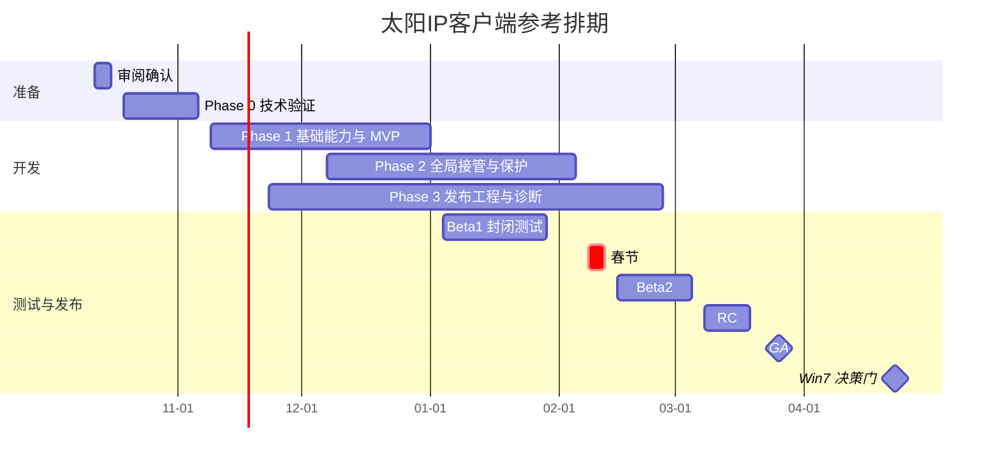
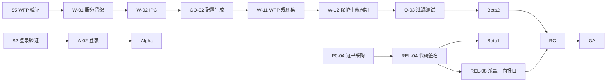

# 太阳IP客户端：实施计划

- 整理日期：2026-10-10，Asia/Hong_Kong。
- 依据：[主设计](../specs/2026-10-10-sunipip-client-design.md)、[设计审阅报告](../reviews/2026-10-10-sunipip-client-design-review.md)、[补充设计](../specs/2026-10-10-sunipip-client-design-addendum.md)。
- 前提：按审阅报告第 7 节“建议”列的默认决策排期。决策不同时，按该表“影响”列调整。
- 排期起点：假设本周完成审阅确认，W1 从 2026-10-19（周一）开始。2027 年春节（2 月 6 日）前后约一周不安排工作，具体以官方放假安排为准。
- 本文是项目级计划，覆盖阶段、里程碑、任务、估算、依赖、测试和风险。**每个阶段开始前，再为该阶段编写工程级任务计划**（精确到文件、测试和提交），存放在本目录。
- 估算单位为人日，是 Phase 0 之前的参考值。M1 时根据 Spike 结果复核一次。
- 编号约定：本文的任务编号前缀为 `P0-`、`S`、`DM-`（领域层）、`A-`（数据层）、`U-`（界面）、`GO-`（Go 共享层）、`W-`（Windows）、`N-`（Android）、`REL-`（发布工程）、`Q-`（测试）、`K-`（风险）、`M`（里程碑）。以 `R-`、`G-`、`C-`、`B-`、`D-` 开头的编号均指审阅报告中的条目。

## 1. 里程碑

| 里程碑 | 周次 | 日期 | 退出条件 |
| --- | --- | --- | --- |
| M0 审阅确认 | W0 | 2026-10-16 | 待决策事项 D-01 至 D-18 定稿；后端依赖清单已发出 |
| M1 技术验证完成 | W3 | 2026-11-06 | Spike S1–S11 结论成文；关键 ADR 定稿；主设计按审阅报告 §8 修订；P0 级后端依赖有书面答复 |
| M2 内部 Alpha | W9 | 2026-12-18 | Windows 系统代理模式和安卓 VPN 都能连接真实线路，检测并显示出口 |
| M3 封闭 Beta1 | W12 | 2027-01-08 | 签名安装包、应用内更新、远程配置、诊断导出就绪；对外发放给第一批 Beta 用户 |
| M4 Beta2 | W17 | 2027-02-19 | Windows 全局接管与断线保护、安卓网络切换和系统保护引导就绪 |
| M5 RC | W20 | 2027-03-12 | 量化门禁全部通过（§13）；杀毒软件报白完成；B-01 已落实 |
| M6 GA | W22 | 2027-03-26 | 正式发布，开始灰度 |
| M7 Win7 决策门 | GA + 4 周 | 2027-04-23 | 根据数据决定是否启动 Win7 兼容版及其路线（D-01） |



## 2. 团队与角色（参考配置）

| 角色 | 人数 | 主要职责 | 投入期 |
| --- | --- | --- | --- |
| 产品 / 项目经理 | 0.5 | 决策、后端对接、法务协调、Beta 运营、客服培训 | 全程 |
| Flutter 工程师 A（领域与数据） | 1 | `packages/domain`、`packages/data_web`、契约测试、远程配置 | W1 起 |
| Flutter 工程师 B（界面，兼 DevOps） | 1 | 界面、托盘、通知、Windows 界面侧原生插件、CI、安装包 | W4 起 |
| Go / Windows 原生工程师 | 1 | `native/core`、Windows 服务、WFP、TUN、网络修复工具 | W1 起 |
| Android 原生工程师 | 1 | VpnService、libbox 封装、系统集成；Phase 1 有余量时支援界面开发 | W1 起 |
| 测试工程师 | 1 | 测试计划、模拟服务、故障注入、泄漏测试、设备矩阵 | W4 起 |
| UI 设计 | 0.3 | 线框、视觉、图标 | W1–W8 |
| 太阳IP后端对接人 | 0.2 | 后端依赖 B-01 至 B-12 | W1 起 |
| 法务顾问（外部） | 按需 | GPL 合规、隐私政策、用户协议、分发合规 | W2–W18 |

**容量核算**：总工作量约 354 人日，约合 71 人周（§9）。参考配置下 W1–W22 的可用产能大致相当（按 70% 有效工时计算）。

**瓶颈**：Go / Windows 工程师处在关键路径上，Phase 2 和 Phase 3 有重叠负载。如果条件允许，建议在 W8–W18 增加一名 Windows 方向的外包或兼职工程师，承担安装包和网络修复工具。

**人手较少时**：如果只有 2–3 名工程师，阶段顺序不变；Beta1 只发 Windows，安卓顺延一个阶段。GA 预计推迟到 W32–W36。

## 3. Phase 0：准备与技术验证（W1–W3）

**目标**：在写产品代码之前，消除会导致返工的不确定性，并把关键技术选择写成 ADR。

### 3.1 管理与准备任务

| 编号 | 任务 | 负责 | 估算 | 依赖 |
| --- | --- | --- | --- | --- |
| P0-01 | 召开决策会，确定 D-01 至 D-18 | 产品经理 | 1 | — |
| P0-02 | 把后端依赖 B-01 至 B-12 发给后端，跟进书面答复 | 产品经理 | 3 | — |
| P0-03 | 准备测试账号和各状态的资源样本（B-09） | 产品经理 + 后端 | 2 | P0-02 |
| P0-04 | 启动代码签名证书采购（含硬件令牌或云签名服务）；制定 Ed25519 密钥方案 | 产品经理 | 1 + 等待 | — |
| P0-05 | 确定正式名称、包名和图标方向（D-18） | 产品经理 | 1 | — |
| P0-06 | 按补充设计 §18 的页面清单绘制线框 | 设计 + 产品经理 | 5 | P0-01 |
| P0-07 | 初始化仓库：目录结构（§11）、CI 骨架、代码规范、ADR 模板 | Flutter A | 2 | — |
| P0-08 | 汇总 Spike 报告和 ADR；按审阅报告 §8 修订主设计 | 全员 | 3 | 全部 Spike |
| P0-09 | 启动法务咨询（GPL、隐私政策、分发合规） | 产品经理 | 1 | — |

### 3.2 技术验证（Spike）

| 编号 | 要回答的问题 | 方法 | 退出标准 | 负责 | 估算 |
| --- | --- | --- | --- | --- | --- |
| S1 | 网页接口的真实响应长什么样？状态枚举有哪些取值？ | 用测试账号调用主设计 §4.1 的全部接口，保存完整响应，覆盖 B-09 的各种状态；脱敏后存入 `contracts/fixtures/raw/` | 每种状态至少一份样本；写出 `contracts/enums.yaml` 初稿 | Flutter A | 3 |
| S2 | 登录需要哪些验证？原生 App 能否完成？ | 走通密码登录、短信发送和登录、人机验证组件、`VERIFICATION_REQUIRED`；测令牌有效期、多端互踢、验证票据是否与 IP 绑定 | 登录流程图；是否需要内嵌网页的结论 | Flutter A | 2 |
| S3 | 中转具备哪些能力？到期后会怎样？ | 测试 SOCKS5 域名地址类型、UDP 转发、IPv6、并发上限；与后端配合测试到期后的认证结果 | 中转能力表；B-01 的结论 | Go | 2 |
| S4 | Go 服务内嵌 sing-box 能否支撑两种模式？ | 锁定 sing-box 版本；mixed 入口 + SOCKS5 出站 + 系统代理；TUN + `auto_detect_interface` + 进程直连；确定 Windows 最低版本；测量包体积 | 两种模式都能经真实中转访问并检测出口 | Go | 4 |
| S5 | WFP 断线保护是否可靠？ | 实现规则集原型；杀服务、杀内核、拔网线、切换 Wi-Fi、重启，各 10 次，全程抓包；做出网络修复工具原型 | 不允许的数据包为 0；重启后网络可以恢复；修复工具有效 | Go | 5 |
| S6 | 界面与服务如何通信？ | 对比 Flutter 平台通道（C++）和 FFI 两种方式访问命名管道；实现调用方签名校验 | 选型 ADR；一次往返 < 50 ms | Flutter A + Go | 3 |
| S7 | 安卓数据面能否稳定运行？ | libbox + VpnService（`:vpn` 进程）+ `protect`；比较 App 自身排除在 VPN 外和 `protect` 两种方案；Wi-Fi 与蜂窝切换；IPv6 阻断；前台服务类型；始终开启 VPN 的拉起路径；在 3 台国产 ROM 设备上测试；建立内存和耗电基线 | 连接、切换、系统拉起全部可用；前台服务类型 ADR | Android | 6 |
| S8 | 入口解析由谁执行？ | 对比内核自带能力与原生实现：多上游、超时、物理网络绑定、错误分类 | ADR（D-04） | Go + Android | 2 |
| S9 | 业务 DNS 方案是否可行？ | FakeIP + 域名透传；抓包确认没有 DNS 泄漏；在不支持 UDP 的条件下验证 QUIC 能回退到 TCP | 配置方案 + 抓包证据 | Go | 2 |
| S10 | 会不会被杀毒软件误报？ | 用测试签名的构建上传多引擎扫描；用 360、火绒、腾讯电脑管家、Microsoft Defender 在本地扫描 | 误报清单与处理计划 | Go | 1 |
| S11 | 出口检测用哪个端点？ | 与后端商定自建端点 | 端点地址与返回格式 | 产品经理 | 1 |

### 3.3 Phase 0 退出条件（M1）

1. S1–S11 都有书面结论，存放在 `docs/superpowers/spikes/`。
2. B-01、B-02、B-03、B-05、B-06、B-07、B-09 有书面答复。B-01 如果在 W3 前无法确认，标记为 GA 阻断项，其余工作继续推进。
3. 以下 ADR 定稿：IPC 方案、入口解析的执行位置、业务 DNS 方案、安卓 App 自身的排除方案、sing-box 锁定版本、安卓前台服务类型。
4. 主设计已按审阅报告 §8 修订，补充设计已合并或标注为已采纳。
5. 根据 Spike 结果复核本计划的估算；偏差超过 20% 时，重新排期并通知相关人员。

## 4. Phase 1：基础能力与 MVP（W4–W11）

**目标**：两个平台都完成“登录 → 我的 IP → 资格判断 → 连接 → 出口检测 → 断开”的端到端流程。W9 达到内部 Alpha，W11 结束时达到 Beta1 的功能要求。

### 4.1 领域层 `packages/domain`

| 编号 | 任务 | 负责 | 估算 | 依赖 |
| --- | --- | --- | --- | --- |
| DM-01 | 统一模型与网页字段映射（驼峰兼容、ID 规范化、枚举映射） | Flutter A | 4 | S1 |
| DM-02 | 资格判定（补充设计 §5）+ 共享测试向量执行器 | Flutter A | 4 | DM-01 |
| DM-03 | 会话、连接、保护三个状态机，以及超时与重试参数 | Flutter A | 5 | DM-02 |
| DM-04 | 错误码清单 `contracts/error-codes.yaml` 及文案 | Flutter A + 产品经理 | 2 | — |
| DM-05 | 服务器时间偏移与到期调度 | Flutter A | 2 | DM-01 |

### 4.2 数据层 `packages/data_web`

| 编号 | 任务 | 负责 | 估算 | 依赖 |
| --- | --- | --- | --- | --- |
| A-01 | HTTP 客户端：显式直连、超时、退避、429 处理、客户端标识 | Flutter A | 3 | P0-07 |
| A-02 | 登录（密码、短信、人机验证）与令牌安全存储 | Flutter A | 5 | S2、A-01 |
| A-03 | 资源分页筛选、分组、单条刷新 | Flutter A | 4 | A-01、B-05 |
| A-04 | 刷新调度（补充设计 §12.3）与到期提醒 | Flutter A | 3 | A-03、DM-05 |
| A-05 | 模拟 API 服务 `tools/mock-api` 与契约测试 | 测试 + Flutter A | 4 | S1 |

### 4.3 界面 `app/`

| 编号 | 任务 | 负责 | 估算 | 依赖 |
| --- | --- | --- | --- | --- |
| U-01 | 应用骨架、路由、主题、字符串外置 | Flutter B | 3 | P0-06 |
| U-02 | 登录页 | Flutter B | 3 | U-01、A-02 |
| U-03 | 首页与连接卡片 | Flutter B | 4 | U-01、DM-03 |
| U-04 | 我的 IP、筛选、资源详情、不可连接原因 | Flutter B | 5 | A-03、DM-02 |
| U-05 | 设置页 | Flutter B | 2 | U-01 |
| U-06 | Windows 托盘、单实例、关闭到托盘 | Flutter B | 3 | U-01 |
| U-07 | 到期提醒与通知 | Android（支援） | 2 | A-04 |

### 4.4 Go 共享层 `native/core`

| 编号 | 任务 | 负责 | 估算 | 依赖 |
| --- | --- | --- | --- | --- |
| GO-01 | ConnectRequest 结构与校验（`contracts/ipc`） | Go | 2 | P0-08 |
| GO-02 | sing-box 配置生成（mixed 入口、SOCKS5 出站、基础 DNS、局域网例外）+ golden 测试 | Go | 5 | S4、S9 |
| GO-03 | 内核生命周期、状态与流量事件 | Go | 4 | GO-02 |
| GO-04 | 出口检测 | Go | 2 | S11 |
| GO-05 | 入口解析（按 S8 结论） | Go | 3 | S8 |

### 4.5 Windows

| 编号 | 任务 | 负责 | 估算 | 依赖 |
| --- | --- | --- | --- | --- |
| W-01 | 服务骨架：注册到服务控制管理器、自动启动、失败恢复、日志 | Go | 3 | S4 |
| W-02 | IPC 服务端：DACL、调用方校验、方法实现、输入校验 | Go | 5 | S6、GO-01 |
| W-03 | 界面侧 IPC 客户端（平台通道或 FFI） | Flutter B | 3 | W-02 |
| W-04 | 系统代理的设置、快照、归属判断和残留恢复 | Flutter B（Go 支援） | 4 | W-03 |
| W-05 | 确保控制面请求显式直连 | Flutter A | 1 | A-01 |

### 4.6 Android

| 编号 | 任务 | 负责 | 估算 | 依赖 |
| --- | --- | --- | --- | --- |
| N-01 | VpnService（`:vpn` 进程）+ libbox 集成 + 配置下发 | Android | 6 | S7、GO-02 |
| N-02 | 界面与 VPN 进程的通信（绑定服务、事件流） | Android | 3 | N-01 |
| N-03 | 前台通知、通知权限、前台服务类型 | Android | 2 | N-01 |
| N-04 | VPN 授权、冲突与撤销处理 | Android | 2 | N-01 |
| N-05 | 基于 Keystore 的加密存储（令牌、会话记录、缓存配置） | Android | 2 | — |

### 4.7 Phase 1 检查点

- **M2 内部 Alpha（W9）**：两个平台都能完成“密码登录 → 列表 → 连接真实线路 → 显示出口 IP → 断开并恢复设置”；共享测试向量全部通过；没有 P0 缺陷。
- **Phase 1 结束（W11）**：短信登录、筛选、到期提醒、托盘、通知完成；Phase 3 中 Beta1 需要的部分（签名、更新、远程配置、诊断）就绪。

## 5. Phase 2：全局接管与断线保护（W8–W16）

**目标**：Windows 全局接管和断线保护达到“故障时不泄漏、正常时不锁网”；安卓网络切换和系统级保护达到设计要求。

| 编号 | 任务 | 负责 | 估算 | 依赖 |
| --- | --- | --- | --- | --- |
| W-10 | TUN 模式：wintun、自动路由、严格路由、局域网排除、界面进程直连规则 | Go | 5 | GO-02 |
| W-11 | WFP 规则集，以及入口放行规则的动态更新 | Go | 8 | S5、W-01 |
| W-12 | 保护生命周期：意图记录、服务重启后恢复、残留检测 | Go | 4 | W-11 |
| W-13 | 网络修复工具 | Go | 3 | W-11 |
| W-14 | 网络变化处理，重连同一资源 | Go | 4 | W-10 |
| W-15 | 模式切换与失败回滚 | Go | 3 | W-10、W-12 |
| N-10 | 网络切换：更新底层网络、重新解析、重连 | Android | 4 | N-01 |
| N-11 | IPv6 阻断与 UDP 能力处理 | Android | 2 | N-01、S3 |
| N-12 | 系统级保护状态的核实与引导 | Android | 3 | N-01 |
| N-13 | 系统拉起路径与首次解锁前的处理 | Android | 3 | N-05 |
| N-14 | 国产 ROM 后台保活引导 | Android | 2 | N-01 |
| GO-10 | 业务 DNS：FakeIP、域名透传、非 A/AAAA 查询的处理 | Go | 4 | S9、GO-02 |
| GO-11 | 重连退避与 `validUntil` 检查 | Go | 2 | GO-03 |
| DM-10 | 到期或撤销后自动停止、“已暂停”状态的业务流程（D-08） | Flutter A | 3 | DM-03 |
| U-10 | 全局接管开关、保护状态界面、解除保护和续费流程 | Flutter B | 5 | W-12 |
| U-11 | 异常退出后的恢复入口 | Flutter B | 2 | W-12 |

**Phase 2 结束（W16）**：补充设计 §19 中断线保护的泄漏指标在内部测试中达标；网络修复工具能在所有故障场景下恢复网络；然后进入 Beta2。

## 6. Phase 3：发布工程、诊断与合规（W6–W18）

| 编号 | 任务 | 负责 | 估算 | 依赖 |
| --- | --- | --- | --- | --- |
| REL-01 | CI：Dart 和 Go 测试、Android 和 Windows 构建、许可证扫描 | Flutter B | 4 | P0-07 |
| REL-02 | 锁定 sing-box 版本，从源码构建（构建标签），生成 SBOM | Go | 3 | S4 |
| REL-03 | Windows 安装包（服务注册、wintun、升级、卸载清理）；安装器选型 ADR | Flutter B（Go 支援） | 6 | W-01、W-13 |
| REL-04 | 接入代码签名（硬件令牌或云签名） | Flutter B | 3 | P0-04 |
| REL-05 | Android 签名与按 ABI 拆分构建 | Android | 2 | N-01 |
| REL-06 | 远程配置：签名 JSON、多镜像、内置默认值、白名单 | Flutter A + Go | 4 | B-11 |
| REL-07 | 应用内更新：清单签名、灰度、强制更新、下载校验与安装；发布脚本 | Flutter A + Flutter B | 8 | REL-04、REL-06 |
| REL-08 | 向杀毒厂商报白（360、火绒、腾讯电脑管家、Microsoft Defender） | 产品经理 | 3 + 等待 | REL-04 |
| REL-09 | 开源发布流程：源码对应、第三方声明、sing-box 名称条款检查 | 产品经理 + Go | 4 | REL-02 |
| REL-10 | 诊断：一键检测、诊断包、导出前预览、脱敏扫描测试 | Flutter B + Go | 6 | GO-04、W-02、N-02 |
| REL-11 | 日志系统：结构化、轮转、脱敏过滤 | Flutter A + Go | 2 | — |
| REL-12 | 隐私政策、用户协议、关于页 | 产品经理 + 法务 | 3 | P0-09 |
| REL-13 | 崩溃上报（仅在 D-09 决定启用时） | Flutter A | 3 | D-09 |

时间要求：

- **证书采购**在 W1 启动。证书私钥必须存放在硬件中，CI 签名方案受此约束，必须在 Beta1 前就绪。
- **杀毒厂商报白**在拿到签名构建后立即开始（约 W10），各厂商的处理周期不同，不能拖到 RC 再做。
- **SmartScreen 信誉**需要随下载量逐步积累，不应假设某种证书类型能立即消除警告。Beta 期间就使用正式签名，提前积累信誉。

## 7. Phase 4：测试、Beta 与 GA（W4–W22）

### 7.1 测试任务

| 编号 | 任务 | 负责 | 估算 | 时间 |
| --- | --- | --- | --- | --- |
| Q-01 | 编写测试计划与用例（对应主设计 §12 和本文 §13） | 测试 | 5 | W4–W5 |
| Q-02 | 可控的 SOCKS5 测试中转 `tools/test-relay` | 测试 | 3 | W5–W6 |
| Q-03 | 故障注入与泄漏测试脚本（Windows 本机抓包；安卓在路由器侧抓包） | 测试 + Go | 6 | W8–W12 |
| Q-04 | 设备矩阵测试与回归（持续进行） | 测试 | 15 | W9–W21 |
| Q-05 | Beta 用户招募、反馈渠道、问题分级 | 产品经理 | 3 | W10–W12 |
| Q-06 | 客服培训、FAQ、v2rayN 迁移指南、Win7 用户过渡指南 | 产品经理 | 4 | W16–W21 |
| Q-07 | RC 回归与验收签字 | 测试 + 全员 | 10 | W20–W21 |
| — | 缺陷修复缓冲（开发工作量的 20%） | 开发 | 45 | Beta1–RC |

### 7.2 发布节奏

| 阶段 | 时间 | 范围 | 用户 |
| --- | --- | --- | --- |
| Beta1（封闭） | W12–W15 | Windows 系统代理模式 + 安卓 VPN | 20–50 名现有客户，以 v2rayN 和 v2rayNG 用户为主 |
| Beta2 | W17–W19 | 增加 Windows 全局接管与断线保护、安卓系统保护引导 | 扩大到 100–200 名 |
| RC | W20–W21 | 冻结功能，只修缺陷，完整回归 | 同 Beta2 |
| GA | W22 | 按 10% → 50% → 100% 灰度放量，每档 2–3 天 | 全部客户 |
| 观察期 | GA 后 2 周 | 值班，热修复通道保持开启 | — |

Beta 期间每周发布一个构建。反馈按以下标准分级处理：

- P0：断网、泄漏、资格判断错误。24 小时内响应。
- P1：主要功能不可用。3 天内处理。
- P2：体验问题。排入后续版本。

## 8. Phase 5：GA 之后

### 8.1 Win7 决策门（M7，GA + 4 周）

- **输入**：Win7 用户占比（来自客服统计和用户调研）、go-win7 工具链编译原生服务的验证结果、维护成本评估。
- **选项与估算**：

| 选项 | 内容 | 估算 |
| --- | --- | --- |
| A | 不做，长期提供 v2rayN 配置指南 | 0 |
| B | WPF 界面 + 共用 Go 原生服务（go-win7 可行时）；首版只做系统代理 | 约 10–14 人周 |
| C | WPF + .NET Framework 4.8 + Xray，完全独立实现（主设计原路线） | 约 25–35 人周 |

- 选择 B 或 C 时，需要另行确定 Win7 版的许可证（审阅报告 C-08），并且 C# 实现必须通过共享测试向量。

### 8.2 待办池（按优先级排序，由数据驱动）

1. 多 IP 同时使用 / 本地多端口（D-12，视 Beta 调研结果而定）。
2. 加密协议（随服务端路线图，D-14）。
3. 迁移到正式 App API（补充设计 §20）。
4. 分流规则与按应用分流。
5. Windows ARM64 原生构建。
6. macOS 和 iOS。
7. DoH。

## 9. 工作量汇总

| 阶段 | 工作量（人日） | 说明 |
| --- | --- | --- |
| Phase 0 | 50 | Spike 31 人日 + 管理与准备 19 人日 |
| Phase 1 | 105 | 领域 17、数据 19、界面 22、Go 共享层 16、Windows 16、Android 15 |
| Phase 2 | 57 | Windows 27、Android 14、共享层与界面 16 |
| Phase 3 | 51 | 发布工程、诊断与合规 |
| Phase 4 | 46 | 测试与 Beta 运营 |
| 缺陷缓冲 | 45 | 开发工作量的 20% |
| **合计** | **约 354（约 71 人周）** | 不含 Win7 版 |

## 10. 关键路径与并行安排



- **主关键路径**：Windows 断线保护（S5 → W-11 → W-12 → Q-03）。任何延误都会直接推迟 Beta2 和 GA。
- **次关键路径**：登录验证（S2）。如果必须内嵌网页，A-02 和 U-02 的工作量会增加。
- **外部等待**：证书采购、杀毒厂商报白、后端答复。这三项在 W1 就要启动。
- **可并行**：安卓与 Windows 的数据面互不依赖；领域层和数据层可以基于模拟服务先行开发，不必等真实接口。

## 11. 仓库结构与工程规范

### 11.1 目录结构（单仓库）

```
BlueGrass/
├── app/                      # Flutter 应用（Windows、Android 界面）
│   ├── lib/
│   ├── windows/              # Windows 宿主与 C++ 平台通道插件
│   └── android/              # Android 宿主、Kotlin 插件、VpnService（:vpn 进程）
├── packages/
│   ├── domain/               # 纯 Dart：统一模型、资格判定、状态机、错误码
│   └── data_web/             # 纯 Dart：网页数据源适配器
├── native/
│   ├── core/                 # Go：请求校验、sing-box 配置生成、内核生命周期、入口解析、出口检测
│   ├── windows-service/      # Go：Windows 服务、IPC、WFP、TUN 管理
│   ├── netrepair/            # Go：网络修复工具
│   └── android-lib/          # Go：基于 libbox 的 gomobile 封装
├── contracts/
│   ├── fixtures/             # 共享测试向量（资格、映射、错误）
│   ├── enums.yaml            # 原始枚举值到规范值的映射
│   ├── error-codes.yaml      # 错误码清单
│   └── ipc/                  # ConnectRequest 与 IPC 消息结构
├── tools/
│   ├── mock-api/             # 模拟客户中心 API
│   └── test-relay/           # 可控的 SOCKS5 测试中转
├── installer/windows/
├── docs/
│   ├── adr/                  # 架构决策记录
│   └── superpowers/          # specs、reviews、plans、spikes
└── win7/                     # 决策门通过后再创建
```

### 11.2 工程规范

- **分支**：主干开发，`main` 受保护；功能分支通过 PR 合并，至少一人审查，CI 全绿才能合并。发版时从 `main` 切出 `release/x.y`，热修复从发布分支合回主干。
- **提交**：采用约定式提交前缀（`feat:`、`fix:`、`docs:` 等），说明使用简体中文。
- **代码注释**使用英文；文档与提交说明使用简体中文。
- **版本号**：采用语义化版本 + 构建号；安卓 `versionCode` 由版本号和构建号推导，只增不减，以支持“重新发布作为回退”（审阅报告 R-08）。
- **ADR**：放在 `docs/adr/NNNN-标题.md`，内容包括背景、选项、决定、后果。审阅报告第 7 节的待决策事项关闭时，链接到对应的 ADR。
- **完成标准**：代码已审查；有单元测试；共享测试向量通过；错误码和文案已登记；仓库、测试数据、日志中都没有真实凭据；文档已同步。
- **秘密**：仓库中只放占位值。CI 启用秘密扫描，签名材料不进入 CI 日志。

## 12. 测试策略

| 层级 | 内容 | 工具与方法 |
| --- | --- | --- |
| 单元测试 | 领域模型、资格判定（共享测试向量）、状态机、时钟；Go 配置生成（golden 文件） | Dart test、Go test |
| 契约测试 | 数据层对照 `tools/mock-api`；每日用真实测试账号对只读接口跑一次金丝雀测试（限频） | CI 定时任务 |
| 集成测试 | 内核 + 测试中转：UDP 开关、IPv6 开关、认证失败、主动断开 | `tools/test-relay` |
| 故障注入 | 见下方场景清单 | 脚本 + 人工 |
| 泄漏测试 | 在物理网口抓包，按白名单（入口 IP 和端口、候选 DNS、控制面、局域网、DHCP、邻居发现）比对，白名单外的数据包即为泄漏 | Windows 用 pktmon 或 Wireshark；安卓在路由器侧抓包 |
| 兼容性 | 设备矩阵 | 见下表 |
| 性能 | 补充设计 §19 的指标 | 自动计时、采样 |
| 安全 | IPC 模糊测试、提权审查、诊断包脱敏扫描、依赖许可证扫描、秘密扫描 | CI + 人工审查 |

**故障注入场景**：杀内核、杀服务、杀界面进程；删除 TUN 适配器；禁用网卡；Wi-Fi 与有线互切、Wi-Fi 与蜂窝互切；睡眠与唤醒；带保护意图重启；中转宕机；中转拒绝认证；全部 DNS 失效；系统时钟偏差 ±1 天；API 返回 401、403、422、500、超时、格式错误；连接中到期；连接中被撤销；其他软件修改系统代理；其他 VPN 抢占（安卓）；连接中升级。

**设备矩阵**：

| 平台 | 覆盖范围 |
| --- | --- |
| Windows | Windows 10 22H2 x64、Windows 11 23H2 和 24H2 及更新版本 x64、Windows 11 ARM64（只测系统代理模式）；分别在安装和不安装 v2rayN、Clash Verge 的环境中测试；分别在 360、火绒、Defender 环境中测试 |
| Android | Android 8.1、9、10、12、13、14、15、16；品牌包括小米 HyperOS、华为（可运行 APK 的 HarmonyOS 4.x 或 EMUI）、荣耀 MagicOS、OPPO ColorOS、vivo OriginOS、三星 One UI、Pixel |

## 13. 质量门禁与量化验收

### 13.1 主设计 §12 各类别的量化标准（C-07）

| 类别 | 量化标准 |
| --- | --- |
| 登录与会话 | 规定场景全部通过；401、403、422 都映射到正确的错误码；令牌不出现在任何日志和诊断包中 |
| 资源同步 | 共享测试向量 100% 通过；分页浏览 1000 条资源无重复、无遗漏 |
| 中转权限 | 判定表的每一行都有自动化用例；任何路径都不使用 `assetAddress`（代码检查 + 测试） |
| 网站异常 | API 不可用 24 小时内，已有连接保持；到达 `validUntil` 后 60 s 内停止 |
| 实际连接 | 真实线路连接 100 次，成功率 ≥ 99% |
| Windows 系统代理 | 20 种启停和冲突场景下，100% 按归属正确恢复 |
| Windows TUN | 每个故障场景注入 50 次，泄漏数据包为 0；网络修复工具 100% 恢复成功 |
| 安卓 VPN | 网络切换 50 次，重连 P95 ≤ 10 s；进程终止后的行为符合补充设计 §9.4 |
| DNS | 物理网口上没有业务 DNS；单个解析器失效时，连接成功率不下降 |
| 流量范围 | 中转不支持 IPv6 或 UDP 时，直连数据包为 0 |
| 出口保持 | 重连 1000 次，出口始终属于同一资源 |
| 更新与恢复 | 篡改包、错误签名、错误平台的包 100% 被拒绝；下载中断后可以续传或重试 |
| 诊断与开源 | 脱敏扫描命中为 0；发布物与源码 tag 一一对应 |
| Win7 独立验收 | 不在本期范围（M7 Win7 决策门） |

### 13.2 里程碑门禁

| 门禁 | 条件 |
| --- | --- |
| Alpha | 两个平台都能连接真实线路；共享测试向量通过；P0 缺陷为 0 |
| Beta1 | 使用正式签名的安装包；更新和远程配置的签名校验通过；诊断脱敏扫描通过；P0 = 0，P1 ≤ 5 |
| Beta2 | 断线保护泄漏测试通过；网络修复工具通过；安卓网络切换测试通过；P0 = 0 |
| RC | §13.1 全部达标；4 家杀毒软件无误报；P0 = P1 = 0；开源发布物就绪；隐私政策和用户协议已上线；B-01 已落实 |
| GA | RC 版本在 Beta 用户中运行 1 周，没有 P0 问题；客服培训完成 |

## 14. 风险登记

| 编号 | 风险 | 可能性 | 影响 | 应对 | 负责 |
| --- | --- | --- | --- | --- | --- |
| K-01 | 网页接口变更或增加反爬措施 | 中 | 高 | 适配层隔离；每日金丝雀契约测试；与后端约定变更通知（B-08）；API 基址可通过远程配置切换 | Flutter A、产品经理 |
| K-02 | 中转服务端不强制校验到期 | 中 | 高 | B-01 列为 GA 阻断项 | 产品经理 |
| K-03 | 登录依赖人机验证，原生难以实现 | 中 | 中 | S2 尽早验证；准备内嵌网页方案 | Flutter A |
| K-04 | WFP 缺陷导致用户断网 | 中 | 高 | 非持久规则；网络修复工具；故障注入；灰度发布 | Go |
| K-05 | 杀毒软件误报、SmartScreen 警告 | 高 | 高 | W1 采购证书；S10 预检；拿到签名构建后立即报白；保持签名身份一致 | 产品经理、Go |
| K-06 | 国产 ROM 杀后台 | 高 | 中 | 独立进程 + 前台服务；保活引导；推荐开启系统级始终开启 VPN | Android |
| K-07 | 中转不支持 UDP 或 IPv6 | 中 | 中 | 阻断而不是直连；明确提示能力限制 | Go |
| K-08 | sing-box 配置格式随版本变化（1.12 已弃用部分字段，并计划在 1.14 移除） | 高 | 中 | 锁定版本；配置生成集中在 `native/core`；golden 测试；升级内核必须走 ADR | Go |
| K-09 | 人手不足 | 中 | 高 | Win7 决策门；Beta1 可以只发 Windows；W8–W18 补充 Windows 人手 | 产品经理 |
| K-10 | 分发与合规问题 | 中 | 高 | 法务评估；官网分发；文案审阅 | 产品经理 |
| K-11 | 测试样本不足 | 高 | 中 | B-09；共享测试向量；模拟服务 | 产品经理 |
| K-12 | 签名密钥丢失或泄露 | 低 | 高 | 硬件保存；离线备份；发布两人复核 | 产品经理 |
| K-13 | 春节假期打乱节奏 | 高 | 低 | 计划已跳过春节周；Beta2 安排在节后 | 产品经理 |
| K-14 | 开源后出现去掉限制的分支 | 高 | 低（取决于 B-01） | 依靠服务端强制校验 | 产品经理 |
| K-15 | SOCKS5 明文传输 | 中 | 中 | D-14；推动服务端加密协议路线图 | 产品经理 |

## 15. 沟通与决策机制

- **每周例会**：进度、风险、待决策事项；每周发布一个内部构建。
- **决策记录**：技术决策写成 ADR；产品决策在审阅报告第 7 节更新状态，并链接到对应 ADR。
- **后端依赖跟踪**：B-01 至 B-12 每周更新状态。逾期的依赖在例会上升级处理。
- **文档维护**：主设计是唯一事实来源；补充设计合并进主设计后标注为“已合并”；每个阶段的工程级计划放在本目录。

## 16. 下一步行动

1. 审阅本计划和审阅报告，召开 1 小时决策会，确定 D-01 至 D-18。
2. 把审阅报告第 6 节的后端依赖清单发给太阳IP后端负责人，约定在 W3 前给出书面答复。
3. 启动代码签名证书采购和法务咨询。
4. 准备测试账号和资源样本。
5. W1 启动 Phase 0；每个 Spike 完成当天提交结论。
