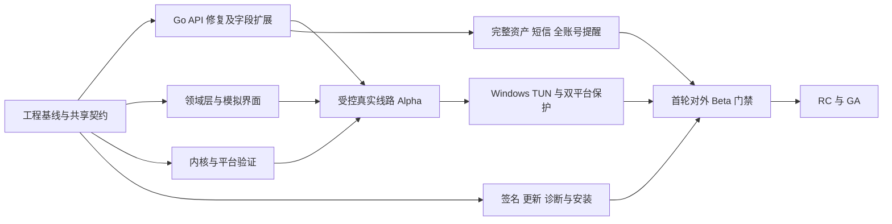

# BlueGrass：开发实施计划

> **For agentic workers:** REQUIRED SUB-SKILL: Use superpowers:subagent-driven-development or superpowers:executing-plans to implement this plan task-by-task. Track implementation steps with `- [ ]`; do not treat an accepted design as implemented code.

**Goal:** 按已确认的 D-01～D-19、D-23～D-48，交付 Windows 10/11 与 Android 客户端，完成真实资源连接、网络保护、资源管理、提醒及发布闭环。

**Architecture:** Flutter 界面与 Dart 业务层通过 `CustomerDataSource` 接入独立 Go API；Go 原生层内嵌唯一 Xray-core，由 Windows 服务、Android VpnService、iOS/macOS Packet Tunnel 分别承接系统网络。原生层独立执行资格快照、有效期、出口验证和业务放行，账号令牌留在业务层；更新、出口检测和可选崩溃接收服务独立维护。

**Tech Stack:** Flutter/Dart、Go、Kotlin、Windows/Apple 原生桥接、Xray-core、MySQL 8/InnoDB；服务端现有 `go.mod` 要求 Go 1.26.0，客户端 Xray 固定版本及 Go 1.27 要求见[共享手册](../../development/four-platform-development.md)，实际工具链和产物证据由 P0-07/S4 记录。

**Spec:** [主设计](../specs/2026-10-10-sunipip-client-design.md)、[补充设计](../specs/2026-10-10-sunipip-client-design-addendum.md)、[ADR 目录](../../adr)、[当前 API 契约](../../development/client-api-integration.md)、[项目复核](../reviews/2026-10-11-bluegrass-project-reaudit.md)。

- 修订：2026-10-11，Asia/Hong_Kong。用户结束本轮逐项讨论，要求整理实施文档以准备开发。
- 本文保留总工作包与任务编号。2026-10-19 起内核、协议和四端落地以 [ADR 0049](../../adr/0049-xray-only-four-platforms.md)及[四端开发手册](../../development/four-platform-development.md)为准。早期启动任务与状态是历史基线，不是当前完成证据；旧固定出口放行门槛撤销，短信可选。
- 旧版日期、W1～W22 排期及约 354 人日不再作为执行承诺。它们保留在 Git 历史中；当前以依赖、可验收成果和实际投入重新排期，不虚设人员数量。
- 旧任务编号保留，便于主设计中的 S1～S12、GO/W/N/REL 等引用继续有效；新增 `BE-` 专门表示现有服务端的修复与扩展，不与 Dart 数据层 `A-` 混用。

## Global Constraints

- 品牌 `BlueGrass`；Android applicationId/namespace 均为 `com.bluegrass.client`；Windows 服务 `BlueGrassService`，管道 `\\.\pipe\BlueGrass.Control`。
- 首发 Windows 10/11 x64、Android 8.0/API 26 及以上；现有 Android 基线为 ARM64；ARM32/通用 APK 尚未验证，不作为已交付架构。Win7 SP1 x64 后续独立交付，保留系统代理/TUN/保护目标。
- 四端唯一代理核心为固定 Xray；SOCKS5、SS、VMess、VLESS、Trojan、HTTP/HTTPS、Hysteria2 进入适配，TUIC/AnyTLS 明确不支持，不打包第二核心。每个资源一种当前协议，同一时刻一个活动资源。
- 当前资源固定 IPv4 出口并声明支持 TCP/UDP；客户端逐协议实测能力。连接就绪后观测实际出口，不再要求权威预期出口匹配，探测失败不拆除连接；UDP 额外探测只在一键诊断执行。
- Windows 首次默认系统代理，之后保存模式选择；界面自启、启动后自动连接及崩溃上报默认关闭。Android 采用 VPN 模式。
- LAN 默认允许，遵循 D-31 地址/接口范围、D-32 内网 DNS 和 FakeIP 优先规则；公网 IPv6 在全局接管中阻断，不关闭整机 IPv6。
- 新会话必须刷新资格；已有会话缓存只受已知有效期约束，不新增 72 小时或其他客户端失联期限。资源不可用自动暂停保留保护，主动断开才按归属恢复。
- 官网负责注册/订阅/购买/续费等交易。客户端读取资源及有效期；余额后置，短信参数稍后确定，不引入人机验证或恢复已撤回的账号专项。
- 系统代理、TUN/VPN、本地例外分别验收；系统代理模式不承诺全机零直连。客户端限制不能替代中转服务端最终授权。
- 开发测试只用本地或明确的隔离测试环境；当前 MySQL 测试入口仍要求 loopback:3306、`suntest`、随机 `bg_it_*` 测试表，不改业务表。

## Review Focus

1. **旧会话结果污染新连接**：取消/切换账号后的旧 401、旧探测成功或旧统计不能改动当前状态；归 DM-03/A-02/GO-01，启动清单 K-05～K-07。
2. **局域网例外扩大为公网直连**：LAN DNS、ULA/FakeIP 重叠、显式 IPv6 目标必须按 D-31～D-34 分流；归 S7/S9、GO-10、W-10/N-11。
3. **界面顺序误当同步证据**：最近使用置顶不能改写游标；未加载页、摘要部分成功不能证明资源已回收或提醒已全量覆盖；归 A-03/A-04/U-04/U-07。
4. **时钟或计数重置制造错误授权/统计**：到期不能等待下一轮刷新，休眠恢复先核对，null 不伪造期限；统计跨进程丢失须标不完整；归 DM-05/GO-03/GO-11。
5. **清理/恢复破坏归属或长期会话**：其他软件修改代理、会话 schema 部分创建、长刷新链清理和数据库备份恢复须独立验证；归 BE-01/BE-04/BE-05/W-04/W-13/REL-03。

## 1. 开发基线与完成状态

| 对象 | 2026-10-11 本地证据 | 实施含义 |
| --- | --- | --- |
| 仓库基线 | HEAD `3a4a513`；已有 `client-api/` 和设计文档，本轮决策尚在工作区 | 不重新初始化 Git，不覆盖本轮 ADR；开发分支保留已确认文档 |
| Go API | 密码登录、滑动刷新、登出、`/me`、可连接节点游标列表和单条详情已有源码 | 复用现有工程，按 BE 系列修复/扩展，不再实施历史 PHP 或网页取数方案 |
| API 能力缺口 | 没有短信接口、完整资产/到期摘要、固定预期出口字段、多协议完整参数及配置版本 | 缺字段不能补默认值后放行真实连接；见 CP-01/04/05 |
| 客户端及交付工程 | `app/`、`packages/`、`native/`、`contracts/`、`.github/` 等尚未建立 | 下文这些路径都是计划创建的目标，不是已经可运行的项目 |
| 运行验证 | 仓库保存历史隔离 MySQL 测试和 Hytron 测试部署记录 | 本轮未复核远端在线状态，历史成功不算当前客户端联调通过 |
| 本机工具链 | 本轮 PATH 找到 Git/Python，未找到 Go、Flutter、Dart | K-01 先准备并验证工具链；本轮未运行 Go/Flutter 功能测试 |

历史 API 证据见 [verification.md](../../../client-api/docs/verification.md) 和 [OPERATIONS.md](../../../client-api/docs/OPERATIONS.md)。正式客户端不得以当前 API 缺少 `expected_exit_ip` 为由跳过 D-29。

## 2. 已确认范围与实现落点

| 决策 | 开发要求 | 主任务 |
| --- | --- | --- |
| D-01、D-02、D-03、D-11 | 主力 Windows/Android、单内核多协议、Go 服务；Win7 独立后续 | S4/S7/S12、GO、W、N；M7 |
| D-04 | 入口 DNS 自动/自定义、有序候选、持久化、不隐式回退 | S8、GO-05、U-05 |
| D-05、D-19 | 独立 API，按需分页、连接前详情、无网页回退、唯一会话管理 | CP-01、A-00～A-05 |
| D-06、D-07、D-08、D-15 | 首轮 Beta 有保护；出口通过才放行；到期暂停与主动断开分离；缓存无额外失联截止 | GO-04/11、DM-10、W/N、Q-03 |
| D-09、D-13、D-18 | 官网签名发行、BlueGrass 身份、默认关闭的自建崩溃摘要 | REL-01～REL-14 |
| D-10、D-17 | 自启/自动连接独立默认关闭；关闭窗口到托盘，退出完整恢复 | U-06/U-08、W-04 |
| D-12、D-14、D-24 | 单活动资源、每资源单协议，保留 SOCKS5 兼容；同资源配置迁移再验证，无隐式降级 | DM-03、GO-02/04、S12 |
| D-16、D-26、D-27 | 密码和短信；复用官网供应商/模板，由独立 API 发码校验，不用人机验证 | CP-05、BE-07、A-02、U-02 |
| D-23、D-25 | 默认可连接视图，全部资源仅当前归属，含到期未回收 | BE-06、A-03、U-04 |
| D-28、D-29、D-33 | 独立 HTTPS 探测、必需预期 IPv4、实际出口严格匹配 | BE-03、S11、GO-04 |
| D-30 | 客户端只读资源信息，官网交易；API 令牌刷新与续费交易分离 | A-02/A-04、U-10 |
| D-31、D-32 | LAN 默认本地路由，明确内网名称本地解析，DNS/FakeIP 优先，失败不交叉回退 | CP-06、GO-10、W-10/N-11 |
| D-34、D-35 | 所交付资源支持 TCP/UDP；UDP 真实转发验收，诊断不增加连接门槛 | S3/S12、GO-04、REL-10 |
| D-36、D-37、D-44 | 普通更新后台下载；计费网络本次同意；就绪横幅/角标；明确确认才安装 | REL-07 |
| D-38 | 到期时刻统一北京时间 UTC+8，内部 UTC/null，不能由显示值反推授权 | DM-05、U-03/U-07 |
| D-39、D-40 | 首次预选不连接；最近成功连接优先，余下保留接口顺序，分页去重和历史隔离 | A-03、U-04 |
| D-41、D-43 | 首页业务流量/速度；完整出口 IP，预期/实际/历史验证状态区分 | GO-03、U-03 |
| D-42、D-45 | 主题跟随系统可手选；Windows 默认系统代理并记住模式，运行状态以原生为准 | U-01/U-05/U-10、W-15 |
| D-46、D-47、D-48 | 全账号归属资源四档提醒、无凭据摘要后台同步、同轮合并、逐资源去重 | BE-06、A-04、U-07 |

后期范围：余额、Win7 独立交付、多活动资源/逐资源端口、规则与按应用分流、Windows ARM64 原生构建、macOS/iOS、DoH、独立 API 增量/短凭据等扩展。首版全量到期摘要属于 D-47 必需能力，不能混入“增量同步后期再做”而一并延期。

## 3. 契约前置工作与阻塞边界

下面是工程交付项，不继续向用户逐项询问实现细节。产品明确延后的短信数值单独保留；其他选型由证据和共享测试锁定。

| 编号 | 必须产出的契约/证据 | 当前缺口、负责人角色 | 阻塞什么；什么可先做 |
| --- | --- | --- | --- |
| CP-01 | `contracts/http/client-api-v1.openapi.yaml`、资源身份/配置模型、枚举及正反例 | 业务 API 现有契约可摘录；预期出口来源、其他协议与资产映射需后端/数据层在隔离环境核对 | 缺出口映射阻塞 BE-03 的真实字段实现和真实连接；DTO、模型、模拟界面可先做 |
| CP-02 | `contracts/ipc/messages.schema.json`、状态图、请求/确认/事件及恢复快照向量 | C03/F03/F04；领域层与 Go 层共同负责 | 身份/代次/排序不确定前不并行各写一套 IPC；可先完成 K-02/K-05/K-07 的无网络参考模型 |
| CP-03 | `contracts/fixtures/time/` 与 `docs/development/time-and-recovery.md` | UTC/null、单调时间、休眠、墙钟跳变、跨进程/系统重启；Go/Android/领域层 | 到期执行与恢复门禁；不引入额外离线寿命，不能把最后一次校时伪装成新校时 |
| CP-04 | 规划的完整资产及无凭据到期摘要契约，分页/删除证据/完整性定义 | C01；后端与数据层核实当前归属、订阅关系及客户到期来源 | “全部资源”、筛选及全账号提醒依赖此项；可连接列表/测试夹具可先开发 |
| CP-05 | 短信请求响应、purpose 隔离、供应商适配、参数配置表及发送/校验测试 | D-26/27；供应商配置待核实，用户已推迟验证码有效期/重发间隔/次数数值 | 可做适配边界和 UI 状态；参数未确认不填生产默认数值，不启用真实发码或宣称短信验收完成 |
| CP-06 | 模式/平台流量矩阵、控制面冷 DNS 自举、WFP 开机保护、完整代理快照归属规则 | C06/F05/F06/F07；Windows、Android 与 Go 层 | S5/S7/S9 先验证；首轮对外 Beta 必须有冷启动/故障/修复抓包证据 |
| CP-07 | 签名确切字节格式、key ID/轮换、防回退、安装维护事务及崩溃接收限值 | C07；发布工程与服务端 | 可做下载器状态/测试服务；受信格式与密钥流程定稿前不发布真实更新 |
| CP-08 | 会话 schema 校验、准入/清理/重放保留、数据库恢复和必跑集成入口 | 审计 A01～A06、A08；现有 Go API 负责人 | BE-01/02/04/05/08；不得把历史单次测试当作新修复已通过 |
| CP-09 | 诊断白名单、全凭据删除、短字符串/嵌套错误/链接测试向量 | C09；领域、Go、发布工程 | 日志框架建立时即实施；凭据用户名也不保留首尾片段 |

边界冻结方式：每项契约有版本、负责模块、输入输出、失败语义和 fixtures；下游引用同一文件。未确认源字段或平台行为，记录明确阻塞项和可独立执行任务，不能用假字段/虚假通过值完成打勾。

## 4. 开发顺序与里程碑

| 阶段 | 可交付成果 | 进入/退出条件 |
| --- | --- | --- |
| M0 文档准备 | 本总计划、首轮清单、45 项已接受 ADR 与缺口映射 | 本轮交付；不表示客户端或接口扩展完成 |
| M1 工程与契约基线 | 工具链锁、必跑测试、共享模型/IPC fixtures、模拟客户端、关键 Spike 结论 | K-01～K-09 的相应成果可复现；未解外部输入明确登记，不能伪装全通过 |
| M2 内部 Alpha | Windows 系统代理、Android VPN：密码登录→资源→真实出口验证→业务→主动恢复 | 权威预期 IPv4 字段及来源已交付，原生放行/暂停可用；只用受控测试线路，未交付的首版功能明确标记 |
| M3 首轮对外 Beta1 | 首版协议/登录/资源/提醒/UI；Windows TUN/保护/修复；Android 保护；签名、更新、诊断 | 本文 §9 的 Beta1 门禁全部通过；不能以默认系统代理为由推迟 TUN，也不能在缺短信/摘要等关键能力时标记首版完成 |
| M4 Beta2 | 扩大设备与真实使用场景，回归稳定性/性能/更新恢复 | 保护与授权门禁持续通过；收敛残留体验问题 |
| M5 RC | 首版全部验收、发布物/源码/许可对应、运维与客服流程 | P0/P1 为零，证据对应同一待发布 revision |
| M6 GA | 通过 RC 的发行包按既定灰度策略发布 | 放量与回滚值守已准备，观察数据满足发布条件；无未经验证的新配置混入 |
| M7 Win7 | 独立路线、同等网络能力目标与兼容性验收 | 主力版与 Android 后续独立计划，不计入本次首发关键路径 |



首轮顺序以启动清单为准：K-01 → K-02；K-03/K-04 及允许的 K-09 调研可并行，K-02 → K-05 → K-06，K-02 → K-07，K-06/K-07 → K-08。真实接入与发布分别等待其门禁，不让一个外部字段拖住所有可独立的工程工作。

## 5. 工作包、文件范围与验收产物

以下路径除 `client-api/` 和现有文档外均为计划创建。每个工作包都执行“行为测试/契约样例 → 最小实现 → 相关检查 → 本地差异审阅”，只有证据对应当前代码才能完成勾选。首轮关键包的准确接口和逐步命令在启动清单中。

### 5.1 P0 与技术验证

| 编号 | 工作与目标文件 | 交付/验收 |
| --- | --- | --- |
| P0-01 | ADR 范围与本计划 | 使用已确认决定，不继续增加产品选项；变更需求单独记录 |
| P0-02 | `docs/development/dependency-register.md` | 将 B-01～B-13 按当前独立 API 重新映射，注明证据、负责人角色及阻塞任务；网页专用门槛不移植 |
| P0-03 | `contracts/fixtures/` | 假客户、各资源状态、多页/空页、协议配置；禁止真实令牌或节点密码 |
| P0-04 | `docs/development/signing-and-hosting.md` | 列出发行签名、对象存储/镜像、探测和崩溃服务所需材料与交付点；本计划不代表采购或部署已执行 |
| P0-05 | `app/assets/branding/`、发行身份清单 | BlueGrass 图标各尺寸与 D-18 标识；验证小尺寸、浅深色、安装身份 |
| P0-06 | `docs/design/wireframes/` | 首页、资源、设置、诊断、保护与更新状态；涵盖 D-23～D-48，先形成可审阅线框 |
| P0-07 | 工具链锁、`.gitignore`、CI 与开发入口 | K-01；不重建 Git，锁定 SDK/依赖与测试命令 |
| P0-08 | `docs/superpowers/spikes/`、契约冻结记录 | 报告标记通过/失败/输入阻塞，附命令、revision、平台和脱敏证据 |
| P0-09 | `docs/release/licenses.md`、隐私和用户条款材料 | 根据最终依赖清单审查发行要求，源码与包匹配；不沿用未锁版本的笼统合规结论 |

| Spike | 必须回答的问题与证据 | 阻塞的实现 |
| --- | --- | --- |
| S1 | 实际 API/schema → 字段映射；订阅 ID、UTC/null、预期 IPv4 权威来源、当前归属/摘要完整性 | BE-03/06、A-03/04 |
| S2 | 密码/刷新串行化和崩溃重放；短信供应商与隔离契约，数值仍单列待确认 | BE-07、A-02/U-02 |
| S3 | 当前线路 TCP/UDP、目标解析、入口族、并发及服务端到期/撤销行为（新认证和已有连接） | 数据面准入；首次对外 Beta 前补齐最终授权证据 |
| S4 | 锁 Go/Xray commit、Go 模块伪版本、校验值与构建选项；嵌入生命周期、计数点、系统代理/TUN 基本路径 | GO-02/03、W-01；输出 `S4-embedded-core.md` |
| S5 | WFP 在内核/服务终止、冷启动、重启、升级期间的保护；修复/卸载归属 | W-11/12/13、REL-03；不能用普通运行抓包替代重启窗口测试 |
| S6 | Flutter↔Windows 管道桥接及 Android 绑定接口，身份校验和 CP-02 契约 | W-02/03、N-02；平台通道或 FFI 的选择须有原型证据 |
| S7 | Android API 26 起的 VPN、后台/锁屏/系统拉起、绑定网络、lockdown 和 LAN/DNS | N-01～N-14；至少涵盖最低版与目标国产 ROM |
| S8 | 指定入口 DNS、故障切换、真实物理网络绑定、TTL/配置更新 | GO-05、U-05；抓包证明不查询自定义列表外服务器 |
| S9 | LAN DNS 接管、明确内网名称、FakeIP 重叠、作用域、本地/公网不交叉回退 | GO-10、W-10/N-11；含冷缓存控制面自举 |
| S10 | 签名构建在目标安全软件上的行为 | REL-08/RC；扫描提交和报白由发布流程安排，不自动向外部服务上传包 |
| S11 | 独立 HTTPS IPv4 探测真实来源、备用适配、错误/限流；UDP 诊断另测 | GO-04/REL-10；业务 API/DB 故障不直接拖垮探测 |
| S12 | D-03 每协议配置、TLS/SNI、域名目标、TCP/UDP 实际能力与平台证据 | GO-02、首版协议门禁；客户端清单与已部署线路分开，不把协议名称当作 UDP 支持证明 |

### 5.2 现有 Go API：修复与扩展

| 编号 | 文件范围与接口产物 | 关键验收/关联审计 |
| --- | --- | --- |
| BE-01 | `client-api/internal/session/schema.go`、`schema_test.go`；`cmd/client-api/main.go` | `VerifySchema(ctx)` 检查自身三表/列/索引/引擎/约束；正常启动不自动 DDL；缺表和部分迁移不能通过 `-check`。A01 |
| BE-02 | `internal/httpapi/handlers.go`、`httpapi.go`、`ratelimit.go`、`admission_test.go`、配置文件定义 | 受保护请求在 Authenticate 前有界准入，保留会话后置配额；无效/超额令牌压测核对 DB 调用数。共享 NAT 与并发上限分别处理。A03 |
| BE-03 | `internal/model/model.go`、`source/nodes.go`、新增映射/测试，`httpapi/*`、API 文档 | CP-01 权威映射通过后添加单值 `expected_exit_ip` 及版本化连接配置；缺失/非法不伪造；当前示例与扩展契约分开。C02/C05 |
| BE-04 | `internal/session/store.go`、`prune.go`、`prune_test.go`、auth 组合测试 | 按实际工作量拆子记录/父记录/空设备清理；活动长会话重放检测保留契约一致；并发设备锁不误删，输出计数/积压。A04/A05 |
| BE-05 | `client-api/deploy/`、`cmd/client-api/main.go`、运维/恢复文档及隔离演练脚本 | 依赖数据库迟到后的自动恢复；备份恢复不让旧会话/轮换状态复活；明确调度和重复启动检查。A02/A06；不操作线上实例作实验 |
| BE-06 | `internal/source/assets.go`、`expiry_summaries.go`、对应 DTO/handlers/tests；规划的 API 扩展契约 | 当前归属全资产与无凭据到期摘要、稳定分页、筛选和删除/完整性证据；回收与到期区分，摘要不批量读取密码。C01、D-25/47 |
| BE-07 | `internal/sms/`、`internal/auth/`、`internal/httpapi/` 的短信接口及测试 | 复用供应商/签名/模板，独立 purpose/状态，发送/校验限频且无 CAPTCHA；参数输入补齐才启用真实发码。C02 |
| BE-08 | `internal/testdb/testdb.go`、`internal/integration/`、`tools/ci/run_api_integration.py`、CI | 强制集成模式缺配置即失败；schema/prune/180 天刷新链/多 active 规则/回执与恢复覆盖，必需测试不准全跳过。A08 |

所有后端源查询继续只读；仅独立会话表或经单独明确的接口自有表允许写入。完整资产字段、短信端点和协议参数没有证据前不能猜 SQL 列名，也不能借扩展任务恢复被取消的账号专项。

### 5.3 领域与数据层

| 编号 | 目标文件/目录 | 输出与通过条件 |
| --- | --- | --- |
| DM-01 | `packages/domain/lib/src/model/`、`contracts/domain/` | 带类型的资源键、状态、协议配置、UTC/null；API 的订阅 ID 不伪装成官网资产 ID |
| DM-02 | `packages/domain/lib/src/eligibility/`、共享 fixtures | 纯函数资格判定；缺预期 IPv4/配置不完整拒绝准备连接，原始资产地址永不作入口 |
| DM-03 | `packages/domain/lib/src/connection/`、`contracts/ipc/` | 连接/保护/登录代次与原生确认；取消、切换、迟到成功及旧错误隔离；见 K-05/K-07 |
| DM-04 | `contracts/error-codes.yaml`、Dart/Go 错误映射 | API 原始 code 与用户领域 code 分层；普通会话失效不靠 message 字符串匹配 |
| DM-05 | `packages/domain/lib/src/time/`、`native/core/clock/` | 服务端时间锚/单调截止、null、跳时/休眠/重启与北京时间显示分离；无 60 秒授权宽限 |
| DM-10 | 连接状态机及平台暂停适配 | 到期/撤销保持保护和拒绝转发入口；主动停止按归属恢复，旧结果不重新放行 |
| A-00 | `packages/domain/lib/src/data_source.dart` | `CustomerDataSource` 与显式能力说明；无隐式网页回退；K-02 定义数据类型，K-06 落地接口与适配 |
| A-01 | `packages/data_api_v2/lib/src/transport/` | 显式控制通道、TLS 校验、超时/取消、Retry-After；不继承本产品故障系统代理 |
| A-02 | `packages/data_api_v2/lib/src/session/` | 唯一续期协调器、请求 UUID 先落盘、新令牌原子保存；恢复/重试按当前 120 秒契约；秘密进入系统安全存储 |
| A-03 | `packages/data_api_v2/lib/src/resources/` | DTO→领域、游标空页、详情资格复核、最近项查询与去重、全资产筛选；不以展示顺序生成游标 |
| A-04 | `packages/domain/lib/src/reminders/`、数据层摘要同步 | 全账号摘要后台分批、进度/完整性、四档、期限变化、逐项去重与同轮摘要；未包含项不能被批量标记已提醒 |
| A-05 | `tools/mock-api/`、`contracts/fixtures/http/` | 确定性场景与故障注入，客户端契约测试；生产构建不带模拟凭据或假已连接状态 |

### 5.4 原生共享层与平台

| 编号 | 目标目录/接口 | 通过条件 |
| --- | --- | --- |
| GO-01 | `native/core/control/`、`contracts/ipc/` | 结构化请求校验、幂等命令、顺序更新、暂停/停止/模式确认；原生不接收任意配置路径或账号令牌 |
| GO-02 | `native/core/config/` | 锁定内核版本的逐协议 builder 与 golden 向量；必须字段/TLS/SNI 校验，无隐式协议降级 |
| GO-03 | `native/core/engine/`、`traffic/` | 生命周期和业务计数；快照带会话/代次/序号/完整性，不重复统计入出两侧、不含 LAN/探测/直连控制流量 |
| GO-04 | `native/core/probe/`、`gate/`，独立 `services/exit-probe/` | 受控 HTTPS IPv4 探测、严格匹配、端点失败/有效不匹配区分；放行前二次校验会话及有效期，UDP 诊断不阻塞建连 |
| GO-05 | `native/core/dns/entry/` | 指定候选/端口/传输、物理绑定、变更及缓存；原域名保留用于 TLS |
| GO-10 | `native/core/dns/business/`、`routing/` | 明确内网域名与作用域；FakeIP 优先；公网 AAAA 空答案与流量层 IPv6 阻断；允许的 LAN IPv6 保留 |
| GO-11 | `native/core/session/`、`clock/` | 同一会话重连与配置/期限更新；已证明到期立即暂停，不等 UI 或下一轮 API 轮询；跨重启时间证据按 CP-03 处理 |
| W-01 | `native/windows-service/` | SCM 生命周期、启动/故障恢复与独立保护意图，UI 自启关闭不关闭保护服务 |
| W-02/W-03 | Go 管道服务与 `app/windows/` 桥接 | DACL/调用方校验/版本协商，协议使用 CP-02，拒绝旧运行代次请求 |
| W-04 | `app/windows/` 的当前用户代理管理 | 完整代理快照及写入值归属比较；暂停保留本地拒绝入口；其他软件改值后不覆盖 |
| W-05 | 数据层 Windows 控制通道 | 保护状态下 API/更新及冷缓存 DNS 受控可达；不为整个外部浏览器开白名单 |
| W-10/W-11 | Windows TUN、WFP、路由 | D-31 本地范围和 DNS 优先；系统代理与 TUN 分模式；出口验证前普通业务不放行 |
| W-12 | Windows 保护状态与启动恢复 | 服务/内核退出、系统重启与维护升级窗口实测；过滤规则生命周期不能依赖已死亡进程 |
| W-13 | `native/netrepair/` | 仅清理本产品对象；代理恢复复用 W-04 完整归属判定，不能只凭 localhost 端口认领 |
| W-14/W-15 | Windows 网络变化及模式事务 | 同资源恢复；期望/实际模式分离，切换失败如实回滚，新会话 TUN 失败不静默降级 |
| N-01/N-02 | `app/android/.../vpn/`、`native/android-lib/` | `:vpn` 进程与结构化 IPC，保护并绑定实际底层连接；核心状态不依赖界面进程 |
| N-03/N-04/N-05 | Android 通知/授权/安全存储 | VPN 授权、冲突、撤销和系统保护分别处理；Keystore 加密会话，首次解锁前不虚构凭据可用 |
| N-10/N-11 | Android 网络切换与流量矩阵 | IPv4 TCP/UDP 经资源，公网 IPv6 阻断；LAN/DNS/mDNS/scope/FakeIP/lockdown 联合验证 |
| N-12/N-13/N-14 | Android 系统保护、系统拉起、保活引导 | API 26 起分别核实能力，无法查询的系统保护状态不显示已验证；不承诺应用独力替代系统 lockdown |

### 5.5 产品交互与展示

| 编号 | 工作范围 | 可验收行为 |
| --- | --- | --- |
| U-01/U-05 | `app/lib/features/settings/`、主题/文案/路由 | 跟随系统/浅色/深色，偏好持久化；入口 DNS、LAN、模式及用户开关分别控制，不重建业务会话 |
| U-02 | `app/lib/features/auth/` | 密码与短信各状态；供应商/参数未交付不能显示短信已可用，不做 CAPTCHA/客户端交易 |
| U-03 | `app/lib/features/home/` | 资源、完整出口及验证标签、UTC+8 到期、上下行/本次流量；统计不可用/不完整明确，旧资源结果不串入 |
| U-04 | `app/lib/features/resources/` | 可连接/全部视图、首次预选但不连接、最近成功优先、筛选与空/错/加载状态；不能从某页缺席推断回收 |
| U-06/U-08 | Windows 单实例/托盘/启动设置 | 关闭隐藏、托盘退出完整清理；自启与自动连接独立默认关闭；已有原生状态优先 |
| U-07 | `app/lib/features/reminders/` | 全归属资源四档提醒、同轮摘要与到期清单导航，逐资源去重/平台投递结果，旧通知点击复核账号及状态 |
| U-10/U-11 | `app/lib/features/protection/` | 模式范围和真实保护状态、暂停原因、明确恢复网络及官网入口；不自动解除保护或处理订单 |

### 5.6 发布、诊断与测试

| 编号 | 工作范围 | 验收产物 |
| --- | --- | --- |
| REL-01/REL-02 | `.github/workflows/`、构建/依赖锁和 SBOM | Dart/Go 契约、必跑 MySQL、Android/Windows 构建；锁定版本/构建标签，生成包可追溯 |
| REL-03/REL-04/REL-05 | `installer/windows/`、签名、Android ABI 包 | 安装权限/身份、维护升级、失败恢复、卸载归属；真实签名证据，不把下载结束当安装成功 |
| REL-06 | `packages/domain/lib/src/release/` 与远程配置适配 | CP-07 的签名/白名单/镜像/有效版本/换钥/防回退向量，离线缓存不绕过强制规则 |
| REL-07 | `app/lib/features/update/`、下载与安装桥接 | 普通包后台下载；手机流量/计费/未知状态待本次同意；下载就绪横幅/角标，不抢焦点，明确安装后才维护暂停 |
| REL-08/REL-09/REL-12 | 发布材料与外部审核流程 | 安全软件兼容、源码/许可/构建对应、隐私与用户条款，正式发布前落实 |
| REL-10/REL-11 | `packages/domain/lib/src/diagnostics/`、原生日志/探测 | UDP 真实数据报诊断；白名单导出/预览；用户名、密码、Token、订阅秘密全部删除，短值/嵌套/错误对象测试 |
| REL-13/REL-14 | 崩溃客户端与独立接收服务 | 默认关闭；仅白名单摘要，有限队列/大小/保留/幂等，关闭撤回待发；不接入使用行为统计 |
| Q-01/Q-02 | 测试矩阵、`tools/test-relay/` | D-03 各协议的受控配置和可重复故障，不只测试 SOCKS5 |
| Q-03/Q-04 | `tools/network-tests/`、设备证据 | 分模式抓包、故障/重启/升级/其他代理冲突；最低系统版及平台矩阵 |
| Q-05/Q-06/Q-07 | Beta 反馈、客服与 RC 回归 | 版本关联的问题记录、FAQ/修复指南、最终验收记录；外部通知与发布由明确授权的流程执行 |

## 6. 目标仓库与模块边界

```text
client-api/                       现有服务器 Go API，自有会话表与只读业务源
app/                              Flutter Windows/Android 应用
packages/domain/                  纯 Dart 模型、状态、时间、提醒与 release 规则
packages/data_api_v2/              独立 API v1 适配与会话协调，不含平台网络接管
native/core/                      Go 模型校验、状态门槛、配置、DNS、探测、计数
native/windows-service/            SCM/命名管道/WFP/TUN/恢复
native/netrepair/                  Windows 独立修复，复用归属规则
native/android-lib/                Go/Xray 绑定，实际 Kotlin 宿主在 Android/android/
services/exit-probe/               独立出口检测服务；UDP 诊断按冻结契约实现
services/crash-receiver/           自建白名单崩溃接收服务
contracts/http/ domain/ ipc/       当前 API、目标扩展与原生契约分开版本化
contracts/fixtures/               跨语言正反例和时间/状态序列
scripts/                          跨平台检查入口
tools/mock-api/                    可重复模拟 API
tools/test-relay/ network-tests/   受控线路与抓包故障工具
tools/ci/                         强制集成测试及报告检查
installer/windows/                Windows 安装/升级/卸载
win7/                             后续启动独立开发时创建
```

`client-api/` 与 `native/*` 分属不同 Go 模块/运行权限；不把服务器密码登录逻辑复制到 LocalSystem 服务。`packages/data_web` 不作为首版实现目标，历史网页观察仅供核对业务含义。根工作区、各模块及原生构建的锁文件由 P0-07/S4 统一记录。

## 7. 依赖登记与可并行边界

| 输入 | 当前执行定义 | 最晚交付点 |
| --- | --- | --- |
| B-01 | 中转对到期/撤销后的新认证及既有 TCP/UDP 的授权与生效证据 | 首次对真实客户发放 Beta 前；旧审阅的 GA-only 表述不再作为当前门禁 |
| B-02/B-03/B-04 | 已部署/可测协议矩阵、源枚举与权威固定 IPv4 字段；入口和出口地址族分开 | S1/S3/S12、BE-03、真实 Alpha 前 |
| B-05 | 独立 API 游标/详情能力的验证；原网页单条定位问题不再阻塞 | A-03 契约测试 |
| B-06 | 独立短信发码/校验与复用供应商；验证码/限流数值继续待用户后续确定 | 仅约束真实短信启用；短信可选，不阻止本轮迁移 |
| B-07 | 仅核对当前独立 API 已承担的资格含义，不恢复旧网页账号专项 | S1/CP-01；没有字段不伪造 |
| B-08/B-09 | 测试环境、接口变更约定、普通测试账号及各状态/协议样本 | 涉及的真实联调前 |
| B-10 | 独立 IPv4 HTTPS 检测受信端点、真实来源/备用契约；UDP 诊断另列 | S11/GO-04/REL-10 |
| B-11/B-12/B-13 | 签名分发/镜像、离线客服资料、崩溃服务限值与保留 | 发布工程及 Beta1 前 |

并行时先冻结共同输入：身份/IPC/fixtures 未完成不能各自发明类型；UI 可以消费确定性假数据，服务端扩展和平台 Spike 可以并行；真实资源连接、短信发送、签名安装和发布不能用模拟结果代替。

## 8. 检查命令与证据规则

以下是实施后要建立的检查入口；当前不存在的脚本须由 K-01 创建，不能把本文命令的列出当作执行成功。

| 工作目录 | 命令 | 成功含义 |
| --- | --- | --- |
| `client-api` | `go test -race ./...`、`go vet ./...`、`go build -trimpath -o bin/client-api ./cmd/client-api` | 本模块当前代码通过；若含 DB 跳过，不能声称完成集成验收 |
| 仓库根 | `python tools/ci/run_api_integration.py` | 必须提供受保护的 `GO_API_TEST_CONFIG`，runner 检查允许目标及必需用例，不接受全部跳过 |
| 仓库根 | `python tools/contracts/validate.py` | schemas/fixtures/引用及正反例约束通过 |
| 各 Dart 包 | `dart analyze`、`dart test` | 纯模型、状态和适配用例通过；不代表网络接管已验证 |
| `app` | `flutter analyze`、`flutter test`、`flutter build windows`、`flutter build apk` | 对应平台 SDK/宿主可构建且 UI 测试通过；正式签名另验 |
| 各原生 Go 模块 | `go test ./...`，适用环境加 `-race`；按锁文件构建 | Go 层单测/构建通过；WFP/VPN 仍需设备与抓包 |
| 仓库根 | `pwsh -File scripts/check.ps1`（Windows）、`bash scripts/check.sh`（Linux CI） | 仅汇总实际已执行的必需检查，缺工具/模块/必需配置明确失败，不假绿 |

证据放 `docs/superpowers/spikes/`（结论）及忽略目录 `.artifacts/verification/`（运行产物）。每份记录包含 revision、平台/工具链、命令、执行/跳过/失败数、脱敏日志或抓包路径和限制；私有配置、令牌和节点认证材料不进入仓库或报告。

## 9. 统一验收与发布门禁

### 9.1 必须覆盖的行为

| 范围 | 验收要求 |
| --- | --- |
| 登录/刷新 | 密码完整链路；可选短信启用时单独验收；并发请求仅一次续期；同 UUID 恢复、原子保存、迟到旧 401 隔离；429/503/网络失败不误登出 |
| 配置与出口 | 单协议完整参数、必需预期 IPv4；认证成功但探测失败不放行；缺字段/无效/不匹配/旧结果全部拒绝；UDP 诊断不成为额外连接门槛 |
| 原生到期 | 在已知截止点立即进入禁止新转发/终止业务流程，不等待 30 分钟刷新或额外 60 秒；休眠恢复先校验再转发；null 不设置伪期限；记录实际调度延迟但不把它当授权宽限 |
| 同一会话 | API 暂不可达且仍在已知有效期内可恢复原资源；不加离线寿命、不切换出口；明确撤销按状态处理 |
| 系统代理 | 按完整快照和当前值归属恢复；到期暂停保留拒绝转发监听；其他程序的 UDP/DNS/直连不计为本模式提供了全机保护 |
| TUN/VPN | 公网未允许直连数据包为 0，含失败/终止/重启/切网/升级；LAN 与受控 DNS/控制通道按明确白名单单独核对 |
| LAN/DNS | RFC 私网/ULA/链路作用域、共享地址、真实直连前缀、FakeIP 池冲突；公网端口 53 不借 LAN 直连；内网/公网解析不交叉回退 |
| TCP/UDP 与 IPv6 | 每协议双向业务及同一固定 IPv4 出口；当前公网 IPv6 阻断，已允许 LAN IPv6 保留；不能以 TCP 回退成功代替 UDP 证据 |
| 资源/提醒 | 所属全资产与可连接列表分离；最近排序不改游标；全量摘要完成性可见；四档/UTC+8/null/旧任务隔离、同轮摘要逐项去重；未加载页也纳入范围 |
| 首页/偏好 | 首次预选不连接；IP 状态真实；统计同会话连续/重置不完整标注；主题/模式持久化；托盘/自启/自动连接行为按 ADR |
| 更新/恢复 | 清单和包签名、身份、哈希、版本防回退；后台下载与计费网络同意；就绪不弹窗、不安装；确认后维护保护和资格/出口再验证 |
| 诊断/隐私 | 短用户名、密码、Token、链接及嵌套错误的假秘密扫描不命中；用户预览/导出；可选崩溃默认零上报，开启也只含白名单 |
| 服务端可靠性 | BE-01/02/04/05/08 的 schema、准入、Prune、重放、启动恢复与备份恢复证据；实际集成用例执行而非跳过 |

### 9.2 平台与性能矩阵

- Windows：10 22H2 x64、11 23H2/24H2 及发行时明确列入的目标版本；与其他代理和安全软件共存。Windows ARM64 仅探索，不预先宣称支持或断言 TUN 必然不可用。
- Android：**8.0/API 26 必测**，并覆盖 8.1、9、10、11、12、13、14、15、16 的目标设备/模拟器组合；至少三类目标国产 ROM 真机，覆盖普通用户/工作配置文件、其他 VPN、锁屏和系统拉起。
- Win7：后续独立完整验收，不能拿主力版结果替代。
- 保留补充设计 §19 的性能目标：冷启动 Windows≤2s/Android≤3s；正常连接 P50≤3s/P95≤8s；恢复 P95≤10s；界面/服务/Android VPN 内存分别≤200/80/80MB；日志每进程≤10MB；1000 条资源分页性能。S4/S7 建基线，若目标与真实环境冲突，记录测量和处理方案，不在报告里悄悄改数字。
- 抓包故障场景先在 Spike 各至少 10 次，再在 Beta 门禁各 50 次；逐协议真实或受控连接至少 100 次且成功率≥99%。安装包体积是待实测参考，不代替功能/安全门禁。

### 9.3 发布判定

| 门禁 | 必需条件 |
| --- | --- |
| 内部 Alpha | 受控真实线路主流程及关键负向用例通过，模拟与真实证据分开；未完成能力在内部构建中明确，不发给真实客户当首版 |
| Beta1 | D-49 协议矩阵、密码与会话、资源/摘要/提醒、各交付平台网络能力、Windows TUN/保护/修复、签名/更新/诊断/崩溃服务全部达到首版门槛；B-01 最终授权证据已具备；P0=0，授权/保护/数据错误等阻断项=0，其余 P1 必须有明确结论且不影响既定首版要求 |
| Beta2 | 扩大覆盖后同样门禁持续通过；兼容性/性能/安装更新回归无新增阻断项 |
| RC | 本文全量验收通过，P0=P1=0；源码、锁文件、包、签名、许可、运维和客服资料对应同一版本 |
| GA | RC 观察期无阻断缺陷，值守/回滚与灰度条件就绪；按明确发布授权执行，不由文档完成自动触发部署 |

通知准点送达受系统后台能力约束，须如实报告；它不能成为延后原生到期处理的理由。强制更新与灰度冲突已移出范围，不再加新的冲突优先级分支。

## 10. 审计问题与工作包映射

| 审计项 | 处理位置 | 关闭证据 |
| --- | --- | --- |
| A01/A03/A08 | BE-01/02/08、K-01/K-03/K-04 | 负向 schema、鉴权前 DB 预算、强制集成报告 |
| A02/A06 | BE-05 | 隔离启动/备份恢复演练及操作手册 |
| A04/A05 | BE-04 | 大刷新链/孤儿设备/锁并发/清理超时/180 天后重放组合测试 |
| C01 | CP-01/04、BE-06、A-03/04 | 资产与摘要契约、归属/分页/期限 fixtures 与真实映射 |
| C02 | CP-05、BE-03/07、S12 | 短信配置/参数、协议矩阵与实际连接证据 |
| C03、F03/F04/F08 | CP-02/03、DM-03/05/10、GO-01/11 | IPC/时间状态序列、崩溃/重启/乱序、原生到期执行 |
| C04 | S3/B-01 | 新认证及既有 TCP/UDP 的服务端撤销/到期证据，Beta1 前关闭 |
| C05 | BE-03、S11、GO-04 | 权威出口映射、真实受控探测与验证失败阻断 |
| C06、F05/F06/F07/F13 | CP-06、S5/S7/S9、W-04/10～15、N-11 | 分模式冷 DNS/LAN/保护/归属/重启抓包 |
| C07、F09/F11/F12 | CP-07、REL-03/06/07/14 | 受信字节格式/换钥/防回退向量，维护恢复及服务端接收证据 |
| C08、F14 | 所有 UI、Q、平台矩阵 | 最低版/主题/无障碍/统计/通知与安装证据；修正纸面冲突不等于运行关闭 |
| C09 | CP-09、REL-10/11；品牌文档同步 | 用户名整体删除与短秘密回归；D-18 说明当前独立 API 路径 |

## 11. 开发交付习惯与开始入口

每个工作包建立短记录：任务编号、前置证据、改动文件、验证命令/结果、剩余限制和相关 ADR。源代码、schema、fixtures 和调用方必须一起更新；不产生第二套无人维护的接口说明。提交/推送/部署按会话中明确授权的范围执行，本轮文档修改不自动执行这些动作。

首轮从 [K-01：开发环境与验证基线](2026-10-11-bluegrass-development-kickoff.md) 开始，随后冻结共享契约并建立可运行的模拟客户端。当前可开始工程和纯逻辑开发；真实线路放行、真实短信启用和对外 Beta 分别等待已列明的前置证据，不再把旧排期或 ADR 数量当作完成度。
