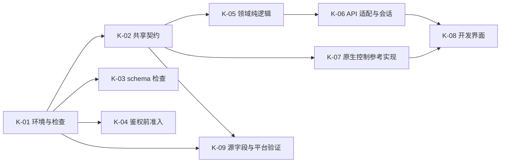

# BlueGrass：开发启动任务清单

> 历史记录说明（2026-10-19）：本文保留原日期的方案、缺口和测试/构建事实；其中 sing-box 主内核、旧协议全量承诺及 libbox 路线已由 [ADR 0049](../../adr/0049-xray-only-four-platforms.md) 替代。四端仅使用 Xray-core，旧报告不能作为新核心或其他平台的验收证据。原固定预期出口门槛已撤销，短信为可选能力。

> **For agentic workers:** REQUIRED SUB-SKILL: Use superpowers:subagent-driven-development or superpowers:executing-plans to implement this plan task-by-task. Steps use checkbox (`- [ ]`) syntax for tracking.

**Goal:** 建立可复现的开发/测试基线、共享契约、客户端纯逻辑与模拟界面，并取得真实接入所需的源字段及平台验证结果。

**Architecture:** 保留现有 `client-api/`，先补其可独立验证的 schema 检查和鉴权前准入；Dart 与 Go 通过同一份资源身份/状态序列 fixtures 建模。首轮界面使用明确的开发数据源，原生控制参考实现不接管宿主网络；真实 sing-box 与平台原型在独立验证任务中接入。

**Tech Stack:** 现有 Go API（最低 Go 1.26.0）、Flutter/Dart、Go 原生模块、Python 校验工具、隔离 MySQL 测试环境；精确版本在 K-01/S4 锁定。

**Spec:** [总实施计划](2026-10-10-sunipip-client-implementation-plan.md)、[主设计](../specs/2026-10-10-sunipip-client-design.md)、[补充设计](../specs/2026-10-10-sunipip-client-design-addendum.md)、[当前 API 接入](../../development/client-api-integration.md)、[审计 A01～A08/C01～C09](../reviews/2026-10-11-bluegrass-project-reaudit.md)。

- 编制日期：2026-10-11。以下都是待执行任务；本次请求只修改文档，复选框不预先勾选。
- 当前无客户端/原生工程，PATH 未找到 Go/Flutter/Dart。目标路径并非已存在文件，不要运行不存在的测试并将“找不到文件”当作预期行为失败。
- “准备开发”不要求重新确认既定产品决定；短信数值等明确延后输入只阻塞对应任务。第一轮产物不是首版发行包。

## Global Constraints

- 总计划的 Global Constraints 全部适用；D-01～D-19、D-23～D-48 为本轮冻结产品范围。
- 不重建 Git、不覆盖现有未提交文档、不修改或读取生产数据库；不把本轮文档完成当成部署/发布授权。
- API v1 的 `id` 是订阅 ID 字符串；`expires_at` 是 UTC 或 null；当前没有预期出口字段。原始 `host` 不是出口，缺字段不能生成可放行的连接配置。
- 界面自启/自动连接/崩溃上报默认关闭，Windows 模式默认系统代理，LAN 默认允许，主题默认跟随系统。
- Flutter 模板身份必须修正为 `com.bluegrass.client`；不能直接发布模板默认包名。
- 不实现已取消的账号专项、客户端交易、余额或额外离线截止；不为短信填未确认的生产数值。
- 测试账号/资源均是假数据或授权隔离测试数据，示例不包含真实 Token、密码、订阅链接。

## Review Focus

1. 旧登录/连接结果覆盖新会话：K-05 `old_generation_result_is_ignored`、K-06 `late_refresh_cannot_overwrite_login`、K-07 `TestLateProbeCannotReleaseNewAttempt`。
2. 缺出口/空期限被错误归一化：K-02 fixtures、K-05 `missing_expected_exit_blocks_profile` 与 `null_expiry_has_no_deadline`。
3. 分页/最近排序掩盖未加载资源：K-05 `recent_order_preserves_cursor`、`partial_summary_is_not_complete`；K-06 空页契约。
4. 暂停与停止混淆导致直接放流：K-07 `TestExpiryPausesWithoutRelease`、`TestStopRequiresCurrentOwner`；后续平台抓包不能省略。
5. Go 测试看似绿色却跳过真实 MySQL：K-01 runner 的缺配置/缺必需事件/skip 负向用例，K-03 隔离 schema 测试。

## 0. 执行顺序与交付边界

可以并行 K-03/K-04/K-05 的文件边界；同一文件的改动顺序合并。K-09 的无依赖调研先做，实际核心/桥接原型消费 K-02/K-07 的契约。每个任务结束先核对差异与证据，再进入依赖它的任务；当前不预定 Git 提交、推送或部署动作。

## K-01：工具链与不可假绿的验证入口

**Files**

- 新建：`docs/development/toolchain-lock.md`、`.gitignore`、`tools/dev/verify-environment.ps1`、`scripts/check.ps1`、`scripts/check.sh`。
- 新建：`tools/ci/run_api_integration.py`、`tools/ci/test_run_api_integration.py`、`.github/workflows/ci.yml`。
- 修改：`client-api/internal/testdb/testdb.go`（只增加必跑模式）、`client-api/README.md`。

**Interfaces**

- `verify-environment.ps1`：输出工具名称/精确版本/路径；缺必需工具退出非零。锁文件记录 Flutter release+commit、对应 Dart、Go、JDK/Android SDK/NDK、Windows SDK/构建工具；内核版本由 S4 补到同一记录，不写“latest”。
- `run_api_integration.py`：在仓库根运行，以 `GO_API_TEST_CONFIG` 读取私有配置路径，设置 `GO_API_REQUIRE_INTEGRATION=1`，执行 Go JSON 测试流；不输出配置内容。
- runner 仅在 Go 退出 0 且必需集成测试实际 `pass` 时退出 0；必需集初始含现有 `TestConcurrentSameRefreshReturnsIdenticalResult`、`TestBusinessReadUsesMVCCWhileOtherProgramHoldsWriteLock`、`TestJoinNeverMixesCredentialVersionsDuringConcurrentUpdates`、`TestReadOnlyPoolEnforcedForEveryConnectionAndRecoversAfterQueueTimeout`，BE 新回归逐步加入。

- [ ] **1. 核对并准备环境。** 记录 `go version`、`go env CGO_ENABLED CC`、`flutter --version`、`flutter doctor -v`、`dart --version`、`java -version`；Flutter/Dart 按同一 SDK 使用，race 的宿主/C 编译环境需实际可用。现有 API 最低 Go 1.26.0，原生依赖若需更高版本由 S4 更新锁。准备独立 MySQL 8 runner 的 `127.0.0.1:3306/suntest`，不把现有生产/共享服务当测试目标。
- [ ] **2. 先写 runner 负向测试。** `test_missing_config_fails`、`test_required_test_skip_fails`、`test_missing_pass_event_fails`、`test_go_failure_fails`、`test_all_required_pass_succeeds`，注入假 Go JSON 输出验证退出码；不需要真实 DB 即可跑这些测试。
- [ ] **3. 运行并确认因 runner 行为未实现而失败。** 仓库根：`python -m unittest discover -s tools/ci -p 'test_*.py'`。不能把 Python/文件缺失当作测试已覆盖。
- [ ] **4. 实现 runner、必跑模式和 CI。** `testdb.Open` 在 require 标志为 1 且缺配置时 `t.Fatal`，普通本地模式仍可明确 skip；原 loopback/库名/随机表隔离约束保留。CI 自建隔离数据库、配置不进仓库；基础检查阶段不调用尚不存在的客户端模块。
- [ ] **5. 核对当前代码基线。** 在 `client-api/` 执行 `go test -race ./...`、`go vet ./...`、`go build -trimpath -o bin/client-api ./cmd/client-api`；仓库根执行 runner。保存执行数/跳过数、revision 及脱敏结果，存在失败先定位，不用历史测试记录替代。
- [ ] **6. 建立检查入口。** `scripts/check.*` 按已建立模块执行必需检查，后续任务加入对应步骤；缺 SDK/依赖或必需配置退出非零。根忽略规则覆盖 build、`.artifacts/` 和私有配置，保留已存在的忽略约定；工具锁、CI 与检查入口一起审阅。

**Done:** 环境与 API 当前基线可复现，必跑集成用例不因跳过而显示通过；没有部署或修改业务表。

## K-02：冻结第一版共享类型与测试向量

**Files**

- 新建：`contracts/http/client-api-v1.openapi.yaml`（现有事实）、`contracts/http/client-api-next.openapi.yaml`（明确标为规划扩展）。
- 新建：`contracts/domain/resource.schema.json`、`contracts/ipc/messages.schema.json`、`contracts/enums.yaml`、`contracts/error-codes.yaml`。
- 新建：`contracts/fixtures/{http,identity,eligibility,time,connection,reminders,traffic}/`、`tools/contracts/validate.py`、`tools/contracts/test_validate.py`、锁定的校验依赖文件。

**Interfaces：以下是本轮拟落地的规范接口，不是现有 API 已返回的字段。**

| 类型/消息 | 第一版字段与约束 |
| --- | --- |
| `ResourceKey` | `environment`、`dataSource`、`accountKey`、`kind`（`subscription`/`asset`）、`sourceId`（非空字符串）；相等比较包含全部字段，不按名称/IP/列表下标关联 |
| `ResourceBrief` | `key`、显示名称、当前归属/业务状态、`expiresAtUtc: UTC instant or null`、同步来源/时间；可缺连接配置，不等同于连接授权 |
| `NodeRecord` | 当前节点 DTO 的归一化结果；当前 `id` 映射 `kind=subscription`，保留源字符串。缺预期出口在此保持缺失，不提前构造有效 `ConnectionProfile` |
| `ConnectionProfile` | `key`、唯一 `protocol`、入口/认证/协议/传输/TLS 参数、必需 `expectedExitIpv4`、`validUntilUtc or null`、配置指纹/版本及能力来源；入口不能补出口 |
| `Page<T>` | `items`、`hasMore`、原样不透明 `nextCursor`、同步上下文；空 items 且 hasMore 合法，排序不改 cursor |
| `ResourceQuery` / `DataSourceCapabilities` | Query 含 `view=connectable/allOwned`、keyword/country/group/expiringSoon 和显式排序；capabilities 分别标明当前节点、完整资产、到期摘要、短信能力，未交付返回 UnsupportedCapability，不静默忽略筛选 |
| `ExpirySummary` / `ExpirySnapshot` | Summary 含 ResourceKey、名称、归属/业务状态、客户到期 UTC/null 及同步元数据；Snapshot 含已知条目、complete、同步代次/游标。完成性必须由接口证据决定 |
| `ControlContext` | `schemaVersion=1`、登录代次 `clientEpoch`、原生 `runtimeEpoch`、`logicalSessionId`、`attemptId`、`resourceKey`；`runtimeEpoch` 来自 Hello，不携带业务令牌 |
| `ControlRequest` / `CommandAck` | Context + `requestId`、递增 `sequence`、命令和结构化参数；Ack 含对应 requestId、applied/stale/rejected、原生实际状态。相同 requestId 不同内容拒绝，相同内容幂等 |
| `NativeEvent` | Context + 运行代次内递增 `eventSequence`、实际状态/保护/统计；界面仅应用当前上下文较新事件，缺事件后重取快照 |
| 原生命令 | `Hello`、`Connect`、`ApplyResourceUpdate`、`Pause`、`Disconnect`、`SetMode`、`SetEntryDnsPolicy`、`ReleaseProtection`、`GetStatus`、`Subscribe`、`RunProbe`；资源更新和暂停须返回确认，不能只有 UI 自行改变状态 |
| `TrafficSnapshot` | Context、`counterEpoch`、序号、单调采样时间、上传/下载累计十进制整数字符串、available/complete；Dart 转 BigInt/Go 检查 uint64 边界，禁止经浮点 round-trip |
| `ReminderKey` / `ReminderBatch` | Namespace+资源键+规范化 UTC 期限+stage；Batch 有稳定批次 ID、实际成员键与平台提交状态；不能一条摘要标记全部未包含项 |

`Hello`/未绑定会话的 `GetStatus` 不要求已经存在 logicalSessionId/attemptId；其请求只有版本、requestId 和必要调用方上下文，响应提供 runtimeEpoch 与可空 activeSession。涉及资源/业务的命令必须有完整 ControlContext。恢复握手先检查调用方/账号归属，再显式绑定允许接续的 clientEpoch；跨账号不能通过 Hello 接管旧业务。UI 重启、同账号重新登录、原生重启和旧 owner 请求各有 fixture，原生鉴权机制由 S6 实测承接。

现有 `ConnectRequest` 文档中的 `resourceId`/`subscriptionId` 双字段在 schema 落地时统一映射到上述带类型键，并同步调用方/说明；当前没有已发行客户端，无需编造历史 IPC 兼容包。未知官网资产 ID 不填 0 或订阅 ID 冒充。API 扩展的真实 SQL 来源及端点由 S1/BE-03/06 交付，本任务不能伪造“已支持”示例。

- [ ] **1. 摘录现有 API 成功/失败/分页/刷新事实，列出扩展差异。** 以 `client-api/docs/API.md` 和 DTO 源码为准；当前规范不混入不存在的短信、预期出口或资产字段。
- [ ] **2. 定义上表 schemas 与统一向量格式。** 每个向量含 `caseId`、输入/事件序列、期望规范状态或错误、关联 ADR；秘密只用明显的假值。字段类型、null、未知枚举及不支持版本均有负向样例。
- [ ] **3. 先写校验器测试。** `test_unknown_field_rejected`、`test_fixture_schema_mismatch_fails`、`test_resource_key_namespaces_do_not_alias`、`test_large_counter_roundtrip_is_exact`、`test_current_api_fixture_has_no_planned_fields`；运行 `python -m unittest discover -s tools/contracts -p 'test_*.py'` 确认相应规则缺失时失败。
- [ ] **4. 实现 `validate.py` 与依赖锁。** 读取 schemas/fixtures，检查必需向量、正负例期待及跨文件引用；采用锁定版本的 JSON Schema 校验器，错误只输出假数据或字段路径。运行 `python tools/contracts/validate.py` 为零退出才继续。
- [ ] **5. 对照主设计和 ADR 检查字段语义。** `ApplyResourceUpdate` 区分只更新到期、配置变更需再验证、明确不可用需 Pause；序号先后不等于权威字段版本，详情请求串行/代次隔离的向量须覆盖旧响应。将字段映射和例外写入 `contracts/README.md`，不能只留一张字段表。
- [ ] **6. 更新总计划/补充设计中的接口索引，形成可供 Dart 与 Go 共同消费的基线。** 版本/类型不一致先修契约，不让两个实现独立补默认值。

**Done:** 当前事实与扩展目标分开，类型和状态序列可机读；仅说明契约完成，不说明后端字段或原生通道已交付。

## K-03：现有 API 会话 schema 完整性检查（BE-01）

**Files**

- 新建：`client-api/internal/session/schema.go`、`schema_test.go`。
- 修改：`client-api/cmd/client-api/main.go` 的 `checkDatabases`、`internal/session/store.go` 的迁移后检查、`client-api/docs/DATABASE.md`。

**Interfaces**

- 消费：现有 `session.Store`、自身表前缀及 `testdb.Open(t)`。
- 产出：`func (s *Store) VerifySchema(ctx context.Context) error`；读取元数据验证 `sessions`、`refresh_tokens`、`device_sessions` 的必需列、主/唯一索引、外键及 InnoDB。只返回受控表/结构差异，不自动修共享业务 schema。

- [ ] **1. 写隔离数据库测试。** `TestVerifySchemaAcceptsMigratedStore`；`TestVerifySchemaRejectsMissingRefreshTable`；`TestVerifySchemaRejectsMissingColumnOrIndex`；`TestVerifySchemaRejectsWrongEngine`；`TestVerifySchemaHonorsContext`。使用 fixture 随机前缀，破坏的也只能是本测试表。
- [ ] **2. 执行 `go test ./internal/session -run TestVerifySchema -count=1`（client-api 目录）。** 验证失败来自漏检结构，而非环境或目标配置错误。
- [ ] **3. 实现 `VerifySchema` 并接入 `-check`/正常启动检查。** 成功不能只说明 `sessions.id` 可 SELECT；schema 不完整启动失败并给出可修复说明。正常启动不运行迁移，显式迁移结束也验证自身结果。
- [ ] **4. 重跑本组与必跑集成 runner。** 同时确认现有登录/刷新并发仍通过，数据库只读源及测试约束没有放宽；保存缺表/部分迁移的失败证据与恢复办法。

**Done:** A01 对应实现及回归通过；不把 A04/A05 的清理问题连带标为已修复。

## K-04：在受保护请求鉴权前增加有界准入（BE-02）

**Files**

- 新建：`client-api/internal/httpapi/admission_test.go`。
- 修改：`internal/httpapi/httpapi.go`、`handlers.go`、`ratelimit.go`、`internal/config/config.go`/测试和配置示例；`client-api/docs/API.md`。

**Interfaces**

- 消费：现有 `h.protected(...)`、可信代理 IP 解析、`rateLimiter.allow` 和全局在途 slots。
- 产出：`func (h *apiHandler) admitProtected(r *http.Request) error`，在 `Authenticate` 前调用；超额返回既有 429/Retry-After 语义，登录/刷新与健康接口的既有预算独立，已认证读取仍执行会话配额。
- 新入口配额与键容量在配置中显式受界；数值通过现有 pool/并发基线和共享 NAT 压测决定并记入文档，不将会话每分钟 120 次直接复制成整个 NAT 的总预算。它不是尚待用户确认的短信限额。

- [ ] **1. 用可计数 fake Authenticator 写失败测试。** `TestProtectedAdmissionRejectsBeforeAuthenticate`：预算耗尽后的请求不增加鉴权调用；`TestInvalidTokensHaveBoundedLookupRate`：语法合法但无效令牌仍受限制；`TestReadSessionQuotaStillApplies`；`TestAdmissionKeyCapacityAndRecovery`；`TestHealthIsNotBlockedByProtectedBudget`。
- [ ] **2. 执行 `go test ./internal/httpapi -run 'TestProtectedAdmission|TestInvalidTokens|TestReadSessionQuota|TestAdmissionKeyCapacity|TestHealthIsNotBlocked' -count=1`。** 先看到 DB/鉴权调用量超界的有效失败。
- [ ] **3. 实现入口准入与配置校验。** 不信任任意转发头，不把格式非法令牌加入无界 map；已有会话级配额、请求取消及并发释放保持。
- [ ] **4. 重跑 httpapi/config 测试、`go test -race ./...` 与必跑集成。** 混合有效/无效/超额请求，记录允许请求、拒绝请求及鉴权/DB 调用数；共享 NAT 正常多用户场景不能因过小默认值被误拒。

**Done:** A03 有当前代码与负载证据；不会因 HTTP 返回 429 就宣称实际鉴权查询已受限。

## K-05：纯 Dart 领域模型与状态序列

**Files**

- 新建 `packages/domain/pubspec.yaml`、`lib/bluegrass_domain.dart`。
- 新建 `lib/src/model/{resource_key,node_record,connection_profile,page}.dart`、`eligibility/prepare_profile.dart`、`connection/reducer.dart`、`time/clock.dart`、`resources/recent_order.dart`、`reminders/{planner,batch}.dart`、`traffic/snapshot.dart`。
- 新建 `test/{identity,eligibility,connection,time,pagination,reminders,traffic}_test.dart`；测试数据引用 K-02，不能另建不一致的 JSON 样例集。

**Interfaces**

- `ProfileResult prepareProfile(NodeRecord node, DateTime effectiveNowUtc)`：成功携带完整 `ConnectionProfile`，失败携带领域错误；缺 expectedExitIpv4 返回 SYNC-003，不替换源值。
- `ConnectionState reduceConnection(ConnectionState state, ConnectionEvent event)`：输出状态与需执行的 effect；必须等匹配的原生确认才显示已连接。
- `List<ResourceBrief> orderRecent(List<ResourceBrief> items, RecentSuccessIndex history)`：仅显示排序，原 `Page.nextCursor` 不变。
- `ReminderEvaluation evaluateReminders(ExpirySnapshot snapshot, ReminderLedger ledger, DateTime effectiveNowUtc)`：返回本轮合法项、取消项、覆盖完整性与批次草案；不直接发平台通知。
- `TrafficView deriveTraffic(TrafficSnapshot? previous, TrafficSnapshot current)`：同会话/计数代次的单调时间差计算速度；缺口/重置不显示虚假零或峰值。

相关类型在本包定义并加入 K-02 schema/向量：`ProfileResult = Ready(profile) | Rejected(error)`；`ConnectionState` 分别持有连接状态、保护状态和当前 Context，`ConnectionEvent` 区分用户意图、已接受的资源更新、原生确认、原生事件和时间事件；`RecentSuccessIndex` 为资源键到幂等成功序号的映射；`ReminderLedger` 为提醒键/批次到提交状态的映射，`ReminderEvaluation` 含 dueItems/cancelledKeys/coverageComplete/batchDraft；`TrafficView` 含可空上下行速度、精确累计和 available/complete 标记。

- [ ] **1. 按 K-02 建包与类型，写行为用例。** 首批必须覆盖：

| 测试名 | 关键断言 |
| --- | --- |
| `missing_expected_exit_blocks_profile` | 当前 API 节点可解码，但缺出口时不能生成连接 profile；入口不能补值 |
| `null_expiry_has_no_deadline` / `exact_deadline_disallows_forwarding` | null 不伪造期限；有效 now 达截止点即不允许业务，不加 60s |
| `old_generation_result_is_ignored` | A 连接取消后 B 的状态不被 A 的成功/失败改变 |
| `recent_order_preserves_cursor` | B 最近成功即前置，但游标还是原接口值；失败/预选不写历史 |
| `partial_summary_is_not_complete` | 已加载第一页不代表全账号；缺席不取消旧提醒 |
| `reminder_catchup_uses_only_current_stage` | 7/3/1 多档已跨过仅取最紧迫；到期变更撤销旧键，null 无任务 |
| `grouped_reminder_marks_only_included_items` | 5 个待发、摘要只包含 3 个时，另外 2 个保持待发；失败无成功记录 |
| `counter_epoch_change_is_incomplete` | 原生重置/丢样标不完整，旧资源结果不串入；大整数字符串精确 |

- [ ] **2. 在包目录执行 `dart test`，确认各测试失败点是缺失的规则。** 无法编译或 fixture 不合法先修环境/类型，再验证业务断言。
- [ ] **3. 实现上述纯函数与 reducer。** 不在领域层发 HTTP、启动 TUN 或读取系统代理；系统副作用由 effect 接口承接。北京时间只是展示转换，期限比较保持 UTC。
- [ ] **4. 执行 `dart analyze`、`dart test`。** 将未连续恢复的跨系统重启校时方案留给 CP-03/S4/S7 的明确产物；运行期单调时间测试通过不等于跨重启已验证，也不允许实现固定离线截止作为替代。

**Done:** 领域核心规则与共享向量一致，缺后端字段时明确失败，可供真实/模拟数据源共同使用。

## K-06：独立 API 适配与唯一会话协调器

**Files**

- 新建 `packages/domain/lib/src/data_source.dart`、`packages/data_api_v2/pubspec.yaml`。
- 新建 `packages/data_api_v2/lib/src/{api_v2_data_source,http_transport,node_mapper,api_failure}.dart`、`session/{session_coordinator,session_store,auth_snapshot}.dart`。
- 新建 `packages/data_api_v2/test/{session_coordinator,node_mapper,pagination,api_errors}_test.dart`、`tools/mock-api/README.md` 与确定性场景入口。

**Interfaces**

- `CustomerDataSource`：`capabilities`；`Future<Page<ResourceBrief>> listResources(ResourceQuery query, String? cursor)`；`Future<NodeRecord> getConnectionRecord(ResourceKey key)`；`Future<Page<ExpirySummary>> listExpirySummaries(String? cursor)`。`ResourceQuery` 包含视图及筛选，尚不支持的能力返回结构化 `UnsupportedCapability`，不能返回假空全集。
- `HttpTransport.send(ApiRequest request) -> Future<ApiResponse>`：可注入确定性响应与取消；真实实现禁用隐式系统代理并保留 TLS 校验。
- `SessionStore.read() -> Future<AuthSnapshot?>`、`replace(AuthSnapshot) -> Future<void>`、`clear() -> Future<void>`：异步、原子加密记录边界；单元测试注入内存实现，真实环境后续由 DPAPI/Keystore 适配，不把内存/明文存储作为发布兜底。
- `SessionCoordinator.validAccessToken() -> Future<String>`；所有请求共享一个 coordinator。AuthSnapshot 含登录代次、令牌期限、session/device ID，以及先落盘的 pending refresh token/request UUID。

测试中的 `ApiRequest`/`ApiResponse` 只承载方法、路径、受控头、JSON 与 HTTP 状态；`ApiFailure` 保留原始 code 和 retryAfter，秘密值不进入异常字符串。`UnsupportedCapability` 定义在 domain；真实 capability 不能由 mock 功能反向推断。

- [ ] **1. 写可控制响应先后的测试。** `concurrent_requests_share_one_refresh`（20 个请求只有 1 次 refresh）；`refresh_retry_reuses_persisted_uuid`；`crash_before_token_save_recovers_same_request`；`late_refresh_cannot_overwrite_login`；`retry_after_does_not_clear_session`；`expired_access_is_not_logout`；`empty_page_keeps_next_cursor`。
- [ ] **2. 执行包内 `dart test` 看见预期规则失败。** 测试必须能指定时间、乱序响应和存储失败，不用真实客户账号/时间 sleep 拼凑。
- [ ] **3. 实现现有 v1 请求映射。** `/nodes` 只提供可连接节点能力，不冒充全部资产；订阅 ID 保留字符串。`expires_at:null` 合法；缺预期出口保持缺失，由 K-05 阻止建连。保留原始游标，404/409 不编造具体回收原因。
- [ ] **4. 实现串行续期和恢复。** 先存 UUID 再请求，结果原子替换；超时用同 token/UUID 重试，访问令牌失效原请求最多重试一次；恢复窗口按实际返回/既有默认 120 秒处理，不绕过 Retry-After，也不把普通资源轮询退避套给令牌恢复。
- [ ] **5. 执行 `dart analyze`、`dart test`，与 mock 场景核对当前 API 样例。** 单独记录“适配器测试”和“真实测试 API 联调”；没有请求真实服务不能写后者通过。

**Done:** 可消费现有密码/节点 API，明确表达能力缺口；完整资产、摘要、短信等待对应 BE 契约，不阻止基础适配开发。

## K-07：无宿主网络副作用的原生控制参考实现

**Files**

- 新建 `native/core/go.mod`、`control/{types,controller,snapshot}.go`、`gate/gate.go`、`clock/clock.go` 及相应 `_test.go`。
- 新建 `native/core/engine/engine.go` 与测试 fake；真实 sing-box 实现留给 S4/GO-03。

**Interfaces**

- `Controller.Apply(ctx context.Context, req ControlRequest) (CommandAck, error)`；`Controller.Snapshot() NativeSnapshot`；遵循 K-02 schema。
- `Engine.Prepare(ctx, profile) error`、`Engine.ProbeExit(ctx) (ProbeResult, error)`、`Engine.SetBusinessGate(open bool) error`、`Engine.Stop(ctx) error`；首轮 fake 记录调用顺序，不创建系统代理/WFP/TUN。
- `Clock.Read() TimeReading`：TimeReading 含有效 UTC 估计、单调纳秒、运行代次及时间可信度；`NativeSnapshot` 将 actualMode、连接、保护、到期及流量有效性分开，不能只用一个 connected 布尔值。

- [ ] **1. 写 fake Engine 的状态顺序断言。** `TestGateClosedUntilMatchingIPv4`；`TestLateProbeCannotReleaseNewAttempt`；`TestExpiryPausesWithoutRelease`；`TestStopRequiresCurrentOwner`；`TestDuplicateRequestIsIdempotent`；`TestSameRequestDifferentPayloadRejected`；`TestUpdateExpiryCannotReviveCancelledAttempt`；`TestUntaggedCounterIsIgnored`。
- [ ] **2. 在 `native/core/` 运行 `go test ./...`，先确认规则缺失导致失败。** 测试注入 Clock 和探测完成事件，不访问公网、系统路由或真实节点。
- [ ] **3. 实现控制器、门槛和快照。** Connect 准备期间门槛关闭；只有匹配当前身份/代次、未到期且固定 IPv4 一致后开放；Pause 关闭业务但保留保护意图，Disconnect 是显式终止；控制与统计事件序列分开维护。
- [ ] **4. 执行 `go test -race ./...`（支持 race 的环境），复用 K-02 fixtures。** Dart/Go 对同一时间/身份/乱序向量得到一致规范结果；当前没有平台保护实现，不能把 fake Gate 结果算作零泄漏证据。

**Done:** 原生控制语义可测，尚未声称真实线路、TUN/WFP 或 Android VPN 可用。

## K-08：可审阅的客户端基础界面

**Files**

- 新建 Flutter `app/`；入口 `lib/main.dart`、`lib/app.dart`、`lib/bootstrap.dart`。
- 新建 `lib/features/{auth,home,resources,settings,diagnostics}/`、`lib/l10n/app_zh.arb`、`lib/dev/fixture_data_source.dart`、`lib/dev/fake_native_client.dart`。
- 新建 `lib/platform/native_control_client.dart`、`lib/preferences/{preferences_store,user_preferences}.dart`，供生产桥接和开发 fake 共享类型。
- 新建 `test/{startup_preferences,resource_selection,home_state,theme}_test.dart`、`integration_test/fixture_flow_test.dart`。
- 修改生成的 Android applicationId/namespace、`MainActivity` 包路径、Windows `Runner.rc`/CMake 显示与可执行标识；依据 D-18。

**Interfaces**

- `BootstrapDependencies` 注入 `CustomerDataSource`、`SessionStore`、`NativeControlClient`、`PreferencesStore`；生产和开发入口显式分离。
- `NativeControlClient.hello(HelloRequest) -> Future<HelloResponse>`、`getStatus() -> Future<NativeSnapshot>`、`send(ControlRequest) -> Future<CommandAck>`、`events -> Stream<NativeEvent>` 消费 K-02；开发 fake 复用 K-07 的状态向量，不直接设置任意“已连接”。
- `PreferencesStore.read() -> Future<UserPreferences>`、`replace(UserPreferences) -> Future<void>`；UserPreferences 含 theme（system/light/dark）、Windows mode（system_proxy/tun）、allowLan、startOnLogin、autoConnect、crashReporting，默认值与 Global Constraints 一致；偏好不存令牌。
- fixture 仅在 `BLUEGRASS_DATA_SOURCE=fixture` 的开发构建启用，并明确标记模拟环境；发行检查拒绝 fixture 配置。这里不是把模拟开关放进产品普通用户设置。

- [ ] **1. 创建 Flutter 工程与本地包依赖。** `flutter create --platforms=windows,android --org com.bluegrass --project-name bluegrass_client app`；随即将 Android 身份改为 `com.bluegrass.client`、应用名改为 BlueGrass，迁移生成的 MainActivity 路径，避免保留重复类。模板的默认包名不能直接作为验收结果。
- [ ] **2. 替换模板计数器测试，写核心交互断言。** `fresh_start_defaults_are_correct`：系统代理/系统主题/LAN 允许且自启自动连接上报关闭；`preselect_does_not_connect`；`recent_sort_does_not_change_selection`；`expected_ip_is_not_verified_ip`；`utc_expiry_displays_beijing`；`theme_change_keeps_session_and_input`；`missing_statistics_are_not_zero`。
- [ ] **3. 在 app 目录运行 `flutter test` 并确认规则缺失失败。** 不保留与新页面无关的模板计数器断言。
- [ ] **4. 实现首页/列表/设置及各 loading/empty/error/pause 状态。** 首页完整 IP 与验证标签、统计有效性、UTC+8；资源预选/最近排序与原游标分离；主题/模式偏好持久化。短信、全账号摘要和真实原生未接入时明确开发状态，不能伪造正式成功。
- [ ] **5. 运行 `flutter analyze`、`flutter test`、`flutter test integration_test/fixture_flow_test.dart -d windows`（Windows 开发机），并在指定 Android 模拟器/设备复验相同流程。** 测试选中设备 ID 来自 `flutter devices`，不猜 ID。
- [ ] **6. 对浅/深色、窄/宽窗口和键盘焦点做视觉检查，记录截图与限制。** 构建 Windows 和 APK 验证身份；fixture 可运行不等于真实网络接管或签名发行包完成。

**Done:** 团队能审阅真实可运行的基础交互和错误状态；业务/平台接口可替换，未接入项如实呈现。

## K-09：真实接入与平台 Spike 交接

**Files**

- 新建：`docs/development/dependency-register.md`、`docs/development/time-and-recovery.md`、`docs/superpowers/spikes/S1-api-mapping.md`、`S3-relay-authorization.md`、`S4-embedded-core.md`、`S5-windows-protection.md`、`S6-ipc-bridge.md`、`S7-android-vpn.md`、`S8-S9-dns-routing.md`、`S11-exit-probe.md`、`S12-protocol-matrix.md`。
- 对应原型放 `tools/spikes/`；脱敏命令/抓包产物放忽略的 `.artifacts/verification/`，结论文档引用本地证据标识。

**Interfaces / deliverables**

| 输出 | 必须回答的具体问题 |
| --- | --- |
| S1 映射表 | 当前订阅 ID/资格/UTC/null 已知字段；权威 expected IPv4、完整资产及全量摘要的真实来源，缺什么阻塞哪个 BE 任务 |
| S3 授权表 | 服务端对到期/撤销后的新连接与已有 TCP/UDP 的实际动作与时延；不只看 API 不再发节点 |
| S4/S12 锁与矩阵 | 内核 release/commit、Go/NDK/构建标签；每协议参数和 UDP 承载机制；对应真实/受控线路证据；HTTP 等出站不能凭统一业务声明就填 UDP 支持 |
| S5/S6 | 进程终止和开机窗口如何阻断；完整代理归属；平台桥接选择与鉴权。失败窗口未关闭不能宣称 Beta1 就绪 |
| S7/S8/S9 | 最低 Android 8.0、底层网络、LAN/FakeIP/端口 53/内网域名/公网 IPv6；控制面冷 DNS 可达；lockdown 和首次解锁情况 |
| CP-03 时间恢复 | 同运行代次单调截止、墙钟回拨/前跳、null、休眠/系统重启后的时间可信度与恢复算法；不得以新增 72h 截止替代问题 |
| S11 | 独立 IPv4 HTTPS 实际来源与备用；受控探测不含业务令牌；UDP 诊断服务另列，不当作建连门槛 |

- [ ] **1. 在依赖表登记已有证据和缺失输入。** 只使用当前明确可访问的隔离测试环境；没有真实源字段时先完成接口/fixture，记录 BE-03/06 的阻塞证据，不猜 SQL 列。
- [ ] **2. 每个原型先写可检查的失败场景，再实施最小证明。** 例如出口不同必须不放行，LAN DNS 查询公网名不得直连，系统代理被其他软件改写后修复不得覆盖。
- [ ] **3. 核对所选版本的官方源码/文档并锁定，再执行最小真实或受控线路实验。** 不把旧 testing commit 当成自动可发行版本；不因某协议缺样本删除 D-03 范围。
- [ ] **4. 每份报告给出“通过 / 失败 / 输入阻塞”及复现命令、平台、revision、样例和下一任务。** 假 Engine、模拟响应、未运行步骤和真实网络结果分开。未取得的结果留作明确阻塞，不能生成空报告充数。
- [ ] **5. 按结果更新工具锁、共享契约和总计划门禁，继续 BE-03/06/07、GO-02～GO-11、W/N 工作包。** 短信参数仍按用户要求留到后续；本任务不再次开启产品选项问答。

**Done:** 已执行原型有证据，缺失输入有具体阻塞任务；只有真实 Alpha 所需项通过后才把模拟界面接到真实业务放行链路。

## 首轮收尾检查

- [ ] 新建目录/脚本与总计划一致；契约、fixture、Dart/Go 类型及实际文档同步。
- [ ] 必跑检查不通过 skip/缺工具假绿；本机检查与真实 MySQL/平台证据分别报告。
- [ ] 至少可演示模拟登录、资源预选与筛选、受控连接状态、主题、时间和统计异常；生产入口不使用 fixture。
- [ ] BE-01/02 当前实现通过回归；BE-04/05 等尚未执行的后端缺口仍留在总计划，不因首轮完成被隐去。
- [ ] 真实出口来源、短信、全资产摘要、内核/平台、发布等剩余依赖明确；没有把本清单完成等同于客户端首版或 Beta 门禁完成。
- [ ] 根据实际投入和 Spike 更新后续任务估算；Git 操作和外部部署按届时的明确授权执行。
