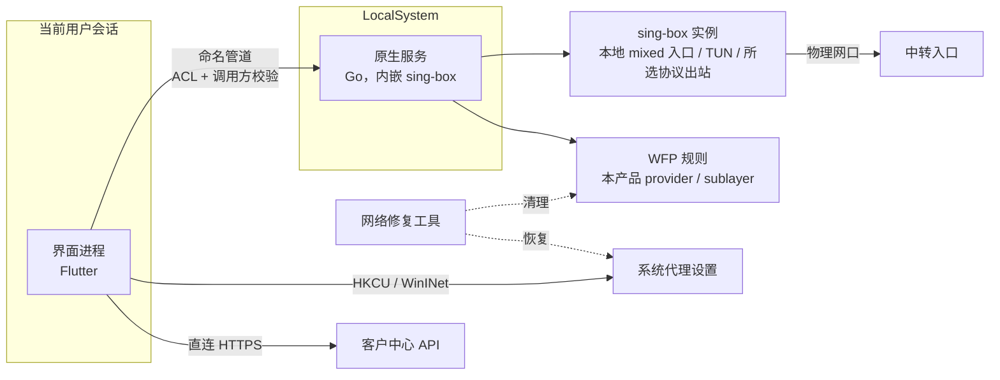
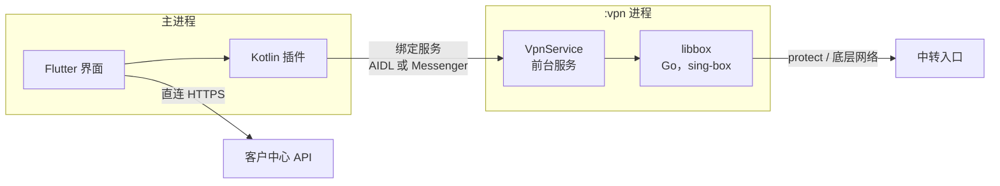

# BlueGrass：补充设计

- 整理日期：2026-10-10，Asia/Hong_Kong。
- 状态：D-01 至 D-19 已记录；2026-10-11 的 [D-19](../../adr/0019-independent-client-api.md) 将接入路径改为独立 Go API。服务端已完成代码与测试，客户端实现、图标素材及运行验收尚未完成。
- 本文针对审阅报告中的缺失项（G-xx）和矛盾项（C-xx）给出具体设计，不重复主设计已有的内容。
- 标注“待 Sxx 验证”的条目依赖 Phase 0 的技术验证（见[实施计划](../plans/2026-10-10-sunipip-client-implementation-plan.md) §3），验证完成前不视为定论。
- 本文不是实现完成或兼容性的证明。
- 产品标识：应用名 `BlueGrass`，Android applicationId 与 namespace 为 `com.bluegrass.client`；安装、更新和展示使用同一身份，见 [ADR 0018](../../adr/0018-bluegrass-branding.md)。
- 取数约束：D-19 采用独立 Go API 的游标节点列表和单条详情，保留 D-05 的按需分页、统一接口和连接前刷新；具体契约见[接入开发文档](../../development/client-api-integration.md)及 §20。当前仅提供合格 SOCKS5 节点，完整资产状态、短信和其他协议仍待补齐。
- D-03 已确认首版清单：SOCKS5、SS、VMess、VLESS、Trojan、HTTP/HTTPS 代理、Hysteria2、TUIC、AnyTLS，见 [ADR 0003](../../adr/0003-first-release-protocol-scope.md)。下文具体的 SOCKS5 认证、流量路径、DNS 与探测方案是该协议的基线；Phase 0 的 S12 为其余协议补齐参数组合、DNS 路径、数据源契约和验收矩阵。

## 1. 首版范围（建议）

| 范围内 | 范围外（推迟或不做） |
| --- | --- |
| Windows 10/11 x64：系统代理模式、全局接管（TUN）、断线保护 | Windows 7 兼容版（已确认后续独立交付，保留系统代理、TUN 和断线保护目标；D-01） |
| Android 8.0（API 26）及以上：VPN 模式，arm64-v8a 与 armeabi-v7a | macOS、iOS（只保留架构边界） |
| 账号登录：密码、短信验证码及必要验证流程（D-16 已确认）；D-03 已确认清单中的全部协议 | 首版清单之外的协议；超出经验证参数组合的扩展 |
| 我的 IP：服务端分页、筛选、详情、不可连接原因 | 分流规则、按应用分流（R-05） |
| 逐资源资格判断、单活动资源会话、断开、切换、出口检测；同一资源多程序并发使用 | 多 IP 同时使用、逐资源本地多端口映射（D-12 已确认后续再做） |
| 到期提醒、入口 DNS 容错（最小方案）、重连；所选协议必要的 TLS/SNI、证书验证和传输能力 | DoH（R-04 建议推迟） |
| 诊断导出、远程配置、应用内更新、托盘、开机自启 | 同时登录多个账号 |

多协议配置的取数来源由 S12 核实。账号级订阅是否参与配置获取，须满足资源及资格可靠关联和凭据保护要求（R-07）。

D-14 已确认继续兼容现有有效 SOCKS5 资源，帮助和资源详情按实际协议配置说明传输保护，见 [ADR 0014](../../adr/0014-socks5-compatibility-and-encryption.md)。D-03 的客户端能力不代表服务端全部已部署；服务端提供加密入口后通过版本化配置映射同一资源，并重新验证资格与出口。加密认证、握手或证书验证失败不自动切换回明文协议。

平台边界（G-26）：

- **Windows ARM64**：作为 S4 的候选兼容性验证项，分别核实安装、系统代理及驱动/TUN 的实际能力；验证前不宣称支持，也不直接从仿真方式推断 TUN 必然不可用。首版已确认的工程基线为 Windows x64，ARM64 原生构建保留在后续范围。
- **HarmonyOS NEXT（HarmonyOS 5 及以后）** 不再运行 APK，不在支持范围内。官网下载页要写明。
- **安卓工作资料与多用户**：VPN 只接管其所在用户空间（个人资料或工作资料）。首版只支持在个人资料中使用，帮助文档中说明。

## 2. 总体架构与进程模型

### 2.1 分层原则

1. **业务规则放在 Dart**：统一模型、资格判断、状态机、错误码都写在不依赖 Flutter 的 Dart 包里，Windows 和安卓共用。
2. **数据面与网络保护放在原生层**：D-11 已确认 Windows 服务使用 Go 内嵌 sing-box；请求校验、配置生成、内核适配、入口解析及出口检测放在共享 `native/core`。Windows 服务/IPC/WFP/TUN 集成留在 `native/windows-service`，安卓通过 libbox 封装与 Kotlin 平台接口集成。
3. **界面进程与数据面进程分离**：界面崩溃或被关闭，不影响已经建立的连接和保护。
4. **原生层只接受结构化的连接请求（ConnectRequest）**：内核配置只由原生层生成，不接受外部传入的配置文本或文件路径（G-06）。
5. **保留通用内核适配接口**：Windows 10/11 与安卓首版仅实现 sing-box 适配，配置生成、生命周期、状态事件和能力检查通过该边界组织；后续有明确需求时增加其他内核适配（D-02）。
6. **数据源与业务模型分离**：业务层只依赖 `CustomerDataSource`；由待实现的 `ApiV2DataSource` 接入独立 Go API v1。鉴权、原始字段和游标分页由适配器处理，不自动回退官网登录，迁移规则见 §20。

### 2.2 Windows 进程模型



| 组件 | 负责 | 不负责 |
| --- | --- | --- |
| 界面进程（当前用户） | 登录与令牌、调用 API、资格判断、状态展示、设置和恢复**按用户生效的**系统代理、托盘 | 不直接操作 TUN 和 WFP |
| 原生服务（LocalSystem） | 内核生命周期、生成内核配置、TUN、WFP 保护、入口解析、网络变化监听、记录保护意图 | 不保存账号令牌，不调用业务 API，不设置系统代理 |
| 网络修复工具 | 在服务或界面损坏时清理本产品的 WFP 对象、TUN 适配器和系统代理残留 | 不建立连接 |

服务架构带来的变化（C-12）：开启全局接管时不再需要运行时 UAC 授权。主设计 §6.1 的“按需获取系统权限”调整为“安装时一次授权”。“取消授权”这一失败场景改为“服务未运行或版本不匹配”（SYS-003）。

D-11 的服务语言与内嵌路线已确认，见 [ADR 0011](../../adr/0011-go-windows-service.md)。内核与 Go 服务在同一进程，异常测试应覆盖内核报错、panic 或其他崩溃导致服务退出的情况，以及直接终止服务进程；不能假定内核总有独立 PID。保护规则和网络修复工具按独立生命周期验证，Flutter IPC 桥接方式仍由 S6 锁定。

### 2.3 Android 进程模型



VPN 放在独立进程，界面进程被系统回收后连接仍然保持。系统直接拉起 VPN 时（始终开启 VPN、开机）不经过界面，启动路径见 §9.4。

### 2.4 连接请求（原生层接口契约）

Windows 命名管道与安卓绑定服务使用同一结构，字段如下：

| 字段 | 说明 |
| --- | --- |
| `requestId` | 请求标识，用于幂等和日志关联 |
| `schemaVersion` | 结构版本；服务端和客户端版本不兼容时拒绝并返回 SYS-003 |
| `accountKey` | 账号命名空间（见 §13），不包含令牌 |
| `resourceId`、`subscriptionId` | 资源标识，用于保持同一出口 |
| `protocol` | 从 D-03 已确认的首版协议清单中取值，按本发行包能力检查 |
| `entry.host`、`entry.port` | 中转入口 |
| `entry.addresses` | 可选，界面侧预解析结果 |
| `auth`、`protocolOptions` | 按协议类型定义字段白名单并校验；SOCKS5 基线为 `username`、`password`，其余协议的完整字段由 S12 锁定；原生层凭据只保存在内存 |
| `transport`、`security` | 所选传输与 TLS 等安全参数，按协议能力矩阵校验；保留原始域名用于 SNI 和证书验证，不透传任意内核配置 |
| `mode` | Windows：`system_proxy` / `tun`；安卓：`vpn` |
| `allowLan` | 是否允许局域网访问 |
| `validUntil` | 已知有效期（UTC），是缓存使用的唯一时间上限；按当前会话更新并由原生层安排到期处理，不增加未复核截止时间（D-15） |
| `serverTimeOffsetMs` | 与业务层相同的服务器时间校正信息；未知时明确标记，按 §12 的回退策略处理，不伪装成新校时结果 |
| `dnsMode`、`dnsCandidates` | `auto` / `custom`；候选为有序的 `{address, port, transport}` 列表，地址必须是 IP 字面量，端口默认 53，传输为 UDP/TCP；自定义模式不加入列表外 DNS（D-04） |
| `exitCheck` | 检测端点列表、预期出口 IP（可选） |

原生层的校验规则：字段白名单；字符串长度上限；端口范围 1–65535；主机名和 IP 语法检查；拒绝任何路径类字段；不接受透传的内核配置。

## 3. 状态模型

### 3.1 四个独立维度（C-01）

| 维度 | 作用范围 | 取值概要 |
| --- | --- | --- |
| 会话状态 | 账号 | 未登录、登录中、需要验证、已登录、续期中、已失效 |
| 资源资格 | 每条资源 | 可连接、仅静态 IP、开通中、已到期、已停用、配置异常、不支持、账号受限、无法确认（见 §5） |
| 连接状态 | 应用（同一时刻最多一个活动资源会话，同一会话允许多个网络连接） | 见 §3.3；D-12 |
| 保护状态 | 设备 | 见 §3.4 |

另外，数据层为列表和每条资源记录**同步状态**（空闲、同步中、成功于某时刻、失败并带错误码）和**数据来源**（刚刷新或来自缓存）。“同步中”只是数据状态，不进入连接状态。

### 3.2 会话状态

| 当前 | 事件 | 下一状态 | 说明 |
| --- | --- | --- | --- |
| 未登录 | 提交登录 | 登录中 | |
| 登录中 | 成功 | 已登录 | 安全存储令牌 |
| 登录中 | 未来短信契约要求人机验证 | 需要验证 | 当前 Go API 未提供此流程，不沿用官网 `VERIFICATION_REQUIRED` 作为既有契约 |
| 登录中 | 账号或密码错误、验证码错误、请求过于频繁 | 未登录 | AUTH-001 / 002 / 006 |
| 已登录 | 访问令牌将到期，或受保护请求返回 `access_token_expired` / `invalid_token` | 续期中 | 同设备会话合并为一次续期，其余请求等待 |
| 续期中 | 成功或恢复到已保存的新令牌 | 已登录 | 原子保存令牌，原业务请求最多重试一次 |
| 续期中 | 断网、超时、429、503 | 续期中 | 保留会话，以同一旧刷新令牌和请求 UUID 重试；恢复窗口及退避见接入文档 |
| 已登录 / 续期中 | 明确撤销、改密、账号不可用或令牌无法恢复 | 已失效 | 提示原因与重新登录；认证失效本身不等同于中转到期，连接另按主设计 §5 处理 |
| 已失效 | 重新登录成功 | 已登录 | 账号不同时，按“切换账号”处理 |
| 已登录 | 用户登出 | 未登录 | 先确认并断开连接，再清除本账号数据 |

普通业务请求网络不可达不使账号失效；续期中的网络故障保留待恢复状态。429/503 不清除会话，不能以“任何 401 都退出账号”代替错误码判断。

### 3.3 连接状态

| 状态 | 含义 |
| --- | --- |
| 未连接 | 没有代理会话 |
| 准备中 | 刷新所选资源的资格，解析入口 |
| 启动中 | 启动内核、TUN 或 VPN |
| 验证中 | 中转握手与认证、出口检测 |
| 已连接 | 中转认证、实际访问及出口 IP 检测均通过，业务转发已开放（D-07） |
| 重连中 | 链路中断后恢复同一资源 |
| 已暂停 | 因到期、撤销等原因终止代理业务；TUN 保留保护，系统代理保留设置及拒绝转发的本地监听（D-08） |
| 正在停止 | 回收接管 |
| 失败 | 未能进入已连接状态，附带错误码 |

| 当前 | 事件 | 下一状态 | 动作 |
| --- | --- | --- | --- |
| 未连接 / 失败 | 用户点击连接 | 准备中 | 刷新所选资源（新会话不使用缓存） |
| 准备中 | 资格为可连接 | 启动中 | 下发 ConnectRequest |
| 准备中 | 资格不是可连接，或刷新失败 | 失败 | 显示对应 ELIG 或 SYNC 错误码 |
| 启动中 | 内核就绪 | 验证中 | |
| 启动中（由已验证的系统代理会话切换至 TUN） | TUN 创建失败，原系统代理会话仍有效 | 已连接（系统代理模式） | 保留原来已验证的连接，提示“全局接管未启动”；不存在原有效会话时不能进入“已连接” |
| 启动中 | 内核启动失败 | 失败 | 回滚本次变更 |
| 验证中 | 认证、实际访问及出口检测成功，结果属于当前会话且资格仍有效 | 已连接 | 开放普通业务转发；Windows 系统代理模式此时才设置系统代理（C-02、D-07） |
| 验证中 | 检测端点全部失败、超时或返回无效结果 | 失败 | CONN-004；普通业务保持关闭，TUN/VPN 保持阻断；提供重试（D-07） |
| 验证中 | 出口与可靠的预期值不一致 | 失败 | CONN-005；普通业务保持关闭，已有保护继续阻断（§11） |
| 验证中 | 认证失败或入口不可达 | 失败 | 停止本次未完成的业务会话，已有保护继续阻断；认证失败时立即刷新资源 |
| 失败（出口检测失败） | 重试且当前会话资格仍有效 | 验证中 | 仅经受控探测通道重试，验证通过前保持业务阻断；新逻辑会话按 D-05 刷新资格 |
| 已连接 | 链路中断、内核退出、网络变化 | 重连中 | 保护保持 |
| 重连中 | 链路恢复 | 验证中 | 轻量验证：握手 + 出口检测 |
| 启动中 / 验证中 / 已连接 / 重连中 | 到达 `validUntil`，或收到明确的到期或撤销信息 | 已暂停 | 取消待处理验证、停止代理会话，保护保留；迟到的成功结果不得放行业务 |
| 已连接 | 用户切换资源 | 准备中（新资源） | 二次确认；切换期间保护不解除 |
| 已暂停 | 用户重试续费后的资源或切换资源 | 准备中 | 按 D-05 刷新资格，按 D-07 验证出口，成功前继续拒绝业务转发 |
| 存在连接或保护意图的任意状态（含验证中、失败） | 用户断开，或用户选择“解除保护” | 正在停止 → 未连接 | 取消待处理验证，解除保护，按归属恢复设置 |
| 任意 | 正常退出程序 | 正在停止 → 未连接 | 主设计 §6.1 |
| 任意（Windows 窗口可见） | 用户点击“×”关闭窗口 | 状态不变 | 隐藏到托盘，首次提示；不触发断开或解除保护（D-17） |

### 3.4 保护状态

**Windows（仅全局接管）**

| 状态 | 含义 |
| --- | --- |
| 关闭 | 没有本产品的 WFP 规则 |
| 布设中 | 正在安装规则 |
| 生效·放行 | 规则生效，隧道及出口验证通过，业务流量经 TUN 放行 |
| 生效·阻断 | 规则生效，隧道不可用或出口验证未通过，普通业务阻断；受控探测可重试（PROT-002） |
| 解除中 | 正在删除规则 |
| 残留 | 启动时发现上次留下的规则或代理设置（PROT-003） |

**Android**

| 层级 | 状态 |
| --- | --- |
| App 级 | VPN 运行时始终生效：隧道断开时 VPN 接口仍在，阻断业务流量 |
| 系统级 | 已核实启用、已核实未启用、无法核实（API 26–28，PROT-004） |

### 3.5 超时与重试（初始值）

以下为初始值，Phase 2 实测后调整，并可通过远程配置在白名单范围内微调。

| 阶段 | 超时 | 重试 |
| --- | --- | --- |
| 刷新所选资源 | Go API 单条详情请求 8 s，支持取消；具体客户端超时由 S1 联调复核 | 单请求可重试 1 次；涉及续期时服从统一会话管理器，整个操作有总时限 |
| 入口解析 | 每个上游 2 s，总计 5 s | 多个上游并发查询 |
| 内核启动 | 10 s | 不重试 |
| TUN 创建 | 15 s | 1 次 |
| 中转握手与认证 | 8 s | 2 次，间隔 1 s |
| 出口检测 | 每个端点 6 s，总计 12 s | 依次换用端点 |
| 重连退避 | 1、2、4、8、16、30、60 s，之后每 60 s 一次 | 保护期间不设上限；每失败 3 次重新解析入口；网络变化时立即重试并重置退避；每次重试前检查 `validUntil` |

### 3.6 同一逻辑会话（C-10）

- **开始**：用户对资源 X 点击连接，且刚刷新的资格为可连接。
- **持续**：用户没有主动断开、切换资源或登出，并且没有到达有效期或收到撤销信息。App 重启、系统重启后仍属于同一逻辑会话。
- **持久化记录**：`{accountKey, resourceId, mode, startedAt, lastVerifiedAt, validUntil}`，存放位置见 §13。
- **使用缓存配置的条件**：同一逻辑会话可按最近验证的配置继续运行或自动重连，上限仅为已知 `validUntil`（D-15）；不设置客户端额外未复核期限。达到已知有效期或明确撤销时按 D-08 暂停，最终认证与授权仍由中转服务端执行。
- **复核时间**：`lastVerifiedAt` 只记录数据新旧和诊断信息；缓存读取或失败刷新不更新它，也不因其距今时间单独停止连接。
- **新逻辑会话**：必须先刷新资格。
- **与启动设置的关系**：D-10 的自动连接开关控制启动时新建会话，不取消已有会话的重连或保护恢复。界面启动先读取原生状态，避免重复建连；Windows 后台服务在界面未启动时仍按保护意图保持阻断。

## 4. 统一数据模型

### 4.1 实体

下表为完整产品的领域模型目标，不是 Go API 的原始响应字段。当前 `customer` 仅有 id、username、display_name，节点仅含接入文档列明的字段；账号标志、原 IP 资产 ID、分组、预期出口与配置版本须保持未提供，不能补默认值伪装为服务端结论。当前数据源内可用订阅 ID 作为节点选择键，同时保留其身份类型，不能据此建立与官网原资产 ID 的对应关系。

| 实体 | 字段 | 说明 |
| --- | --- | --- |
| Account | `accountKey`、`customerId`、`displayName`（掩码）、`flags`（`forwardCertified`、`restricted`、`verificationRequired`，以 B-07 为准）、`fetchedAt` | 账号级门槛（G-03） |
| Resource | `resourceId`、`assetName`、`countryName`、`groupId`、`productCategory`、`remark`、`assetAddress`、`expectedExitIp` | `assetAddress` 只用于展示，**永不用于连接**；`expectedExitIp` 依赖 B-04 |
| Subscription | `subscriptionId`、`status`（规范枚举 + 原始值）、`expiresAt`（UTC 时刻或 null + 原始值） | 独立 API 的节点 id 就是订阅 ID；它不提供官网原 IP 资产 ID |
| RelayRule | `status`（规范枚举 + 原始值）、`listenPort`、`entryHost`、`entrySource` | `entrySource` 记录入口取自哪个字段，便于诊断 |
| Credentials | 按协议定义的认证字段；SOCKS5 基线为 `username`、`password`，其他字段由 S12 锁定 | 敏感数据，存储方式见 §13；逐字段登记脱敏规则 |
| ConnectProfile | `resourceId`、`protocol`、`entry`、`auth`、`protocolOptions`、`transport`、`security`、`capabilities`（`udp`、`ipv6`：未知 / 支持 / 不支持）、`configVersion` | 由资格判断及协议配置校验生成，用于构造 ConnectRequest |
| Eligibility | `state`、`reasonCode`、`evaluatedAt`、`dataSource`（刚刷新 / 缓存）、`serverTimeOffset` | 见 §5 |

### 4.2 规范化规则

- ID 一律保存为字符串，网页返回数字时转为字符串。
- 当前 Go API 使用接入文档规定的下划线字段名，缺失必须字段时报契约异常。历史网页的驼峰兼容只属于网页适配器，不能用于猜测 Go API 响应。
- 枚举值先映射到规范值；遇到无法识别的原始值时映射为 `unknown` 并保留原始值，**不猜测**。
- 时间解析见 §12.2。
- 协议与传输保护分别描述；展示的加密状态只依据 S12 验证过的安全参数组合，不根据协议名称、TUN 是否开启或目标网站是否使用 HTTPS 推断代理认证受到保护（D-14）。

### 4.3 规范枚举（原始值映射待 S1 与 B-03 确认）

| 枚举 | 规范值 |
| --- | --- |
| 订阅状态 | `active`、`pending`、`expired`、`suspended`、`cancelled`、`unknown` |
| 中转规则状态 | `active`、`pending`、`processing`、`disabled`、`expired`、`unknown` |

Phase 0 用测试账号拿到真实样本后，在 `contracts/enums.yaml` 中写出“原始值 → 规范值”的映射，作为 Dart 和 C# 实现的唯一依据。

### 4.4 会话与登录（G-02）

D-16 已确认密码与短信产品目标，D-19 将登录路径改为独立客户端 API，见 [ADR 0016](../../adr/0016-password-and-sms-login.md)及[接入文档](../../development/client-api-integration.md)。当前仅服务端密码登录和续期完成，短信契约与客户端接入仍待实现；不能因后端密码测试通过而关闭 D-16。

| 事项 | 设计 | 依赖 |
| --- | --- | --- |
| 密码登录 | `POST /api/client/v1/auth/login`：username、password、device_id、可选 device_name | D-19、S2 |
| 短信登录 | 尚无独立 API 端点；补齐发送/校验及限频契约，不静默调用官网旧登录 | B-06，S2，D-16 |
| 人机验证 | 若后续短信契约需要第三方组件，再核实受控内嵌网页、票据和出口路径 | S2 |
| 访问令牌 | 默认 30 分钟，保存在安全存储；到期由会话管理器自动续期 | D-19 |
| 刷新令牌 | 默认 180 天闲置期限，成功续期滑动延长；本轮原令牌与请求 UUID 持久化，同会话串行续期，120 秒结果恢复窗口 | D-19、S2 |
| 多端登录 | 官网与客户端会话独立；同账号同 device_id 再登录撤销该设备旧会话，其他设备独立 | S2 |
| 登出 | 有连接时先确认并断开 → 尽力调用 `POST /api/client/v1/auth/logout` → 清除本账号本地数据；请求失败不能宣称服务端已撤销 | |
| 切换账号 | 登出后再登录；缓存按 `accountKey` 隔离 | |
| 注册、找回密码 | 跳转官网 | |

后续短信接入需要在 S2 中验证：若人机验证票据绑定请求 IP，全局接管时内嵌网页走中转、登录接口走直连可能造成出口不一致。当前 Go 密码接口没有人机验证票据流程，不能把该待验证风险当作已经存在的协议要求。

S2 必须验证密码和短信两种完整登录链路，并确定验证码与登录请求的会话及网络出口一致性。保护状态下无法完成的流程，应明确引导用户主动恢复网络后继续，不自动解除保护或放行整个外部浏览器。密码、短信验证码及票据不写入日志、崩溃摘要或长期偏好，只有取得并验证后的会话令牌进入安全存储。

## 5. 资格判定

### 5.1 输入

账号标志、资源原始数据、经服务器时间校正后的当前时间（§12.1）、本次取数的结果。

### 5.2 当前 API 判定与历史字段判定表

独立 Go API 成功返回的是服务端已核实的本人合格中转节点。当前适配器检查身份对应、完整配置、已知有效期及本发行包支持的协议；连接前必须刷新详情。不要求响应中存在网页的 `active_subscription`、`forward_rule` 或 `forward_certified`，也不在客户端重新推断服务端入口覆盖来源。`expires_at: null` 是明确未指定到期，不是缺字段或解析错误。

下面保留原网页完整资产判定表，供后续完整资产契约设计与历史测试参考；不能直接将 Go 节点对象输入该表，否则会因不存在的网页字段误判。完整资产状态仍是产品待办。

| 序号 | 条件 | 结果 | 错误码 |
| --- | --- | --- | --- |
| 1 | 本次取数失败或解析失败（开始新会话时） | 无法确认 | ELIG-008（附带 SYNC 错误码） |
| 2 | 会话已失效 | 需要登录 | AUTH-004 |
| 3 | 账号级受限（具体字段以 B-07 为准；如果 `forward_certified` 是必要条件，在这一条判断） | 账号受限 | ELIG-009 |
| 4 | 没有 `active_subscription` | 无有效订阅 | ELIG-010 |
| 5 | 订阅状态为 `unknown` | 无法确认 | ELIG-008 |
| 6 | 订阅状态为 `suspended` 或 `cancelled` | 已停用 | ELIG-004 |
| 7 | 订阅状态为 `expired`，或 `expiresAt` 不晚于当前时间 | 已到期 | ELIG-003 |
| 8 | 订阅状态为 `pending` | 开通中 | ELIG-002 |
| 9 | `expiresAt` 缺失或无法解析 | 无法确认（数据异常） | SYNC-003 |
| 10 | `forward_rule` 和 `active_subscription.forward_rule` 都不存在 | 仅静态 IP | ELIG-001 |
| 11 | 中转状态为 `pending` 或 `processing` | 开通中 | ELIG-002 |
| 12 | 中转状态为 `disabled` 或 `expired` | 已停用 | ELIG-004 |
| 13 | 中转状态为 `unknown` | 无法确认 | ELIG-008 |
| 14 | 按优先顺序取不到入口；或只取到第 4 级 `original_connect_host` 而 B-03 尚未确认其语义 | 配置异常·入口缺失 | ELIG-005 |
| 15 | `listenPort` 缺失或不在 1–65535 之间 | 配置异常 | ELIG-005 |
| 16 | 缺少所选协议必需的认证信息 | 配置异常·认证缺失 | ELIG-006 |
| 17 | 协议或参数组合不在本发行包的支持清单内（D-03 定协议清单，S12 锁定参数组合） | 不支持 | ELIG-007 |
| 18 | 以上都不满足 | 可连接 | — |

入口的优先顺序沿用主设计 §4.2：`effective_host` → `display_host` → `custom_connect_host` → `original_connect_host`。任何情况下都不回退到 `assetAddress`。

### 5.3 已有会话期间资格发生变化

| 后台刷新结果 | 处理 |
| --- | --- |
| 可连接 | 更新 `validUntil`、`lastVerifiedAt` 与时间校正信息，匹配当前资源/会话后同步到原生层重新安排到期处理 |
| 明确的到期或停用 | 进入“已暂停” |
| 取数失败或无法确认 | 保持连接，显示同步异常（主设计 §5） |
| 会话失效 | 保持连接，提示重新登录 |
| 入口、端口或凭据发生变化 | 用新配置重连同一资源（保持出口） |
| Go 节点详情返回 404 `not_found` 或 409 `node_unavailable` | 服务端明确无法继续提供该资源，进入“已暂停”；409 不提供更细的原因时不要编造“已到期”等标签，分页列表里查不到仍不能作为撤销依据 |

### 5.4 共享测试向量（G-04）

- 存放位置：`contracts/fixtures/eligibility/*.json`。Dart 测试和 C# 测试（Win7 版）读取同一批文件，任何一方结果不一致，CI 即失败。
- 当前 Go API 测试覆盖有效节点、null 到期、必需字段缺失、空页续传、订阅 ID、详情 404/409、资格与凭据变化，以及同一设备的续期恢复。完整资产契约补齐后另补全状态向量。
- 历史网页向量覆盖原判定表各行及 `expiresAt` 边界、无时区、驼峰字段、数字 ID、未知枚举、两处 `forward_rule` 等；不得要求 Go API 返回这些历史字段。
- 禁止写入真实凭据，统一使用 `test-user-01` 之类的占位值。
- 历史网页测试向量格式示例（不是当前 Go API 响应）：

```json
{
  "id": "ELIG-T-001",
  "description": "订阅有效、中转规则有效、入口存在，结果为可连接",
  "now": "2026-10-10T12:00:00+08:00",
  "account": { "forward_certified": true },
  "resource": {
    "id": 1001,
    "asset_name": "示例资源",
    "auth_username": "test-user-01",
    "auth_password": "test-pass-01",
    "active_subscription": {
      "id": 2001,
      "status": "active",
      "expires_at": "2026-11-10T00:00:00+08:00",
      "forward_rule": { "status": "active", "listen_port": 30001, "effective_host": "entry.example.test" }
    }
  },
  "expected": {
    "state": "connectable",
    "reasonCode": null,
    "entry": { "host": "entry.example.test", "port": 30001, "source": "effective_host" }
  }
}
```

示例中的状态值是假设的，以 S1 拿到的样本为准。

## 6. 流量路径矩阵（G-09、G-18）

| 流量 | Windows 系统代理模式 | Windows 全局接管 | Windows 保护阻断 | Android 连接中 | Android 中转断开 |
| --- | --- | --- | --- | --- | --- |
| 遵循系统代理的程序（TCP） | 本地入口 → SOCKS5 中转 | 本地入口或 TUN → 中转 | 失败（中转不可用），不直连 | 不适用 | 不适用 |
| 其他程序（TCP） | **直连**（模式限制，界面提示） | TUN → 中转 | 阻断 | TUN → 中转 | 阻断（VPN 接口保留） |
| 业务 UDP（含 QUIC、WebRTC） | **直连**（模式限制，界面提示） | 中转支持 UDP 时经中转，否则阻断 | 阻断 | 同全局接管 | 阻断 |
| 业务 DNS | 浏览器把域名交给中转远端解析；其他程序走系统 DNS 直连（模式限制） | 劫持到内核，FakeIP + 远端解析（§7） | 阻断 | 同全局接管 | 阻断 |
| 入口 DNS | 服务进程经物理网口 | 服务进程绑定物理网口 | 只放行服务进程访问候选 DNS | VPN 进程 `protect` 或绑定底层网络 | 同左 |
| 中转建连 | 服务进程经物理网口 | 服务进程绑定物理网口，不进 TUN | 只放行服务进程访问入口 IP 和端口 | VPN 进程 `protect` | 同左 |
| 控制面（API、远程配置、更新及用户已开启的崩溃摘要上报） | 界面进程直连（显式禁用代理） | 界面进程按进程规则直连 | 放行界面进程的 TCP 443 | App 自身直连（排除在 VPN 外或绑定底层网络，S7 决定） | 同左 |
| 出口检测 | 受控探测入口 → 所选中转 | 同左 | 允许受控验证/重试经中转发出，普通业务仍阻断 | 受控探测入口 → 所选中转 | 允许受控重试；中转不可达时检测失败，普通业务仍阻断 |
| 内嵌网页（登录人机验证时） | 直连 | 经 TUN → 中转（IP 绑定风险见 §4.4） | 阻断，提示先解除保护 | 跟随 App 自身规则 | 跟随 App 自身规则 |
| 本机回环 | 放行 | 放行 | 放行 | 不经过 VPN | 不经过 VPN |
| 局域网（允许局域网访问时） | 代理例外列表，直连 | 路由排除，直连 | 放行，但目标端口 53 除外 | 路由排除，直连 | 同左 |

要点：

1. **系统代理模式的覆盖缺口**（G-18）：UDP（包括 WebRTC 和 QUIC）、不遵循系统代理的程序，以及它们发出的系统 DNS 查询，都会直连。模式开关旁边要写明“适合浏览器使用；如需确保所有流量都走所选 IP，请开启全局接管”。
2. **控制面直连**：控制面请求不走代理，代理出故障时仍能登录和刷新；只连接受信任的目标，不允许关闭 HTTPS 证书校验。
3. **出口检测必须显式经过本地代理入口**，不依赖系统路由。否则在控制面直连的规则下，检测请求可能从物理网口发出，得到错误的结论。
4. **WFP 无法按域名过滤**（C-06），所以保护阻断时按程序路径放行控制面，并限制为 TCP 443。

## 7. 业务流量 DNS（G-08）

### 7.1 目标

1. 业务域名在出口侧解析，CDN 返回的节点与出口 IP 所在地一致。
2. 物理网口上不出现业务 DNS 明文查询。
3. 中转不支持 UDP 时，DNS 不降级为本地直连。

### 7.2 方案

| 场景 | 处理 |
| --- | --- |
| 系统代理模式 | 浏览器通过 HTTP 代理 CONNECT 把域名交给内核，内核以 SOCKS5 域名地址类型交给中转，由远端解析。不遵循代理的程序不受控，属于模式限制 |
| TUN / VPN 模式的 A、AAAA 查询 | 劫持所有目标端口为 53 的请求到内核，用 FakeIP 应答；建立连接时按 FakeIP 映射或嗅探还原域名，以域名形式交给中转 |
| 其他类型的查询（SRV、TXT、HTTPS 等） | 经中转用 TCP 发往远程配置指定的上游解析器；失败时返回 SERVFAIL，绝不直连 |
| 直接使用 IP 的连接 | 按 IP 交给中转 |
| IPv6 | 中转不支持 IPv6 时（B-02）：AAAA 查询返回空应答，引导程序改用 IPv4；TUN 内的 IPv6 流量一律阻断，不直连。中转支持时：FakeIP 同时分配 IPv6 地址段 |

FakeIP 的注意事项：

- 地址段使用保留段（例如 `198.18.0.0/15` 和 `fc00::/18`）。具体配置写法以锁定的 sing-box 版本为准。
- 映射表持久化，避免内核重启后旧映射失效；断开连接时清理。
- 部分程序会跨会话缓存解析结果，断开连接后短时间内可能访问异常，帮助文档中说明。
- `.local` 交给系统的 mDNS 处理。其他局域网后缀（如 `.lan`）首版不做特殊转发，以免顺带放行发往路由器的公网 DNS 查询（主设计 §8 末段）。诊断中说明这一点。

### 7.3 验证（S9）

- 在物理网口抓包，确认没有业务 DNS 明文查询。
- 经代理访问 DNS 泄漏检测服务，确认看到的解析器位于出口一侧。
- 在中转不支持 UDP 的条件下，确认 QUIC 回退到 TCP 后网页仍能正常访问。

## 8. Windows 特权服务与断线保护（G-06、G-07）

D-06 已确认本节能力在 Windows 首轮对外 Beta 提供。发布前必须完成保护规则、故障泄漏、重启/升级、主动停止和独立网络修复验证；以下技术候选仍须经 S5 验证，存在未解决保护窗口时不得通过 Beta1 门槛。

### 8.1 进程间通信

| 项目 | 设计 |
| --- | --- |
| 通道 | 命名管道 `\\.\pipe\BlueGrass.Control`，Windows 服务名 `BlueGrassService`（D-18） |
| 访问控制（DACL） | SYSTEM 和 Administrators 完全控制；交互用户可读写；拒绝 NETWORK SID |
| 调用方校验 | 取得客户端进程 ID → 映像路径必须位于安装目录 → Authenticode 签名的发布者必须与本产品一致。开发构建可通过调试开关放宽，发布构建不包含该开关 |
| 报文格式 | 带长度前缀的 JSON |
| 方法 | `Hello`（版本协商）、`Connect`、`Disconnect`、`SetMode`、`SetEntryDnsPolicy`（结构化入口 DNS 策略更新）、`ReleaseProtection`、`GetStatus`、`Subscribe`（事件流）、`RunProbe`（诊断） |
| 输入校验 | 见 §2.4；内核配置只由服务生成；日志和缓存路径固定在 `%ProgramData%\BlueGrass`，目录 ACL 只授予 SYSTEM 和 Administrators |
| 多用户 | 同一时间只服务一个交互用户会话；其他用户连接时返回“已被其他用户使用” |
| 版本不兼容 | `Hello` 返回服务版本和协议版本；不兼容时提示修复安装（SYS-003） |

已知限制：与界面进程同一用户身份运行的恶意程序，可以通过注入界面进程来绕过调用方校验。这超出客户端能防护的范围，在威胁模型中如实记录。

### 8.2 WFP 规则生命周期

使用本产品专属的 provider GUID 和 sublayer GUID，这两个值固定写入服务和网络修复工具。

| 选择 | 设计 | 后果 |
| --- | --- | --- |
| 会话类型 | 非动态会话 | 服务进程崩溃后规则仍在，保持阻断，不会泄漏 |
| 持久标志 | 不设置 | 系统重启后规则消失，不会把用户永久锁在断网状态 |
| 重启恢复 | 自动启动服务读取保护意图并恢复阻断；非持久规则在开机早期存在保护窗口，S5 必须验证开机过滤或持久化保护等补足方案 | 当前非持久方案只是候选；开机保护窗口未解决时不能通过 D-06 的 Beta1 门槛 |
| 服务失败恢复 | 服务控制管理器的恢复动作设为 1 s、5 s、30 s 后重启 | |
| 残留清理 | 服务启动时，如果没有保护意图却发现本产品的规则，就清理掉并记录 PROT-003 | |
| 卸载 | 卸载程序和网络修复工具按 GUID 删除所有对象 | |

规则集（ALE 连接与接受层，IPv4 和 IPv6 各一套）：

| 权重 | 规则 | 说明 |
| --- | --- | --- |
| 高 | 放行回环 | |
| 高 | 放行已验证会话的 TUN 业务流量 | 按接口 LUID 匹配；出口验证前不开放普通业务转发，受控探测使用独立路径 |
| 高 | 放行服务进程访问入口 IP 和端口 | 入口重新解析后动态更新 |
| 高 | 放行服务进程访问当前入口 DNS 策略中的地址、端口和 UDP/TCP 协议 | 默认端口 53；自定义端口按配置放行；策略更新时同步规则 |
| 高 | 放行界面进程的 TCP 443 | 控制面（C-06） |
| 高 | 放行 DHCP（UDP 67、68），以及邻居发现、路由器通告所需的 ICMPv6 | 否则网络配置会失效 |
| 中 | 允许局域网访问时，放行局域网地址段，但目标端口 53 除外 | 主设计 §8 末段 |
| 低 | 阻断其余所有 IPv4 和 IPv6 流量 | |

操作顺序：

- **开启全局接管**：布设规则（生效·阻断）→ 创建 TUN，保持普通业务转发关闭 → 经受控探测通道完成认证、访问及出口检测 → 核实结果属于当前会话且资格仍有效 → 开放 TUN 业务转发（生效·放行）。检测失败保持阻断，不能在验证前先添加无条件业务放行规则。
- **主动断开**：停止内核 → 删除 TUN → 删除规则 → 清除保护意图 → 按归属恢复系统代理。
- **保护意图记录**：`%ProgramData%\BlueGrass\state.json`，内容为 `{protectIntent, accountKey, resourceId, mode, since}`，不包含任何秘密。

实现可参考 wireguard-windows 中以 Go 编写的 WFP 防火墙（MIT 许可），实际采用时以其许可文本为准。

### 8.3 网络修复工具

- 一个独立的小程序，需要管理员权限，入口放在开始菜单（“网络修复”）和安装目录下，官网也提供单独下载。
- 功能：删除本产品 provider 和 sublayer 下的所有 WFP 对象；删除本产品的 TUN 适配器；如果当前用户的系统代理仍指向本产品端口，就恢复为接管前的快照，没有快照则关闭代理；清除保护意图。
- 不依赖服务和界面进程，在服务损坏或卸载失败时也能使用。

### 8.4 系统代理（界面进程负责）

- **设置前**保存快照：代理开关、代理服务器、例外列表、自动配置脚本地址、自动检测开关。
- **设置值**：代理服务器为 `127.0.0.1:<本地端口>`；例外列表包括 `<local>`、`localhost`、`127.*` 和私有地址段（具体列表在实现时确定），设置后通知 WinINet 刷新。
- **本地端口**：优先使用固定的首选端口；被占用时依次选下一个可用端口；都不可用时报 CORE-002。
- **自动暂停（D-08）**：到期或撤销后，原生层终止现有代理业务连接，保留本地入口监听并拒绝新转发；界面保持系统代理值不变，不调用主动断开的恢复流程。界面进程异常退出不解除暂停。
- **主动恢复与归属判断**：用户主动断开、恢复网络或正常退出时，如果当前值仍等于本产品写入值，就恢复快照；如果已被其他程序修改，不覆盖，并提示用户（SYS-002）。恢复原设置后回收本产品暂停监听。
- **续费或换资源**：先刷新有效资格和配置，再通过出口验证，最后开放转发；任一步失败继续暂停。控制面和诊断按既定受控路径运行。
- **连接期间被修改**：提示用户，并提供“重新应用”，不自动抢回。
- **异常退出**：下次启动时发现残留，提示用户恢复。
- 拨号和 VPN 连接各自有独立的代理设置，首版只处理默认（局域网）设置，在已知限制中写明。

### 8.5 TUN

- wintun 驱动随安装程序一起分发。
- 开启自动路由，出站绑定物理网口（`auto_detect_interface`），开启严格路由。sing-box 文档说明严格路由可能导致部分应用（如 VirtualBox）工作异常，写入已知限制。
- 排除项：局域网地址段（允许局域网访问时）；界面进程按进程规则直连（控制面）。
- 失败回滚：TUN 创建失败时，保留系统代理模式下的连接（§3.3）。

### 8.6 网络变化

服务监听网络接口和路由变化 → 重新识别默认物理接口 → 重新解析入口 → 更新 WFP 中入口的放行规则 → 重连同一资源。

## 9. Android 数据面（G-17）

### 9.1 VpnService 配置要点

| 项目 | 设计 |
| --- | --- |
| 地址与路由 | 分配 IPv4 私有地址和 IPv6 ULA 地址；添加 `0.0.0.0/0` 和 `::/0` 路由。即使中转不支持 IPv6，也接管 IPv6，以便阻断（主设计 §7） |
| DNS | 设置为 TUN 内地址，由内核劫持处理 |
| 绕过 | 不调用 `allowBypass()` |
| App 自身 | 排除在 VPN 外，或使用 `protect` 绑定底层网络，S7 决定；出口检测始终显式经内核本地入口 |
| 底层网络 | 调用 `setUnderlyingNetworks` 指向当前默认网络，网络变化时同步更新 |
| 局域网 | Android 13（API 33）及以上使用 `excludeRoute`；更低版本用补集路由计算 |
| MTU | 由 S7 实测确定 |

### 9.2 前台服务与权限

| 权限 | 用途 | 说明 |
| --- | --- | --- |
| `INTERNET`、`ACCESS_NETWORK_STATE` | 网络访问与状态监听 | |
| `FOREGROUND_SERVICE` 及类型对应的权限 | 前台服务 | Android 14 起必须声明前台服务类型和对应权限；VPN 场景使用哪种类型，由 S7 按官方文档确认 |
| `POST_NOTIFICATIONS` | Android 13 起显示通知需要运行时授权 | 用户拒绝时不阻止连接，提示 SYS-007 |
| `REQUEST_INSTALL_PACKAGES` | 应用内更新 | |
| `RECEIVE_BOOT_COMPLETED` | 仅在用户主动开启且平台验证确认需要的启动路径中使用 | App 自动连接默认关闭（D-10）；系统始终开启 VPN 按 §9.4 处理，不等同于 App 新会话自动连接 |

不申请 `QUERY_ALL_PACKAGES`，按应用分流已推迟。

### 9.3 网络切换

注册默认网络回调 → 网络可用、丢失或能力变化时更新底层网络 → 通知内核重置连接并重新解析入口 → 重连同一资源。

### 9.4 系统拉起路径（始终开启 VPN、开机）

1. 系统直接启动 VpnService，没有界面，也没有本产品的启动参数。
2. VPN 进程从加密存储中读取同一逻辑会话及缓存配置，按 §3.6 检查已知 `validUntil` 和明确撤销状态；不因未复核时长额外阻断（D-15）。
3. 设备首次解锁前，凭据加密存储不可用：先建立只阻断的 VPN 接口，通知“解锁后自动连接”，并监听用户解锁事件。
4. 没有有效的会话记录：保持阻断，通知“请打开 App 选择资源”。

### 9.5 冲突、撤销与保活

- `onRevoke()`（其他 VPN 获得授权或用户撤销授权）→ 进入失败状态并报 SYS-006，明确提示原因，不自动重新申请授权。
- 国产 ROM 后台限制：提供分厂商的设置引导（小米、华为与荣耀、OPPO 与一加、vivo、三星），内容包括电池优化、自启动、后台锁定，文案通过远程配置更新；可以跳转到应用详情页。
- 系统级保护状态：API 29 及以上通过 `isAlwaysOn()` 和 `isLockdownEnabled()` 显示为“已核实”；API 26–28 显示“无法核实”（PROT-004），并给出设置路径。

### 9.6 分发与自更新

- D-13 已确认从官网下载 APK，首版不增加商店渠道；按 ABI 拆分为 arm64-v8a 和 armeabi-v7a，另提供通用包作为官网兜底，与客户端共用发行清单。
- Android 安装身份固定为 `com.bluegrass.client`、显示名为 `BlueGrass`（D-18）；包身份与签名检查使用此值，不随 stable/beta 更新通道改写。
- 应用内更新：下载 → 校验签名清单、SHA-256、包名和签名身份 → 通过系统 PackageInstaller 流程安装，并取得所需用户授权；不能把文件下载完成当作安装成功。
- 签名密钥离线保管，至少备份两份。**密钥丢失后，已安装的用户将无法覆盖升级。**

## 10. 入口解析（内核优先与指定 DNS，D-04）

| 项目 | 设计 |
| --- | --- |
| 模式与候选 | 自动模式使用默认候选：物理网络 DNS、`223.5.5.5`、`223.6.6.6`、`119.29.29.29`，可由远程配置更新。自定义模式由用户指定一个或多个 DNS 地址、端口和 UDP/TCP 传输，只使用该列表；地址为 IPv4/IPv6 字面量 |
| 优先级与持久化 | 列表顺序表示首选/备用；自定义配置保存为本地偏好，优先于远程默认值；用户可主动恢复自动模式 |
| 查询 | 按优先级进行超时切换或延迟并发；自动模式保留不同提供商，自定义仅一个 DNS 时查询该服务器。查询 A 记录，入口 IPv6 能力由 B-02 确认后加 AAAA；单个上游超时 2 s，总计 5 s，具体执行由 S8 验证 |
| 校验 | 应答必须是 A 或 AAAA 记录，且不能是 `0.0.0.0`、`127.0.0.0/8`、FakeIP 地址段等保留地址 |
| 缓存 | 按 TTL 缓存，下限 30 s，上限 1 小时；网络变化或入口 DNS 策略更新时清空 |
| 错误分类 | 域名不存在、超时、服务器失败或拒绝、网络不可达，分别对应 DNS-001 到 DNS-004；全部失败时保持保护 |
| 多地址 | 连接失败时依次尝试下一个地址；全部失败后重新解析 |
| 执行位置 | 优先使用 sing-box；Windows 服务与 Android VPN 进程负责物理网络绑定、保护规则及经 S8 确认的容错或诊断缺口；App 管理策略 |
| 运行中修改 | 保存设置，通过 `SetEntryDnsPolicy` 或安卓对应服务接口受控下发，同步 DNS 放行规则并清除旧策略缓存；下一次入口解析使用新策略，不主动中断已建立的连接；更新失败保留原策略并报错 |
| 自定义 DNS 全部失败 | 明确显示 DNS 错误并保持保护，不隐式回退到系统或产品默认 DNS |
| 诊断 | 显示当前模式、实际查询的 DNS、故障类别及切换结果；入口 DNS 设置不更改业务 DNS 的代理路径或系统 DNS |
| 后续扩展与首版边界 | DoH 及其自举建议推迟；所选协议需要的原域名保留、TLS/SNI 与证书验证纳入首版，由 S12 验证 |

## 11. 出口检测（G-15）

- **端点**：首选自建端点（B-10），返回 `{ "ip": "...", "country": "..." }`；另配两个第三方端点作为备选，通过远程配置调整。
- **路径**：受控探测通道显式经过所选代理出口，验证阶段与普通业务入口隔离；不能利用控制面直连规则检测出口。
- **步骤**：① 经内核连接检测端点，完成中转握手与认证；② 通过 HTTPS 取得出口 IP；③ 如果有可靠的预期出口，进行比对。
- **结果处理**：
  - 认证、实际访问及出口检测成功，当前会话和资格检查通过 → 已连接，开放普通业务转发。
  - 所有检测端点失败、超时或返回无效出口结果 → 失败（CONN-004），TUN/VPN 保持阻断并允许重试；认证成功不能替代出口结果（D-07）。
  - 出口与可靠的预期值不一致 → 失败（CONN-005），不放行业务流量。出口错误可能直接损害客户账号，安全优先。只有在 B-04 提供了可靠的预期值时才做这项比对。
- **检测时机**：连接时、每次重连后、诊断时。不做周期性后台检测。
- **重试与资源切换**：切换和重连都先关闭普通业务转发，验证通过再恢复；过期、取消或上一会话的迟到结果不得放行当前业务。Windows 首次验证失败不设置系统代理，已有代理会话的重连失败不自动恢复直连。
- **手动诊断**：已验证的正常连接遇到检测服务暂时失败时，记录本次失败并显示上次成功验证时间；若诊断取得可靠的出口不匹配结果，则停止相应业务会话并保持已有保护。

## 12. 刷新、时钟与限流（G-12）

### 12.1 服务器时间

当前 Go API 从响应的 UTC `server_time` 计算偏移量：偏移 = 服务器时间 − 本机时间，多次取样后平滑；结合请求耗时评估样本。到期判断使用校正时间，偏移超过 5 分钟时提示 SYNC-005。必须字段缺失或无法解析时记录契约异常，不将代理的 HTTP `Date` 或本机时间伪装成新的服务端校时证据。

有效期和当前时间校正信息一并提供给原生层；有效期更新须匹配当前资源及会话后再应用，界面关闭不影响既定到期处理。未取得新校时结果不构成新增失联授权期限的理由（D-15）。

### 12.2 到期时间解析

| 格式 | 处理 |
| --- | --- |
| ISO 8601，带时区偏移 | 直接使用 |
| Go 节点 `expires_at: null` | 合法的未指定到期，保留 null；不生成虚假有效期或额外离线期限 |
| 不带时区或只有日期 | 当前 Go API 契约不接受，视为格式异常；历史网页值需单独核实来源时区，不默认按 UTC+8 修补 |
| 无法解析 | SYNC-003 |

### 12.3 刷新节奏

| 时机 | 内容 |
| --- | --- |
| 启动、回到前台、窗口重新激活（距上次刷新超过 60 s） | 独立 API 的 `/me` 和 `/nodes` 列表；令牌到期先自动续期 |
| 连接或切换资源前 | `/nodes/{subscriptionId}` 刷新所选资源（必须成功才能开始新会话） |
| 连接期间 | 每 30 分钟刷新一次所选资源，加 ±5 分钟随机抖动；在 `validUntil` 时刻再触发一次 |
| 开通中的资源（详情页可见时） | 完整资产契约补齐后每 30 秒一次，最多 10 分钟；当前节点 API 不提供开通中资产列表 |
| 从官网续费返回（窗口重新激活） | 立即刷新所选资源 |
| 失败退避 | 5xx 和网络错误：30 s、60 s、120 s……，最长 10 分钟；遇到 429 时遵循 `Retry-After` |

上述是资源同步节奏。令牌有效期与资源刷新调度独立；续期结果恢复必须按[接入文档](../../development/client-api-integration.md)在默认 120 秒窗口内重试同一请求，不能直接套用分钟级资源退避，也不能越过 `Retry-After`。

### 12.4 到期提醒

在到期前 7 天、3 天、1 天以及到期时各提醒一次（系统通知 + 应用内横幅），每条资源每一档只提醒一次。只主动提醒当前所选或最近连接过的资源；其他资源可以通过“即将到期”筛选查看。

### 12.5 客户端标识

B-08 同意后，请求带上包含产品名、版本号和平台的 User-Agent，用于网页请求兼容性与故障定位；D-09 不增加客户端使用行为统计事件。

## 13. 本地存储与凭据（G-11）

| 数据 | 位置 | 保护 | 生命周期 |
| --- | --- | --- | --- |
| 访问/刷新令牌、device_id、session_id、待恢复请求 UUID 及原刷新令牌 | 界面进程的安全存储（Windows 使用 DPAPI 当前用户作用域；Android 使用 Keystore 加密） | 加密；原子保存轮换后的会话记录 | 登出或明确会话失效时清除会话凭据；设备 ID 按安装保留；令牌到期、断网、429/503 不直接清除 |
| 中转凭据与缓存连接配置（同一逻辑会话使用） | 同上；Android 的 VPN 进程属于同一应用 UID，可以读取 | 加密 | 会话结束或超过上限后删除 |
| 同一逻辑会话记录 | 同上 | 加密 | 会话结束时删除 |
| 资源列表缓存（只用于展示，不含凭据） | 应用数据目录，按 `accountKey` 分目录 | 不含秘密 | 登出时清除；界面标注缓存时间 |
| 偏好设置 | 应用数据目录 | — | 卸载时删除 |
| 保护意图（Windows） | `ProgramData`，ACL 只授予 SYSTEM 和管理员 | 不含秘密 | 断开时清除 |
| 系统代理快照（Windows） | 用户数据目录 | — | 恢复后清除 |
| 日志 | 用户数据目录（界面）、`ProgramData`（服务） | 写入前脱敏 | 轮转 |
| 崩溃上报开关与待发摘要 | 按操作系统用户隔离的应用数据目录；原生摘要经受控本地通道取得 | 开关默认关闭，报告按白名单脱敏且不含业务令牌 | 设置持久化；发送成功、超过保留上限或用户关闭时删除待发摘要 |

原则：

- 服务进程不保存账号令牌，中转凭据只存在于内存中。
- `accountKey` 由客户 ID 加固定盐值做 SHA-256 后取前 16 位十六进制得到；不同账号不共享任何缓存。
- 缓存和会话命名空间同时包含服务环境、数据源版本和 `accountKey`。网页与 V2 的账号/资源 ID 只有经过可靠映射才迁移选择状态；旧源的缓存资格不能自动用于新源的新连接。
- 卸载时询问是否删除用户数据；令牌一律删除。

## 14. 错误码体系（G-10）

格式为“域-三位数字”。完整清单维护在 `contracts/error-codes.yaml`（Phase 1 创建），每个错误码包括：用户提示、建议操作、能否重试、诊断附加信息。三端共用这一份清单。

这是客户端领域错误码，Go API 返回的是 `invalid_credentials` 等原始 `error.code`，映射规则见[接入文档](../../development/client-api-integration.md)。访问令牌过期在自动续期无法恢复之前不映射为 AUTH-004；409 `node_unavailable` 不说明具体到期/停用原因，不可凭空映射成某个细分原因。

| 错误码 | 含义 | 建议操作 |
| --- | --- | --- |
| AUTH-001 | 账号或密码错误 | 重新输入，或到官网找回密码 |
| AUTH-002 | 短信验证码错误或已过期 | 重新获取验证码 |
| AUTH-003 | 需要完成安全验证 | 按提示完成验证 |
| AUTH-004 | 登录已失效 | 重新登录（已有连接不受影响） |
| AUTH-005 | 账号受限 | 联系客服 |
| AUTH-006 | 操作过于频繁 | 稍后再试 |
| SYNC-001 | 网络不可达 | 检查网络 |
| SYNC-002 | 服务暂时不可用 | 稍后自动重试 |
| SYNC-003 | 数据格式异常 | 导出诊断并联系客服 |
| SYNC-004 | 请求参数错误（422） | 导出诊断并联系客服 |
| SYNC-005 | 系统时间偏差过大 | 校准系统时间 |
| ELIG-001 | 仅静态 IP，未开通中转 | 查看中转服务、联系客服 |
| ELIG-002 | 开通中 | 等待，界面会自动刷新 |
| ELIG-003 | 已到期 | 续费 |
| ELIG-004 | 已停用或已撤销 | 联系客服 |
| ELIG-005 | 入口配置缺失 | 联系客服 |
| ELIG-006 | 认证信息缺失 | 联系客服 |
| ELIG-007 | 协议不受支持 | 更新客户端 |
| ELIG-008 | 无法确认资格 | 刷新；网络恢复后重试 |
| ELIG-009 | 账号级限制 | 按提示完成认证，或联系客服 |
| ELIG-010 | 无有效订阅 | 购买或续费 |
| DNS-001 | 入口域名不存在 | 联系客服 |
| DNS-002 | 入口解析超时 | 检查网络，自动重试 |
| DNS-003 | 解析服务器出错 | 自动换用其他解析服务器 |
| DNS-004 | 底层网络不可用 | 检查网络 |
| CONN-001 | 无法连接中转入口 | 自动重试；持续失败时联系客服 |
| CONN-002 | 中转认证失败 | 自动刷新资源；可能已到期 |
| CONN-003 | 中转拒绝请求 | 导出诊断并联系客服 |
| CONN-004 | 出口检测失败 | 连接验证未通过时保持业务阻断并重试；手动诊断失败显示本次结果和上次验证时间 |
| CONN-005 | 出口与预期不一致 | 已阻止连接，联系客服 |
| CONN-006 | 当前线路不支持 UDP | 语音、视频、游戏等功能可能不可用 |
| CONN-007 | 当前线路不支持 IPv6 | 已阻止 IPv6，以免泄漏 |
| CORE-001 | 内核启动失败 | 重启客户端，或使用修复安装 |
| CORE-002 | 本地端口不可用 | 关闭占用端口的程序 |
| CORE-003 | 内核异常退出 | 自动重连；持续出现时导出诊断 |
| SYS-001 | 系统代理设置失败 | 以当前用户身份重试 |
| SYS-002 | 系统代理被其他程序修改 | 选择“重新应用”，或关闭其他代理软件 |
| SYS-003 | 后台服务未运行或版本不匹配 | 修复安装 |
| SYS-004 | 虚拟网卡创建失败 | 修复安装，或检查安全软件拦截 |
| SYS-005 | VPN 授权被拒绝 | 重新授权 |
| SYS-006 | VPN 被其他应用接管或授权被撤销 | 关闭其他 VPN 后重试 |
| SYS-007 | 通知权限未授予 | 在系统设置中允许通知 |
| SYS-008 | 当前平台不支持该模式 | 例如 ARM64 下不支持全局接管 |
| PROT-001 | 保护规则安装失败 | 修复安装，或使用“网络修复” |
| PROT-002 | 保护阻断中 | 等待线路恢复，或主动解除保护 |
| PROT-003 | 发现上次异常退出的遗留 | 选择“恢复网络” |
| PROT-004 | 无法核实系统级保护状态 | 按引导在系统设置中检查 |
| UPD-001 | 更新包校验失败 | 已拒绝安装，稍后重试 |
| UPD-002 | 系统版本不兼容 | 查看支持的系统版本 |
| UPD-003 | 下载失败 | 稍后重试 |
| UPD-004 | 当前版本已停止支持 | 必须更新 |

## 15. 远程配置、版本治理与更新（G-13、G-14）

### 15.1 远程配置

- **托管**：对象存储 + CDN，至少两个镜像，其中至少一个国内可达（B-11）。
- **内容**：结构版本、各平台的最低支持版本、各平台各通道的最新版本、API 基址列表、入口 DNS 候选、出口检测端点、业务 DNS 上游、公告、客服联系方式（离线缓存，见 C-04）、厂商保活引导、功能开关、重试参数。
- **签名**：用 Ed25519 对规范化后的 JSON 签名。客户端内置两把公钥，便于轮换。签名无效时忽略该配置，使用上次的有效缓存或内置默认值。
- **拉取**：启动时拉取一次，之后每 6 小时一次；失败不影响使用。
- **DNS 默认值与用户选择**：远程入口 DNS 候选只影响自动模式，自定义模式始终以用户保存的列表为准（D-04）。
- **崩溃上报配置**：可下发受信自建接收地址、报告格式版本与限频参数，但不能打开用户的上报开关或扩大字段白名单（D-09）。
- **安全边界**：远程配置只能在白名单参数范围内调整（例如 DNS 候选必须是 IP 字面量），不能下发代码或任意内核配置。

### 15.2 版本治理

- 当前版本低于最低支持版本时，阻止开始新连接，显示更新页（UPD-004）；已建立的连接保持到用户操作为止。
- 公告可以按平台和版本定向投放。

### 15.3 更新清单

- **分发来源**：D-13 已确认官网与应用内更新共用已发布的签名清单，stable/beta、平台和架构分别匹配；托管独立于 V2 业务 API。
- **字段**：版本号、构建号、通道（stable / beta）、平台、架构、最低系统版本、Android 包身份（`com.bluegrass.client`）、下载地址列表、SHA-256、大小、是否强制、灰度百分比、更新说明、发布时间。整份清单用 Ed25519 签名。
- **客户端流程**：校验清单签名 → 选出匹配项 → 判断灰度（安装 ID 哈希值对 100 取余，小于灰度百分比即命中）→ 下载（支持断点续传）→ 校验 SHA-256 → Windows 额外校验安装包的 Authenticode 发布者 → 安装。
- **Windows 安装**：保留保护意图与会话快照，进入维护暂停并维持必要阻断 → 执行经校验的安装程序 → 服务和界面恢复后检查资格并验证原资源出口 → 成功后恢复业务。安装失败保持可恢复状态，不自动解除保护。
- **回退**（R-08）：把上一稳定版的代码以更高版本号重新发布。配置结构遵循“只增不改”，保证旧代码能读取新数据。

### 15.4 密钥管理

| 密钥 | 用途 | 保管方式 |
| --- | --- | --- |
| Ed25519 私钥 | 签名更新清单和远程配置 | 离线保存或放在 KMS；发布需两人复核 |
| Windows 代码签名证书私钥 | 签名安装包、exe、dll | 按 CA/B 论坛要求存放在硬件中（USB 令牌或云 HSM 签名服务） |
| Android 应用签名密钥 | 签名 APK | 离线保存，至少两份备份 |

所有私钥都不进入仓库，也不出现在 CI 日志中。CI 通过签名服务或专用签名机完成签名。

## 16. 安装、升级与卸载（G-16）

| 环节 | 设计 |
| --- | --- |
| 安装程序 | 按机器安装（需要管理员）。在 Inno Setup 和 WiX 中选型，Phase 3 以 ADR 记录。不使用 MSIX：MSIX 对 Windows 服务和驱动的支持受限 |
| 安装步骤 | 根据 S4 已验证的发行矩阵检测系统版本与架构，不支持时返回 SYS-008 → 复制文件 → 注册 `BlueGrassService`（自动启动、配置失败恢复）→ 准备 wintun → 创建 BlueGrass 开始菜单项（包括“网络修复”）；界面登录自启默认关闭，升级保留用户选择（D-10、D-18） |
| 升级 | 通知服务进入维护暂停，保留保护意图及必要阻断 → 替换文件 → 重启服务 → 界面检查原会话资格和出口 → 通过后恢复业务；失败保持保护与恢复入口，升级不走删除保护规则的卸载流程（D-06、D-13） |
| 卸载 | 断开 → 停止并删除服务 → 按 GUID 删除 WFP 对象 → 删除 TUN 适配器 → 系统代理仍指向本产品时恢复 → 删除 `ProgramData` 数据 → 询问是否删除用户数据（令牌一律删除） |
| 卸载失败 | 官网提供单独下载的网络修复工具 |

## 17. 日志、诊断与泄漏自检

### 17.1 日志

- 结构化记录：时间、级别、模块、错误码、关联 ID。界面进程和服务进程分别记录。
- 轮转：每个进程 5 个文件，每个 2 MB。
- 写入前脱敏。
- 内核日志默认级别为 warn；诊断模式下临时调到 info 或 debug，30 分钟后自动恢复。

### 17.2 脱敏规则

| 内容 | 处理 |
| --- | --- |
| 登录令牌、密码 | 删除 |
| 中转用户名 | 只保留前 2 位和后 2 位 |
| 订阅链接、`socks://` 分享链接 | 去掉查询串和用户信息部分 |
| 手机号 | 掩盖中间 4 位 |
| 邮箱 | 局部掩码 |
| 用户目录路径 | 替换为 `%USERPROFILE%` |
| 出口 IP | 默认保留（客服排查需要）；导出前预览时可以选择掩码 |

CI 中运行诊断包扫描测试：先写入预设的“假秘密”，再确认导出结果里一个都没有出现。

### 17.3 一键检测

检测项：账号会话、资源刷新、入口解析（逐个候选）、到入口的 TCP 建连、SOCKS5 认证、出口检测、UDP 能力（中转声明支持时才测）、IPv6、系统代理状态、TUN 或 VPN 状态、保护规则状态、系统时间偏差、是否存在其他代理或 VPN 软件。

每一项的结果为：通过、不支持、受限、失败，并附错误码。

### 17.4 泄漏自检（G-18）

- 核对保护规则和路由状态是否符合预期。
- 系统代理模式下，明确提示 UDP 和 WebRTC 不在覆盖范围内。
- 提供浏览器端的检测指引，供用户自查 WebRTC 和 DNS 泄漏。

### 17.5 诊断包

- 压缩包内容：`manifest.json`（版本、平台、时间、错误码摘要）、界面日志、服务或 VPN 日志、`probe.json`（检测结果）、`state-history.json`（最近 200 次状态迁移）。
- 用户导出前可以预览内容；不自动上传；客服通过用户手动发送获取。

### 17.6 可选崩溃上报（G-25，D-09 已确认）

首版提供自建 HTTPS 崩溃接收服务，默认关闭，用户在设置中主动开启；不接入第三方统计 SaaS，也不收集使用行为。完整决定见 [ADR 0009](../../adr/0009-opt-in-crash-reporting.md)。

- **内容**：应用/内核版本、平台/系统版本、崩溃模块、错误码、报告时间和脱敏符号调用栈，按白名单生成；不发送原始异常对象、账号身份、凭据、连接配置、访问记录、完整日志或内存转储。
- **关闭状态**：不生成自动上报队列，不访问接收端；本地诊断日志仍按 §17.1 保存。开启后仅为新发生的崩溃生成报告，不自动补传关闭期间的数据。
- **发送与撤回开关**：发送前重新检查开关；关闭后停止后续上传、尽力取消在途请求并清理待发队列。已发送报告按服务端明示的保留期限清理。
- **失败处理**：队列大小、报告大小、保留期限和重试均有上限，限值在发布配置中锁定；服务不可达不影响连接和保护。远程配置不能替用户开启上报。
- **进程边界**：原生进程提供本地脱敏摘要，由用户会话的上传组件读取开关并发送；不向接收端发送业务令牌。崩溃时不能发送的，在下次启动后检查设置再处理。
- **服务依赖**：B-13 单独落实自建接收服务和国内网络可达性，不等待 V2 业务 API；开启时沿既定受约束控制面路径上传。
- **验收**：抓包确认默认关闭零上报请求；测试主动开启、关闭清队列、重启保持、离线重试和脱敏扫描；不生成点击、使用时长、连接次数或访问域名事件。

## 18. 界面信息架构与关键流程（G-19、G-20、G-29）

### 18.1 页面清单

| 页面 | 主要内容 |
| --- | --- |
| 登录 | 密码登录、短信登录、人机验证；注册和找回密码跳转官网 |
| 首页 | 当前资源卡片（名称、地区、出口 IP、状态、到期时间）、连接按钮、全局接管开关；横幅显示到期、同步异常、保护阻断、版本提示 |
| 我的 IP | 搜索，按国家、分组、即将到期筛选；每条显示资格标识；选择资源 |
| 资源详情 | 订阅信息、有效期、中转状态、所用协议及已核实的传输保护、不可连接原因和对应操作；提供 SOCKS5 传输边界说明（D-14） |
| 保护阻断提示 | 阻断原因；说明续费需要先解除保护；按钮：切换资源、解除保护并打开官网、联系客服（显示离线缓存的联系方式） |
| 系统代理暂停提示 | 到期或撤销原因；按钮：刷新续费状态、切换资源、恢复网络、恢复网络并打开官网、离线客服；说明恢复的是接管前网络设置 |
| 设置 | 全局接管、允许局域网访问、入口 DNS（自动/自定义、首选/备用列表、地址与端口、恢复自动）、崩溃报告上报（默认关闭，说明字段和接收方）、开机自启、自动连接、关闭窗口时的行为、安卓系统保护引导、后台保活引导 |
| 诊断 | 一键检测、导出诊断包 |
| 关于 | 版本、检查更新、开源许可、隐私政策、用户协议 |
| Windows 托盘 | 连接/暂停/保护状态、连接或断开、全局接管开关、显示主窗口、退出；“退出”执行完整停止和恢复（D-17） |
| Android 通知 | 状态、断开按钮 |

### 18.2 关键流程

1. **首次使用**：登录 → 我的 IP → 选择可连接的资源 → 连接（安卓先进行 VPN 授权）→ Windows 首次手动连接并通过出口验证后，询问一次是否开启登录自启；自动连接保持独立且默认关闭（D-10）。
2. **切换资源**：二次确认，提示“切换出口会中断现有连接”→ 暂停旧业务，保护不解除 → 刷新目标资格和配置 → 验证目标出口 → 成功后放行新资源。快速切换或取消时按请求标识拒绝迟到结果，不同时放行两个资源（D-05、D-07、D-12）。
3. **到期续费（保护阻断状态下）**：横幅提示已到期 → 用户选择“解除保护并打开官网”→ 解除保护 → 打开官网 → 返回 App 后自动刷新 → 恢复有效后可以重新连接。
4. **异常退出后恢复**：启动时检测到残留（PROT-003）→ 提供“恢复网络”和“继续保护并重连”两个选项。
5. **登出**：有连接时确认 → 断开 → 清除本账号数据。
6. **强制更新**：当前版本低于最低支持版本 → 显示更新页 → 不允许开始新连接。
7. **系统代理到期暂停**：终止现有代理业务，保留设置与本地拒绝转发入口 → 用户选择刷新续费状态或换资源并完成资格与出口验证，或主动恢复接管前设置 → 按实际结果展示已连接或未连接。

### 18.3 文案原则

- 每条提示 = 错误码 + 一句原因 + 一个操作。
- 不把“无法确认”说成“没有购买”。
- 限制提示沿用主设计 §5 的文案。

### 18.4 其他

- **多语言**：首版只提供简体中文，但所有字符串外置（ARB 文件），以后增加语言时不用改代码。
- **无障碍**：支持键盘操作、满足对比度要求、为读屏软件提供标签。
- **单实例**：Windows 再次启动时激活已有窗口并同步原生状态，不重复建立连接；Android 按平台界面和 VPN 生命周期处理。
- **关闭窗口（D-17 已确认）**：点击“×”默认隐藏到托盘，第一次关闭提示一次并持久化提示状态；连接、暂停及保护状态不变。用户从托盘选择“退出”时执行完整停止与按归属恢复，失败时说明残留和恢复入口。
- **托盘异常**：创建失败时保持主窗口可见；Explorer/托盘恢复后重新注册图标并同步状态。系统注销、关机/重启走平台生命周期，不能直接套用隐藏窗口逻辑。

### 18.5 启动与自动连接（D-10）

- Windows“登录系统后自动启动”与“客户端启动后自动连接”是两个独立开关，默认都关闭；自启提示是否已展示也需持久化，拒绝或关闭后不重复询问。
- 启动时先同步原生会话；已有正常连接仅恢复展示，不重复建连。不存在已有逻辑会话且自动连接关闭时等待用户操作。
- 用户开启自动连接后，只尝试当前账号与数据源下上次成功连接的资源，并执行 D-05 资格刷新与 D-07 出口验证；无历史资源或验证失败时提示原因，不自动改选其他资源。
- 用户主动断开后，本次运行不立即再次自动连接；窗口激活或回到前台不触发新会话。
- Windows 后台保护服务自动启动独立于界面自启；存在保护意图时可保持阻断，等待用户打开界面恢复或主动恢复网络。
- Android 提供系统始终开启 VPN 的引导，不显示与 Windows 完全等同的登录自启承诺；系统拉起已有会话按 §9.4 执行，App 新会话自动连接仍默认关闭。

## 19. 非功能指标（G-21，初始目标）

以下目标在 Phase 0 建立基线，Phase 2 复核。

| 指标 | 目标 | 测量方法 |
| --- | --- | --- |
| 冷启动到可操作 | Windows ≤ 2 s；Android 中端机 ≤ 3 s | 自动化计时，各测 20 次 |
| 点击连接到“已连接”（不含首次 VPN 授权） | P50 ≤ 3 s，P95 ≤ 8 s | 正常网络下测 50 次 |
| 链路恢复后重连 | 网络可用后 P95 ≤ 10 s | 故障注入测试 |
| 断线保护 | 每个故障场景注入 50 次，物理网口上出现的不允许数据包为 0 | 抓包后按白名单比对 |
| 内存 | Windows 界面 ≤ 200 MB；服务（含内核）空闲连接时 ≤ 80 MB；Android VPN 进程 ≤ 80 MB | 连接空闲 30 分钟后采样 |
| 耗电 | Android 熄屏连接空闲 1 小时的额外耗电，不高于 v2rayNG 在同一场景下的数值 | 同一台设备对比测试 |
| 资源列表 | 1000 条资源分页浏览流畅；筛选在 1 s 内响应（不含网络时间） | 模拟 API 服务 + 性能分析 |
| 日志体积 | 每个进程 ≤ 10 MB | 轮转配置 |
| 安装包（参考值） | Windows ≤ 60 MB；Android 单个 ABI ≤ 40 MB | 构建产物 |
| 诊断导出 | ≤ 10 s | 计时 |

## 20. 独立 Go API 接入与迁移

### 20.1 统一接口与当前实现

按 [D-19](../../adr/0019-independent-client-api.md)，客户端通过 `CustomerDataSource` 定义统一操作，下一步在 `ApiV2DataSource` 中接入独立 Go API v1。服务端代码位于 `client-api/`，接口、字段、错误、部署边界与数据库预算集中维护在[接入开发文档](../../development/client-api-integration.md)。

适配器封装独立令牌、串行续期、游标列表及单条详情。节点 ID 是订阅 ID；空页仍可能有下一页，不能依赖 total 或页码。连接前刷新详情，某页缺席不能作为撤销证据。`customer` 只有 id、username、display_name，不能继续要求网页专有字段；完整资产、筛选、分组、余额和增量同步尚无契约。

Go API 已实现密码登录、滑动续期、登出、客户摘要与可连接 SOCKS5 节点，Hytron 测试服务已按用户后续要求启动并通过公网健康检查。客户端适配、安全存储和端到端测试仍待实现；不能将此阶段标记为整个客户端完成。账号令牌仍由当前用户进程持有，Windows LocalSystem 服务不调用业务 API。

### 20.2 切换与迁移

- 通过明确的数据源版本与能力配置选择适配器，不能仅替换请求基址就将网页请求视为 V2 请求。
- 迁移前验证登录、分页、筛选、资源身份、资格判断、连接配置和错误语义；两种适配器运行相同的业务契约测试。
- 官网与客户端令牌不可混用；从官网会话迁移需独立登录一次，之后自动续期。缓存按服务环境、数据源版本和账号隔离。
- ID 改变时要求可靠的账号与资源映射；已有连接继续绑定原资源及最近验证快照，切换后的新连接重新核实资格。
- 不因独立 API 返回 401/403 或明确撤销而静默读取网页旧状态继续授予连接；当前接入不设置官网旧登录回退。

### 20.3 当前已覆盖与仍缺少的服务端能力

已覆盖令牌刷新、UTC 时间与 `server_time`、可连接 SOCKS5 配置及单条订阅查询。其余产品目标继续按以下缺口推进：

1. 独立短信发送/校验与必要的人机验证契约，继续满足 D-16。
2. 完整资产、不可连接原因、分组与筛选；当前合格节点列表不能代替全量资产，也没有 `connectable` / `reason_code` 字段。
3. 其他协议及 UDP/IPv6 能力、预期出口 IP、配置版本；当前中转 `host` 不能作为预期出口。
4. `updated_since` 增量同步；当前仅有游标列表和单条详情。
5. 长期目标：按连接会话签发短时效中转凭据，降低泄露影响。
6. 版本信息和最低支持版本等启动引导接口。
