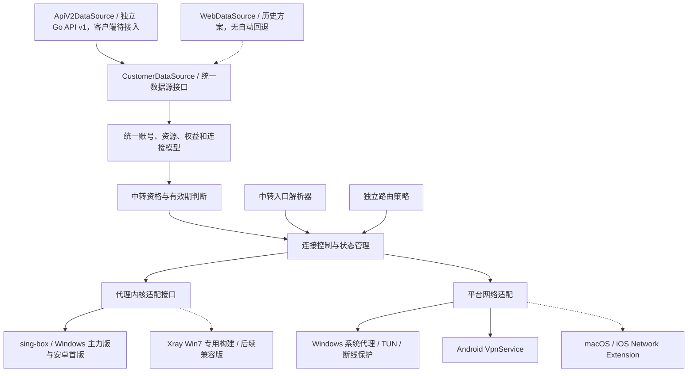

# BlueGrass：需求与架构设计

- 整理日期：2026-10-10，Asia/Hong_Kong。
- 状态：D-01 至 D-19 已记录；独立 Go API 已完成代码与服务端测试，客户端接入、运行与平台兼容性仍待实现和验证。
- 2026-10-11 更新：当前接口以[客户端 API 接入开发文档](../../development/client-api-integration.md)和 [D-19](../../adr/0019-independent-client-api.md) 为准，替代原首版网页取数路径；Hytron 测试 API 已按后续指示启动并通过公网健康检查。
- 正式应用名称：BlueGrass。Android 包标识：`com.bluegrass.client`。图标按 BlueGrass 品牌方向设计，具体素材后续交付，见 [ADR 0018](../../adr/0018-bluegrass-branding.md)。
- 本文记录产品目标、模块边界、平台差异和验收要求，不是实现完成或运行兼容性的证明。
- 审阅与后续：2026-10-10 完成书面审阅与 D-01 至 D-18 决策，见[设计审阅报告](../reviews/2026-10-10-sunipip-client-design-review.md)及其第 7 节 ADR；补充工程设计见[补充设计](2026-10-10-sunipip-client-design-addendum.md)；实施依赖与待重估排期见[实施计划](../plans/2026-10-10-sunipip-client-implementation-plan.md)。

## 1. 产品目标与首版范围

面向太阳IP现有客户，提供“登录账号 → 自动取得已购线路/IP → 选择资源 → 一键连接”的客户端，减少订阅导入、手动配置和售后排查成本。

首版包括账号登录、我的 IP、资源状态、连接控制、到期提示、DNS 容错、断线保护、诊断与更新。购买和续费通过客户端入口跳转官网完成。

D-12 已确认首版同一时刻只使用一个所选资源出口，同一资源可供多个程序并发访问；多 IP 同时使用和逐资源本地端口映射留到后续，见 [ADR 0012](../../adr/0012-single-active-resource.md)。切换资源会中断旧业务，目标资源通过资格与出口验证后再放行，失败时保持已有保护。

按已确认的 D-06，Windows 首轮对外 Beta 即包含系统代理、TUN 和断线保护；保护、泄漏与异常恢复验收通过后再发放。内部 Alpha 可分阶段集成，Beta2 用于扩大覆盖与回归，具体日期另行排定，见 [ADR 0006](../../adr/0006-first-beta-network-protection.md)。

若当前断线保护导致外部浏览器无法访问官网，应解释当前状态并引导用户主动解除相应保护后跳转；不为整个浏览器添加公网直连豁免。

业务网站为 <https://sunipip.com/>，客户中心为 <https://user.sunipip.com/>。现有 Windows 用户主要使用 v2rayN，安卓用户主要使用 v2rayNG。

当前交付的 SOCKS5 地址已经包含中转，客户端直接连接对应入口。后续服务可能切换至 SS、VMess 等协议，客户端采用可扩展的协议与内核适配结构。

只有具备有效中转资格的资源可以在本客户端连接。仅购买静态 IP 的资源可展示信息和开通入口，但不可作为连接出口。

## 2. 已确认的版本范围

| 版本 | 系统目标 | 技术路线 | 维护安排 |
| --- | --- | --- | --- |
| Windows 主力版 | Windows 10/11；工程上优先 x64 | Flutter，Go 后台服务内嵌 sing-box，Windows 原生网络适配 | 与安卓版优先推进 |
| 安卓版 | Android 8.0 / API 26 及以上 | Flutter，Kotlin VpnService，sing-box | 与 Windows 主力版共享业务界面和可共享逻辑 |
| Windows 兼容版 | Windows 7 SP1，64 位 | WPF + .NET Framework 4.8，Xray Win7 专用构建 | 主力版与安卓版发布后独立交付；保留系统代理、TUN 和断线保护目标；独立构建、更新与兼容性验证；不支持 Win7 32 位 |
| macOS、iOS | 后续开发时确定系统基线 | 预留共享业务接口及 Swift / Network Extension 适配 | 本期预留，不宣称已经实现 |

按已确认的 D-01，Windows 10/11 与安卓版先发布，Win7 后续独立交付，保留系统代理、TUN 和断线保护目标。Win7 不设用户占比启动门槛，具体排期另行确定。所需系统补丁、运行库和驱动版本随兼容性验证锁定，并由安装程序检测。

Flutter 当前官方支持范围不包含 Win7。.NET Framework 4.8 的安装范围包含 Win7 SP1；Xray 上游维护 Win7 专用构建流程。这些事实支持兼容版技术路线，但不证明整套客户端已通过 Win7 验收。

主力版与 Win7 版共用账号体系、字段规范和业务规则，分别实现界面及系统接管。不会把 C# 与 Dart 两套实现描述为已经共享同一份源代码。

## 3. 模块边界

| 模块 | 职责与边界 |
| --- | --- |
| 数据源适配 | 统一登录会话、列表分页、所选资源刷新、连接配置及错误；当前接入独立 Go API，原始字段和会话逻辑封装在适配器，界面只依赖统一模型 |
| 统一数据模型 | 描述账号、资源、订阅、中转、协议、能力及状态；不直接采用某个内核的配置格式 |
| 资格判断 | 将实际数据源证据映射为资源资格；当前 API 只返回合格节点，未开通、开通中等完整资产状态仍待契约补齐 |
| 连接控制 | 管理选中资源、启动、验证、停止、重连、模式切换和故障状态 |
| 入口解析器 | 优先使用内核，原生层补齐平台绑定与容错；支持用户指定入口 DNS、缓存、网络切换及重连前的解析 |
| 路由策略 | 独立描述默认出口和未来分流规则，与节点协议、取数方式分开 |
| 内核适配 | 生成内核配置，启动/停止内核，获取状态、流量及脱敏错误；检查版本能力 |
| 平台适配 | 系统代理、虚拟网卡、服务生命周期、权限、安全存储、网络变化和保护规则 |
| 诊断与更新 | 本地诊断、脱敏导出、版本渠道识别、更新验证与回退 |

D-11 已确认 Windows 服务采用 Go，并将可复用的配置生成、内核适配、解析及出口检测放在共享原生层；Windows 的服务管理、IPC、WFP 和 TUN 集成与 Android 的 Kotlin VpnService 平台逻辑分别实现，见 [ADR 0011](../../adr/0011-go-windows-service.md)。内嵌生命周期和平台兼容性仍须经技术验证。

用户于 2026-10-11 要求独立客户端登录及长期自动续期，见 [ADR 0019](../../adr/0019-independent-client-api.md)。业务界面与连接控制只调用统一的 `CustomerDataSource`，下一步由 `ApiV2DataSource` 对接已实现的 Go API。该名称沿用原预留位置，实际 HTTP 路径是 `/api/client/v1`，客户端适配尚未完成。

统一接口包括登录与会话、列表、所选资源刷新、连接配置及错误转换；分页标记对业务层不透明。当前采用游标节点列表和按订阅 ID 查询详情，连接前直接刷新详情。完整资产、分组筛选及增量能力未实现，不得在适配器中编造这些数据。

切换数据源时验证账号、资源身份和会话兼容性，按服务环境、数据源版本及账号隔离缓存；已有连接继续绑定原资源及验证快照，新连接重新核实资格。官网会话与客户端会话独立，不因 API 登录失效或权限拒绝而静默用网页旧数据覆盖结果。节点 `id` 是订阅 ID，不能与原 IP 资产 ID 直接等同。

## 4. 当前 API 与历史网页取数依据

### 4.0 当前独立客户端 API（2026-10-11）

测试 API 基址为 `https://test-api.dos.im/api/client/v1`，代码位于 `client-api/`，Hytron 代码目录为 `/www/wwwroot/test-api.dos.im`。已按用户后续要求启动，公网 HTTPS 健康检查通过，客户端联调仍待完成。接口包含 `/auth/login`、`/auth/refresh`、`/me`、`/auth/logout`、`/nodes`、`/nodes/{subscriptionId}`、`/health`，完整方法、参数、响应和错误见[接入开发文档](../../development/client-api-integration.md)。

访问令牌默认 30 分钟，刷新令牌 180 天闲置有效期且续期后滑动延长。客户端按设备串行续期并持久化重试请求 UUID，访问令牌到期不直接清除会话。列表采用游标分页，详情用于连接前刷新；只返回有效 SOCKS5 中转，不提供原始静态 IP 兜底。业务源只读，会话写入独立表，数据库连接与请求均有并发上限和超时。

D-16 密码与短信目标继续保留，但当前只有密码登录。完整资产列表、其他协议、UDP/IPv6 能力和预期出口 IP 尚未由本 API 提供。不能把节点入口当作出口检测目标，不能把缺失的 `customer.forward_certified` 补为 false，也不能将合格节点列表当作完整资产列表。

### 4.1 历史取数方式（2026-10-10）

以下 §4.1–§4.3 保留原网页观察与字段来源，供核对业务含义；它们不是当前客户端调用契约。原“没有专用 API、先复用网页”的路径已由 D-19 替代。历史探测发生于原设计阶段，本轮文档更新不调用这些生产地址。

D-16 已确认首版同时支持密码登录与短信验证码登录，短信发送及必要的人机验证纳入完整流程，见 [ADR 0016](../../adr/0016-password-and-sms-login.md)。具体发送验证码请求、验证组件及票据约束由 S2 核实，复杂度影响实现和排期，不自动取消短信登录范围。

已定位请求基址：`https://api-all.sunip.cc/api/v1/customer`。

| 用途 | 网页现有请求 | 已观察到的输入或用途 |
| --- | --- | --- |
| 密码登录 | `POST /auth/loginv2` | `username`、`password` |
| 短信登录 | `POST /auth/login-sms` | `phone`、`sms_code`；沿用网站验证流程 |
| 当前用户 | `GET /auth/me` | 取得当前客户资料与账户级状态 |
| 我的 IP | `GET /ips` | `page`、`per_page`，以及网站已有筛选参数 |
| IP 分组 | `GET /ip-groups` | 取得资源分组 |
| 账号级订阅配置 | `GET /subscriptions/config` | 前端读取 `url`、`import_urls`、`subscription_count` |
| 退出登录 | `POST /auth/logout` | 结束会话 |

网页请求携带 `Authorization: Bearer <用户登录令牌>`，并使用 `Accept: application/json, text/plain, */*`。登录处理代码消费 `token` 和 `customer`。

网页请求层识别外层 `success` / `data`；IP 列表组件读取解包后的 `items`、`pagination.total` 和 `pending_orders`。这些结构来自前端消费逻辑，完整原始响应仍需用普通客户测试账号核对。

IP 列表支持 `keyword`、`country`、`product_type`、`expiring_soon`、`sort`、`group_id` 等筛选。按已确认的 D-05，首版按需加载网页资源页，按稳定资源 ID 去重，并区分已加载和未加载的数据。新连接或切换前重新取得账号资格与所选资源；无可靠单条查询时先刷新资源上次所在页，找不到再限频逐页定位。页号和某页缺少记录都不能作为资源身份或撤销依据。

2026-10-10 再次核对当前入口脚本、请求模块和“我的 IP”列表模块，确认网页仍使用上述分页和筛选请求；本次未登录或读取真实资源响应。现有网页内部请求的复用不依赖后端提供新的 App API。是否存在可靠的单条资源定位能力仍待验证，不假定存在 `/ips/{id}`。D-05 的获取策略与 V2 适配预留已确认，见 [ADR 0005](../../adr/0005-web-resource-loading.md)。

已进行的未登录探测：未显式要求 JSON 时曾返回 500；使用网页相同的 Accept 后返回 401 `Unauthenticated.`。这不是登录成功或账号权限的验证。

### 4.2 历史网页资源字段映射

| 信息 | 网页代码使用的字段 |
| --- | --- |
| 资源 ID、名称、地区 | `id`、`asset_name`、`country_name` |
| 订阅 ID | `active_subscription.id`；与资源 ID 分开保存 |
| 订阅状态和有效期 | `active_subscription.status`、`active_subscription.expires_at` |
| 备注 | `active_subscription.customer_remark` |
| 中转规则 | `forward_rule` 或 `active_subscription.forward_rule`；网页另有驼峰字段兼容分支 |
| 中转状态和端口 | 中转规则的 `status`、`listen_port` |
| 当前 SOCKS5 认证信息 | 对应资源的 `auth_username`、`auth_password` |
| 产品展示类别 | `active_subscription.purchased_module` 或中转套餐的 `module` |

网页优先从中转规则的 `effective_host`、中转套餐的 `display_host`、设备组的 `custom_connect_host`、设备组的 `original_connect_host` 取得入口域名。设备组的原始连接域名与资源的原始静态 IP 是两个不同概念。

客户端必须取得明确有效的中转入口。网页辅助函数存在返回资源原始地址的兜底路径，客户端不能继承该路径作为可连接出口。

网页的 `customer.forward_certified` 控制中转相关界面的显示，不能单独证明每条资源已购买中转。产品名称也不能代替订阅和中转规则判断。

列表中的“复制订阅链接”实际生成 `socks://` 单节点分享链接；账号级订阅由 `/subscriptions/config` 提供。后续使用订阅内容补充多协议配置时，必须可靠关联已购资源及中转资格，不能仅凭分享链接授予连接权限。

### 4.3 历史网页会话与错误

本节仅记录网页语义。Go API 的访问令牌过期须先自动续期，按错误码处理终止会话，详见 §4.0 及接入文档。

- App 通过自己的登录流程获得会话，令牌使用平台安全存储；不依赖开发者浏览器中的现有登录状态。
- 401 表示需要重新登录；403 中的 `VERIFICATION_REQUIRED`、其他权限限制、422 参数错误、网络失败和响应结构异常分别处理。
- 字段缺失或解析失败应显示同步异常，不能当作“没有 IP”“没有购买中转”或合法空列表。
- 当前会话观察到的是带中转的资源；静态 IP、开通中、到期、受限及多页资源需要独立样本。

## 5. 中转资格与连接限制

业务上依据“资源—订阅—中转规则”的对应关系判断，不采用“账号买过一条中转，就解锁所有静态 IP”的推断。当前 Go API 在服务端筛选可连接节点；下表是完整产品状态目标，未开通、开通中等完整资产信息仍需补充接口，不能由节点列表缺席推断。

| 状态 | 展示与连接行为 |
| --- | --- |
| 订阅有效、中转规则有效且入口就绪 | 允许连接该资源 |
| 仅静态 IP，无有效中转资格 | 展示资源，禁用连接，提供开通/客服入口 |
| 中转规则为 pending / processing | 显示开通中，刷新状态，暂不连接 |
| 已知订阅或中转到期、停用、撤销 | 禁止开始连接；停止受影响的代理会话，已启用的全局断线保护继续生效 |
| 入口缺失、协议不支持或配置不完整 | 显示具体配置/兼容性错误，禁止连接 |
| 取数失败，无法核实新连接资格 | 显示同步异常，暂不开始新会话 |

到期判断使用原始时间字段及明确的时区规则；“剩余几天”的显示文本不作为授权依据。上游 IP 到期时间可以辅助展示，不能代替客户订阅有效期。

建议限制提示：

> 当前订阅暂不支持连接。
> 您购买的服务仅包含静态 IP，尚未开通中转线路，暂不支持通过 BlueGrass 连接。中国大陆地区使用本客户端，请先开通对应的中转服务。

按钮为“查看中转服务”“联系客服”。文案表达产品服务范围；如需写明“法规限制”，应另行确认适用依据，不将其作为本文已核实的法律结论。

### 已有连接与网站暂时不可用

以下为本设计采用的处理边界，供书面审阅：

- 用户主动开始新会话或切换资源前，刷新并验证对应资格。
- 网站临时不可达、登录令牌失效与中转服务到期是不同状态。已有正常连接不因一次取数失败被立即中断。
- 恢复同一逻辑会话时，可使用该会话最近已验证且仍在已知有效期内的配置进行自动重连；不延长已知权益、不切换资源、不绕过中转认证。
- D-15 已确认缓存仅以已知有效期为上限，不设置 72 小时或其他客户端自定的未复核截止时间；最后复核时间只用于展示与诊断，见 [ADR 0015](../../adr/0015-cache-until-known-expiry.md)。
- 收到明确撤销/停用信息，或达到已知有效期后，停止使用缓存配置。续费后重新取得有效状态才能恢复。
- 界面显示登录或同步异常，并提供重新登录/刷新入口；不会将陈旧状态显示为刚完成的服务端校验。

中转服务端负责最终认证、授权及到期/撤销执行，不依靠客户端代码阻止绕过购买限制。客户端依据已知状态执行展示、资格刷新、到期暂停和出口保护等产品流程，不额外制造失联封禁期限。服务端实际行为仍需通过 B-01 验证，不能把客户端检查通过当作服务端控制已落实的证明。

## 6. Windows 连接行为

### 6.1 系统代理与全局接管

| 用户操作 | 产品行为 |
| --- | --- |
| 点击连接 | 验证资源，启动本地内核，通过受控探测完成实际访问与出口验证，成功后再开放业务转发并设置系统代理（D-07） |
| 开启全局接管 | 对当前线路启用 TUN；默认所有公网目的地，包括国内网站，都走所选 IP |
| 关闭全局接管 | 返回系统代理模式，仍使用当前资源 |
| 主动断开 | 停止连接和本 App 的保护规则，恢复本 App 接管前的设置 |
| 点击窗口“×” | 默认隐藏到托盘，连接、暂停及保护状态继续；首次关闭提示一次（D-17） |
| 托盘菜单“退出” | 执行完整停止流程，按归属恢复接管前设置并清理本产品网络接管；异常残留明确提示恢复入口（D-17） |
| 系统代理模式下到期、停用或撤销 | 进入“已暂停”，终止现有代理业务并拒绝新转发；保留本地监听和系统代理设置，由用户选择续费、换资源或恢复网络（D-08） |

全局接管默认关闭，作为独立开关。系统代理指向 App 在回环地址提供的本地 HTTP / 混合代理入口，由内核处理上游协议和认证。

D-10 已确认 Windows 界面自启和“启动后自动连接”均默认关闭，见 [ADR 0010](../../adr/0010-startup-and-auto-connect.md)。首次手动连接且出口验证成功后，只询问一次是否开启登录自启；自动连接独立由用户开启。启动时先同步后台会话，已有连接不重复建立；关闭界面自启或自动连接不解除已有保护，也不取消同一逻辑会话的故障重连。

系统代理只影响遵循相应设置的程序；TUN 扩大流量接管范围。系统代理模式也采用统一的默认代理出口，不自动启用按国家直连的规则。

D-08 已确认自动暂停不调用主动断开的恢复流程，见 [ADR 0008](../../adr/0008-expiry-keeps-system-proxy.md)。续费或换资源后须重新校验资格和出口，再开放业务转发；用户主动恢复网络或正常退出时按归属恢复快照，不覆盖其他软件的新设置。

Go 后台服务在安装阶段取得所需权限，界面通过鉴权 IPC 请求 TUN 和保护操作。运行时遇到服务不可用、版本不匹配或驱动失败时，撤销本次未完成的变更；仅在原系统代理会话已验证且仍有效时保留该连接，并明确显示“全局接管未启动”。已有保护意图不能因启动失败被自动解除。

### 6.2 断线保护与恢复

- 全局接管运行期间，中转掉线、内核崩溃或 TUN 消失均不得使客户公网流量自动转为物理网口直连。
- 到期或权限撤销导致的自动停止也保持保护，直至用户主动退出全局接管或切换至有效资源；不把自动停止当作用户同意恢复直连。
- 保护由独立的系统过滤规则与后台服务配合实现；保护规则先就绪，再开放全局接管。
- 只放行受约束的 App 自身入口解析、中转建连和必要控制请求；同时保留约定的本机与局域网访问。
- 网络变化后重新识别实际物理出口，再解析和重连。保持资源标识及所选住宅出口，不自动切换至其他已购 IP。
- 正常停止只撤销本 App 创建的规则和设置；检测其他软件已接管的配置，避免覆盖其新设置。
- 记录可恢复的接管状态，提供异常退出后的残留检测与恢复入口。

Win7 兼容版以同样的业务行为为目标。系统代理、TUN 驱动、系统过滤、证书和退出恢复须在 Win7 SP1 x64 环境分别验收，不能以构建成功代替运行验证。

## 7. 安卓连接行为

- 默认接管当前用户/工作配置文件内的全部应用，国内外公网流量统一走所选 IP；预留按应用分流。
- 首次连接通过系统 VPN 授权。连接服务使用 VpnService、前台服务及通知维持运行。
- 中转入口 DNS、必要控制请求及中转建连使用明确保护并绑定的底层网络连接；不为所有应用开放绕过 VPN 的权限。
- Wi-Fi 与移动数据切换时，更新底层网络、入口 DNS 和连接状态，恢复同一资源。
- IPv4、IPv6 都纳入接管及阻断策略；上游暂不支持的流量不能自行从本地网络放行。
- 同一用户空间内与其他 VPN 的冲突需要显示具体原因，不把授权撤销伪装成普通网络故障。

安卓保护能力分两层：

| 场景 | 所需保护 |
| --- | --- |
| VPN 服务仍在运行，中转线路断开 | 保持 VPN 接管，阻断业务流量并自动重连 |
| App 崩溃、进程终止或系统重启 | 需要用户在系统设置启用“始终开启 VPN”和“阻止未通过 VPN 的连接” |

App 提供系统保护设置引导，并显示能实际核实的状态。相关状态查询接口从 Android API 29 开始提供，Android 8/9 上不能把无法核实的设置显示为已验证启用。

启用系统阻断后，主动停止 App 的 VPN 也可能保持断网；界面应解释如何通过系统设置解除。该行为与 Windows 的停止恢复流程分别实现。

## 8. DNS 与底层网络策略

| 请求类型 | 路径 |
| --- | --- |
| 中转入口域名解析 | 按 App 配置的入口 DNS 策略优先由内核执行，原生层补齐能力；经当前物理网口、Wi-Fi 或移动数据直连查询 |
| 中转服务器连接 | 经对应底层网络建立连接，避免进入自己的 TUN/VPN 回环 |
| 客户业务的域名解析与公网访问 | 通过所选中转线路处理 |
| 必要登录、资源同步和恢复控制请求 | 限定 App 自身及受信目标的控制通道，独立于故障代理链路 |
| 中转故障期间的普通业务流量 | 阻断，等待同一线路恢复 |

按已确认的 D-04，设置页支持入口 DNS 的自动与自定义模式，见 [ADR 0004](../../adr/0004-entry-dns-policy.md)。自动模式的候选包括阿里公共 DNS `223.5.5.5` / `223.6.6.6`、DNSPod `119.29.29.29` 和实际物理网络的 DNS，保留不同提供商以供容错。自定义模式允许指定一个或多个 DNS 地址、端口及首选/备用顺序，只在用户列表内查询，不隐式回退到其他 DNS。自定义配置持久化，远程默认值不覆盖用户选择。

多地址列表本身不等于容错。解析器需实现查询超时、备用切换或延迟并发、有限重试、响应校验、TTL 缓存、A/AAAA 地址选择及连接失败后的重新解析。

明确区分 NXDOMAIN、超时、服务器失败和网络不可达，诊断中保留错误类别；多个服务器返回相同失败时不宣称已恢复。所有候选失效时显示解析失败，保持已有的断线保护。

支持后续接入 DoH，并为 DoH 服务域名本身提供独立初始解析路径，保留 TLS 证书验证。后续代理协议采用 TLS 时，解析得到的地址用于建连，原始域名仍用于需要的 SNI、Host 和证书校验。

本地网络 DNS 只作为 App 的入口解析候选。局域网访问豁免不能顺带放行普通应用向路由器发送公网 DNS 查询。

## 9. 协议、内核与分流预留

### 9.1 协议能力

D-03 已确认 Windows 10/11 与安卓首版支持 SOCKS5、Shadowsocks（SS）、VMess、VLESS、Trojan、HTTP/HTTPS 代理、Hysteria2、TUIC、AnyTLS，见 [ADR 0003](../../adr/0003-first-release-protocol-scope.md)。协议、传输方式、TLS/其他安全参数分别建模；所需 TLS/SNI 与证书验证纳入首版，具体版本与参数组合在 Phase 0 锁定并逐项验收。

采用统一的资源与连接配置模型，由内核适配器生成内核专用配置。模型保留配置版本、协议参数、传输参数、内核能力要求和资源关联信息。

- 按已确认的 D-02，Windows 10/11 与安卓首版仅集成 sing-box，保留通用内核适配接口；首版只有 sing-box 实现，后续按明确需求增加 Xray 等适配。
- Win7 兼容版优先使用上游专用的 Xray Win7 构建。
- 各发行包维护自己的协议与传输能力清单；不同内核、版本、构建选项不被视为完全等价。
- 未支持的组合明确提示；不猜测参数、不自动改成另一种协议。
- 后台协议迁移允许新旧配置并存，通过版本与能力检查决定可用配置。

D-14 已确认继续兼容现有有效 SOCKS5 资源，如实说明代理认证和传输保护边界，并配合服务端逐步提供加密入口，见 [ADR 0014](../../adr/0014-socks5-compatibility-and-encryption.md)。D-03 的客户端协议能力与服务端部署情况分别记录；迁移同一资源时重新核实资格和出口，TLS 证书或加密握手失败不自动降级为明文协议。

资源标识与入口协议解耦。更换协议或重新解析入口不能自动变成更换客户的住宅出口资源。

### 9.2 分流预留

首版默认策略为全部公网流量使用所选中转出口，国内网站也包含在内。独立路由模块预留域名、IP 网段、规则优先级、默认动作和配置版本；动作可扩展为代理、直连或阻断。

应用维度按平台真实能力实现。安卓未来采用按应用规则时，需要重新检查其与系统阻断模式的组合行为，不能直接套用 Windows 的分流规则。

本期不增加复杂规则编辑器，预留配置与接口即可。

## 10. 状态、出口验证与诊断

会话、资源资格、连接和保护分别记录状态，资源列表另有同步状态。连接生命周期区分未连接、准备中、启动中、验证中、已连接、重连中、已暂停、正在停止和失败；“同步中”“账号受限”和“保护阻断中”分别属于各自维度，可以与连接状态同时存在。详细迁移见补充设计 §3，按 D-07、D-08 执行验证失败和自动暂停。

内核进程启动成功只代表启动阶段完成。显示已连接前需要通过所选线路完成实际访问验证，并取得可用的出口检测结果。

D-07 已确认首次连接、资源切换和重连均以出口验证成功为放行门槛，见 [ADR 0007](../../adr/0007-exit-verification-required.md)。所有检测端点失败时显示连接失败（CONN-004）并提供重试，TUN/VPN 继续阻断普通业务；仅受控检测流量经所选中转放行。Windows 首次连接在验证前不接管系统代理，已有代理会话的重连失败不自动恢复直连。

实际出口 IP 明确展示；网站能提供可靠预期出口时进行对照。若网站字段只是接入地址，不能擅自将其当成出口地址；通过服务端契约和实测建立对应关系。

诊断覆盖登录、数据同步、权限、中转认证、入口 DNS、TCP、UDP、IPv6、系统代理、TUN 启动、网络切换与保护规则。区分可连接、能力不支持、受限和检测失败，避免以单次延迟检测替代整体连接状态。

用户可手动导出诊断信息。密码、登录令牌、订阅 URL 中的凭据和完整代理认证链接必须脱敏；不默认自动上传客户日志。

D-09 已确认首版提供默认关闭的自建崩溃上报，见 [ADR 0009](../../adr/0009-opt-in-crash-reporting.md)。用户主动开启后仅发送白名单中的脱敏崩溃摘要，不收集使用行为；关闭后停止后续上报并清理待发报告。完整日志与内存转储不自动发送，接收服务独立于当前网页和后续 V2 业务 API。

## 11. 安全存储、开源和更新

用户接受客户端开源。主力客户端按 GPL-3.0 方案组织，保留各依赖原有版权和许可说明，发布与二进制对应的源码和构建说明。

客户凭据在登录后获取，使用平台安全存储。代码、测试样例、仓库文档和构建日志不保存真实凭据；签名私钥独立管理。

Hiddify 当前许可文件包含商用需事先书面许可的附加条款，本方案不以直接复用其代码为基础。正式依赖以最终采用版本的许可证为准。

更新按平台、系统版本、架构和通道匹配，客户端与内核作为同一发行包验证兼容性。Windows 主力版、Win7 兼容版、安卓版分别维护更新渠道；Android 安装与更新身份固定为 `com.bluegrass.client`。

D-13 已确认官网分发 Windows 安装包和 Android APK，并提供应用内更新，见 [ADR 0013](../../adr/0013-official-download-and-updates.md)。官网与客户端共用发行清单，首版不增加应用商店渠道。更新不依赖 V2 业务 API；带保护意图升级时维持必要阻断，恢复原资源前重新验证资格与出口，保留用户设置。

更新包必须验证来源、身份与完整性，发布侧保留上一稳定版的源码、构建资料和相容配置。按 D-13 的恢复方案，可将上一稳定代码以更高版本号重新发布；实际恢复包须验证配置兼容性。HTTPS 下载不能代替更新包验证。Win7 包固定经验证的运行库、内核和驱动组合。

安卓等平台的回退方式受安装和签名规则约束；通过相容的签名、版本号和配置迁移策略设计恢复包，不承诺系统允许任意降低版本号直接覆盖安装。

## 12. 验收标准

| 类别 | 必须覆盖的场景 | 通过标准 |
| --- | --- | --- |
| 登录与会话 | 正常登录、验证流程、401、403、422、退出 | 状态准确，凭据安全，权限错误不被显示成空节点列表 |
| 资源同步 | 按需分页、重复项、列表变化、所选资源跨页定位、字段缺失、响应格式变化 | 已加载数据正确关联且按 ID 去重，未加载状态明确；连接前重新核实所选资源，异常可诊断，缓存不跨账号或数据源混用 |
| 中转权限 | 仅静态 IP、开通中、有效、到期、停用、入口缺失 | 逐资源执行约束，不回退到原始静态 IP |
| 网站异常 | 暂时不可达、会话失效、已有连接、自动恢复 | 按第 5 节区分新会话、既有会话恢复和已知到期 |
| 实际连接 | 当前 SOCKS5 真实线路及各启用协议/传输组合 | 认证、实际访问、出口识别和能力提示符合配置 |
| Windows 系统代理 | 启停、端口冲突、已有代理、其他软件接管 | 状态正确，按归属恢复，失败时回滚本次变更 |
| Windows TUN | 服务不可用、版本不匹配、驱动失败、内核异常或服务终止、TUN 消失、主动停止 | 保护与恢复符合用户动作及故障类型；公网流量不意外直连 |
| 安卓 VPN | 首次授权、后台/锁屏、VPN 冲突、网络切换、进程终止 | 区分 App 保护与系统保护，界面如实显示能力和限制 |
| DNS | 自动/自定义模式、指定单个或多个 DNS、故障切换、全部失效、策略更新、TTL 到期、物理网口变化 | 指定 DNS 实际生效且持久化；自定义模式不查询列表外 DNS；入口解析不回环，业务 DNS 不绕过代理 |
| 流量范围 | 国内外目的地、TCP/UDP、IPv4/IPv6、本机与局域网 | 默认公网统一走所选出口；不支持的能力不通过本地直连兜底 |
| 出口保持 | 掉线重连、入口域名多地址、协议配置更新 | 持续绑定同一资源，不自动选用其他住宅出口 |
| 更新与恢复 | 错包、签名失败、系统不兼容、更新中断、回退 | 拒绝错误更新，可恢复上一稳定发行状态 |
| Win7 独立验收 | SP1 x64、补丁/运行库、证书、驱动、保护与恢复 | 在目标环境实测通过，编译和 CI 成功不替代运行验证 |
| 诊断与开源 | 日志导出、测试样例、源码和发行包 | 信息足够排障，真实凭据不进入公开产物 |

实现前应准备普通客户测试账号及对应的有效、静态、开通中、到期和受限资源样本；必要时配合受控测试数据。样本中的真实凭据不写入此仓库。

## 13. 已完成调研与验证边界

截至本文整理时，已经查看官网、客户中心公开前端脚本，以及用户已登录的“我的 IP”页面，定位网页请求、分页、字段映射和中转入口生成逻辑，并完成未认证请求的响应对照。

尚未直接核对当前会话的完整 JSON 响应，未执行客户端协议连接、带宽/内存性能测试、UDP/IPv6 测试、系统接管或平台兼容性测试。

现有中转线路的 UDP、IPv6、到期撤销、预期出口映射，以及 Win7 驱动/补丁组合，均为后续必须核实的验收项目；本文不将其写成已经确认支持的能力。

本阶段完成设计决策与文档同步。Windows 主力版与安卓版是后续实现重点，Win7 兼容版独立推进；现有实施计划已反映决策范围，详细工程任务和日期需按 Phase 0 结果落实。本次记录不表示技术验证、产品开发或发布已完成。

## 14. 调研依据

以下链接用于追溯当时的调研依据；前端构建文件名、上游版本和文档可能变化，实施时需重新锁定版本与契约。

- [太阳IP官网](https://sunipip.com/)与[客户中心](https://user.sunipip.com/ips)。
- [网页请求处理模块](https://user.sunipip.com/assets/request-DIHGPNVI.js)、[账号模块](https://user.sunipip.com/assets/auth-BFNln1PD.js)、[我的 IP 模块](https://user.sunipip.com/assets/Index-TgY63b21.js)、[账号级订阅配置页面](https://user.sunipip.com/assets/Config-OstDFcw3.js)。
- [Flutter 支持平台](https://docs.flutter.dev/reference/supported-platforms)与[原生平台接口](https://docs.flutter.dev/platform-integration/platform-channels)。
- [sing-box 协议列表](https://sing-box.sagernet.org/configuration/outbound/)、[TUN](https://sing-box.sagernet.org/configuration/inbound/tun/)、[DNS](https://sing-box.sagernet.org/configuration/dns/)、[出站网口及域名解析](https://sing-box.sagernet.org/configuration/shared/dial/)、[许可证](https://github.com/SagerNet/sing-box/blob/testing/LICENSE)。
- [Xray TUN](https://xtls.github.io/config/inbounds/tun.html)、[DNS](https://xtls.github.io/config/dns.html)、[Win7 构建流程](https://github.com/XTLS/Xray-core/blob/main/.github/workflows/release-win7.yml)、[Win7 工具链兼容要求](https://github.com/XTLS/go-win7)。
- [.NET Framework 系统要求](https://learn.microsoft.com/en-us/dotnet/framework/get-started/system-requirements)与[Windows Filtering Platform](https://learn.microsoft.com/en-us/windows/win32/fwp/windows-filtering-platform-start-page)。
- [Android VPN 指南](https://developer.android.com/develop/connectivity/vpn)、[VpnService](https://developer.android.com/reference/android/net/VpnService)、[应用及地址族接管规则](https://developer.android.com/reference/android/net/VpnService.Builder)。
- [Apple Network Extension](https://developer.apple.com/documentation/NetworkExtension/packet-tunnel-provider)。
- [阿里公共 DNS 说明](https://help.aliyun.com/zh/dns/free-service-disclaimer)与[DNSPod 公共 DNS 接入](https://docs.dnspod.com/public-dns/public-dns-guide/)。
- [Hiddify 当前许可文件](https://github.com/hiddify/hiddify-app/blob/main/LICENSE.md)。
