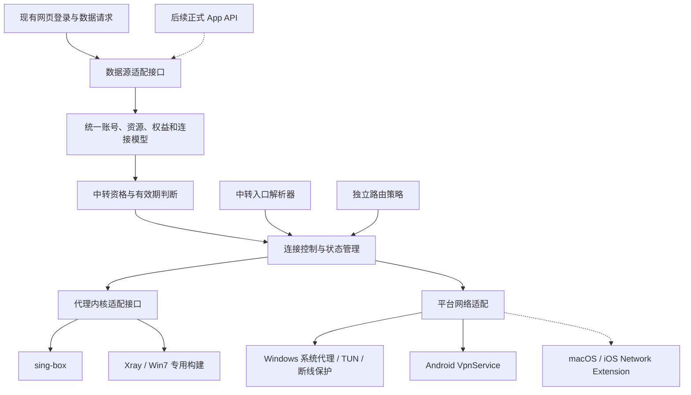

# 太阳IP客户端：需求与架构设计

- 整理日期：2026-10-10，Asia/Hong_Kong。
- 状态：已确认需求与架构草案，供书面审阅；尚未开始产品实现。
- 工作名称：太阳IP客户端。仓库现有名称为 BlueGrass；正式应用名称、图标与包标识在发布设计中确定。
- 本文记录产品目标、模块边界、平台差异和验收要求，不是实现完成或运行兼容性的证明。

## 1. 产品目标与首版范围

面向太阳IP现有客户，提供“登录账号 → 自动取得已购线路/IP → 选择资源 → 一键连接”的客户端，减少订阅导入、手动配置和售后排查成本。

首版包括账号登录、我的 IP、资源状态、连接控制、到期提示、DNS 容错、断线保护、诊断与更新。购买和续费通过客户端入口跳转官网完成。

若当前断线保护导致外部浏览器无法访问官网，应解释当前状态并引导用户主动解除相应保护后跳转；不为整个浏览器添加公网直连豁免。

业务网站为 <https://sunipip.com/>，客户中心为 <https://user.sunipip.com/>。现有 Windows 用户主要使用 v2rayN，安卓用户主要使用 v2rayNG。

当前交付的 SOCKS5 地址已经包含中转，客户端直接连接对应入口。后续服务可能切换至 SS、VMess 等协议，客户端采用可扩展的协议与内核适配结构。

只有具备有效中转资格的资源可以在本客户端连接。仅购买静态 IP 的资源可展示信息和开通入口，但不可作为连接出口。

## 2. 已确认的版本范围

| 版本 | 系统目标 | 技术路线 | 维护安排 |
| --- | --- | --- | --- |
| Windows 主力版 | Windows 10/11；工程上优先 x64 | Flutter，sing-box 主内核，原生网络适配与后台服务 | 与安卓版优先推进 |
| 安卓版 | Android 8.0 / API 26 及以上 | Flutter，Kotlin VpnService，sing-box | 与 Windows 主力版共享业务界面和可共享逻辑 |
| Windows 兼容版 | Windows 7 SP1，64 位 | WPF + .NET Framework 4.8，Xray Win7 专用构建 | 独立界面、构建、更新通道和兼容性验证；不支持 Win7 32 位 |
| macOS、iOS | 后续开发时确定系统基线 | 预留共享业务接口及 Swift / Network Extension 适配 | 本期预留，不宣称已经实现 |

Windows 7 可以与 Windows 10/11 分开开发，主力是 Windows 10/11。Win7 所需系统补丁、运行库和驱动版本随兼容性验证锁定，并由安装程序检测。

Flutter 当前官方支持范围不包含 Win7。.NET Framework 4.8 的安装范围包含 Win7 SP1；Xray 上游维护 Win7 专用构建流程。这些事实支持兼容版技术路线，但不证明整套客户端已通过 Win7 验收。

主力版与 Win7 版共用账号体系、字段规范和业务规则，分别实现界面及系统接管。不会把 C# 与 Dart 两套实现描述为已经共享同一份源代码。

## 3. 模块边界

| 模块 | 职责与边界 |
| --- | --- |
| 数据源适配 | 登录会话、请求、分页、字段映射和错误转换；界面不直接依赖网站原始字段 |
| 统一数据模型 | 描述账号、资源、订阅、中转、协议、能力及状态；不直接采用某个内核的配置格式 |
| 资格判断 | 将网站同源数据映射为可连接、未开通、开通中、到期、受限或无法确认等状态 |
| 连接控制 | 管理选中资源、启动、验证、停止、重连、模式切换和故障状态 |
| 入口解析器 | 多 DNS、物理网络绑定、缓存、网络切换及重连前的入口解析 |
| 路由策略 | 独立描述默认出口和未来分流规则，与节点协议、取数方式分开 |
| 内核适配 | 生成内核配置，启动/停止内核，获取状态、流量及脱敏错误；检查版本能力 |
| 平台适配 | 系统代理、虚拟网卡、服务生命周期、权限、安全存储、网络变化和保护规则 |
| 诊断与更新 | 本地诊断、脱敏导出、版本渠道识别、更新验证与回退 |

正式 API 上线后，增加新的数据源适配器，继续输出统一模型；业务界面与连接控制通过同一接口取数。网页字段变化集中在现有适配器内处理。

## 4. 现阶段网页取数契约

### 4.1 取数方式

第一阶段允许复用网页已经使用的登录和数据请求，不要求新增 App 专用后端 API。业务信息来自现有客户中心的数据源。

已定位请求基址：`https://api-all.sunip.cc/api/v1/customer`。

| 用途 | 网页现有请求 | 已观察到的输入或用途 |
| --- | --- | --- |
| 密码登录 | `POST /auth/loginv2` | `username`、`password` |
| 短信登录 | `POST /auth/login-sms` | `phone`、`sms_code`；沿用网站验证流程 |
| 当前用户 | `GET /auth/me` | 取得当前客户资料与账户级状态 |
| 我的 IP | `GET /ips` | `page`、`per_page`，以及网站已有筛选参数 |
| IP 分组 | `GET /ip-groups` | 取得资源分组 |
| 账号级订阅配置 | `GET /subscriptions/config` | 前端读取 `url`、`import_urls`、`subscription_count` |
| 退出登录 | `POST /auth/logout` | 结束会话 |

网页请求携带 `Authorization: Bearer <用户登录令牌>`，并使用 `Accept: application/json, text/plain, */*`。登录处理代码消费 `token` 和 `customer`。

网页请求层识别外层 `success` / `data`；IP 列表组件读取解包后的 `items`、`pagination.total` 和 `pending_orders`。这些结构来自前端消费逻辑，完整原始响应仍需用普通客户测试账号核对。

IP 列表支持 `keyword`、`country`、`product_type`、`expiring_soon`、`sort`、`group_id` 等筛选。完整同步必须遍历分页、去重并处理同步过程中总数变化，不能只取第一页。

已进行的未登录探测：未显式要求 JSON 时曾返回 500；使用网页相同的 Accept 后返回 401 `Unauthenticated.`。这不是登录成功或账号权限的验证。

### 4.2 资源字段映射

| 信息 | 网页代码使用的字段 |
| --- | --- |
| 资源 ID、名称、地区 | `id`、`asset_name`、`country_name` |
| 订阅 ID | `active_subscription.id`；与资源 ID 分开保存 |
| 订阅状态和有效期 | `active_subscription.status`、`active_subscription.expires_at` |
| 备注 | `active_subscription.customer_remark` |
| 中转规则 | `forward_rule` 或 `active_subscription.forward_rule`；网页另有驼峰字段兼容分支 |
| 中转状态和端口 | 中转规则的 `status`、`listen_port` |
| 当前 SOCKS5 认证信息 | 对应资源的 `auth_username`、`auth_password` |
| 产品展示类别 | `active_subscription.purchased_module` 或中转套餐的 `module` |

网页优先从中转规则的 `effective_host`、中转套餐的 `display_host`、设备组的 `custom_connect_host`、设备组的 `original_connect_host` 取得入口域名。设备组的原始连接域名与资源的原始静态 IP 是两个不同概念。

客户端必须取得明确有效的中转入口。网页辅助函数存在返回资源原始地址的兜底路径，客户端不能继承该路径作为可连接出口。

网页的 `customer.forward_certified` 控制中转相关界面的显示，不能单独证明每条资源已购买中转。产品名称也不能代替订阅和中转规则判断。

列表中的“复制订阅链接”实际生成 `socks://` 单节点分享链接；账号级订阅由 `/subscriptions/config` 提供。后续使用订阅内容补充多协议配置时，必须可靠关联已购资源及中转资格，不能仅凭分享链接授予连接权限。

### 4.3 会话与错误

- App 通过自己的登录流程获得会话，令牌使用平台安全存储；不依赖开发者浏览器中的现有登录状态。
- 401 表示需要重新登录；403 中的 `VERIFICATION_REQUIRED`、其他权限限制、422 参数错误、网络失败和响应结构异常分别处理。
- 字段缺失或解析失败应显示同步异常，不能当作“没有 IP”“没有购买中转”或合法空列表。
- 当前会话观察到的是带中转的资源；静态 IP、开通中、到期、受限及多页资源需要独立样本。

## 5. 中转资格与连接限制

业务上依据网站对“资源—订阅—中转规则”的对应关系判断，不采用“账号买过一条中转，就解锁所有静态 IP”的推断。

| 状态 | 展示与连接行为 |
| --- | --- |
| 订阅有效、中转规则有效且入口就绪 | 允许连接该资源 |
| 仅静态 IP，无有效中转资格 | 展示资源，禁用连接，提供开通/客服入口 |
| 中转规则为 pending / processing | 显示开通中，刷新状态，暂不连接 |
| 已知订阅或中转到期、停用、撤销 | 禁止开始连接；停止受影响的代理会话，已启用的全局断线保护继续生效 |
| 入口缺失、协议不支持或配置不完整 | 显示具体配置/兼容性错误，禁止连接 |
| 取数失败，无法核实新连接资格 | 显示同步异常，暂不开始新会话 |

到期判断使用原始时间字段及明确的时区规则；“剩余几天”的显示文本不作为授权依据。上游 IP 到期时间可以辅助展示，不能代替客户订阅有效期。

建议限制提示：

> 当前订阅暂不支持连接。
> 您购买的服务仅包含静态 IP，尚未开通中转线路，暂不支持通过太阳IP客户端连接。中国大陆地区使用本客户端，请先开通对应的中转服务。

按钮为“查看中转服务”“联系客服”。文案表达产品服务范围；如需写明“法规限制”，应另行确认适用依据，不将其作为本文已核实的法律结论。

### 已有连接与网站暂时不可用

以下为本设计采用的处理边界，供书面审阅：

- 用户主动开始新会话或切换资源前，刷新并验证对应资格。
- 网站临时不可达、登录令牌失效与中转服务到期是不同状态。已有正常连接不因一次取数失败被立即中断。
- 恢复同一逻辑会话时，可使用该会话最近已验证且仍在已知有效期内的配置进行自动重连；不延长已知权益、不切换资源、不绕过中转认证。
- 收到明确撤销/停用信息，或达到已知有效期后，停止使用缓存配置。续费后重新取得有效状态才能恢复。
- 界面显示登录或同步异常，并提供重新登录/刷新入口；不会将陈旧状态显示为刚完成的服务端校验。

第一阶段实施的是官方客户端基于网站信息的限制。服务端认证才是防止绕过购买限制的最终边界；尚未检查中转服务器的到期与撤销实现，不声称已经具备这一保证。

## 6. Windows 连接行为

### 6.1 系统代理与全局接管

| 用户操作 | 产品行为 |
| --- | --- |
| 点击连接 | 验证资源，启动本地内核，入口就绪后设置系统代理，再进行实际连接验证 |
| 开启全局接管 | 对当前线路启用 TUN；默认所有公网目的地，包括国内网站，都走所选 IP |
| 关闭全局接管 | 返回系统代理模式，仍使用当前资源 |
| 主动断开 | 停止连接和本 App 的保护规则，恢复本 App 接管前的设置 |
| 正常退出程序 | 按停止流程回收网络接管；关闭窗口是否留在托盘属于后续界面设计，不等同于退出进程 |

全局接管默认关闭，作为独立开关。系统代理指向 App 在回环地址提供的本地 HTTP / 混合代理入口，由内核处理上游协议和认证。

系统代理只影响遵循相应设置的程序；TUN 扩大流量接管范围。系统代理模式也采用统一的默认代理出口，不自动启用按国家直连的规则。

启用 TUN 时按需获取系统权限，由受控后台组件处理高权限操作。取消授权或启动失败时，撤销本次未完成的变更，保留原有系统代理连接，并明确显示“全局接管未启动”。

### 6.2 断线保护与恢复

- 全局接管运行期间，中转掉线、内核崩溃或 TUN 消失均不得使客户公网流量自动转为物理网口直连。
- 到期或权限撤销导致的自动停止也保持保护，直至用户主动退出全局接管或切换至有效资源；不把自动停止当作用户同意恢复直连。
- 保护由独立的系统过滤规则与后台服务配合实现；保护规则先就绪，再开放全局接管。
- 只放行受约束的 App 自身入口解析、中转建连和必要控制请求；同时保留约定的本机与局域网访问。
- 网络变化后重新识别实际物理出口，再解析和重连。保持资源标识及所选住宅出口，不自动切换至其他已购 IP。
- 正常停止只撤销本 App 创建的规则和设置；检测其他软件已接管的配置，避免覆盖其新设置。
- 记录可恢复的接管状态，提供异常退出后的残留检测与恢复入口。

Win7 兼容版以同样的业务行为为目标。系统代理、TUN 驱动、系统过滤、证书和退出恢复须在 Win7 SP1 x64 环境分别验收，不能以构建成功代替运行验证。

## 7. 安卓连接行为

- 默认接管当前用户/工作配置文件内的全部应用，国内外公网流量统一走所选 IP；预留按应用分流。
- 首次连接通过系统 VPN 授权。连接服务使用 VpnService、前台服务及通知维持运行。
- 中转入口 DNS、必要控制请求及中转建连使用明确保护并绑定的底层网络连接；不为所有应用开放绕过 VPN 的权限。
- Wi-Fi 与移动数据切换时，更新底层网络、入口 DNS 和连接状态，恢复同一资源。
- IPv4、IPv6 都纳入接管及阻断策略；上游暂不支持的流量不能自行从本地网络放行。
- 同一用户空间内与其他 VPN 的冲突需要显示具体原因，不把授权撤销伪装成普通网络故障。

安卓保护能力分两层：

| 场景 | 所需保护 |
| --- | --- |
| VPN 服务仍在运行，中转线路断开 | 保持 VPN 接管，阻断业务流量并自动重连 |
| App 崩溃、进程终止或系统重启 | 需要用户在系统设置启用“始终开启 VPN”和“阻止未通过 VPN 的连接” |

App 提供系统保护设置引导，并显示能实际核实的状态。相关状态查询接口从 Android API 29 开始提供，Android 8/9 上不能把无法核实的设置显示为已验证启用。

启用系统阻断后，主动停止 App 的 VPN 也可能保持断网；界面应解释如何通过系统设置解除。该行为与 Windows 的停止恢复流程分别实现。

## 8. DNS 与底层网络策略

| 请求类型 | 路径 |
| --- | --- |
| 中转入口域名解析 | App 自身解析器，经当前物理网口、Wi-Fi 或移动数据直连查询 |
| 中转服务器连接 | 经对应底层网络建立连接，避免进入自己的 TUN/VPN 回环 |
| 客户业务的域名解析与公网访问 | 通过所选中转线路处理 |
| 必要登录、资源同步和恢复控制请求 | 限定 App 自身及受信目标的控制通道，独立于故障代理链路 |
| 中转故障期间的普通业务流量 | 阻断，等待同一线路恢复 |

入口解析器候选包括阿里公共 DNS `223.5.5.5` / `223.6.6.6`、DNSPod `119.29.29.29`，以及从实际物理网络取得的 DNS。至少保留不同提供商的候选；最终优先级通过目标网络测试确定并配置化。

多地址列表本身不等于容错。解析器需实现查询超时、备用切换或延迟并发、有限重试、响应校验、TTL 缓存、A/AAAA 地址选择及连接失败后的重新解析。

明确区分 NXDOMAIN、超时、服务器失败和网络不可达，诊断中保留错误类别；多个服务器返回相同失败时不宣称已恢复。所有候选失效时显示解析失败，保持已有的断线保护。

支持后续接入 DoH，并为 DoH 服务域名本身提供独立初始解析路径，保留 TLS 证书验证。后续代理协议采用 TLS 时，解析得到的地址用于建连，原始域名仍用于需要的 SNI、Host 和证书校验。

本地网络 DNS 只作为 App 的入口解析候选。局域网访问豁免不能顺带放行普通应用向路由器发送公网 DNS 查询。

## 9. 协议、内核与分流预留

### 9.1 协议能力

支持目标不限定于 SOCKS5、SS、VMess，还包括所选内核稳定支持的 HTTP(S) 代理、VLESS、Trojan、Hysteria2、TUIC、AnyTLS 等能力。协议、传输方式、TLS/其他安全参数分别建模。

采用统一的资源与连接配置模型，由内核适配器生成内核专用配置。模型保留配置版本、协议参数、传输参数、内核能力要求和资源关联信息。

- 主力版优先集成 sing-box，并预留 Xray 适配接口。
- Win7 兼容版优先使用上游专用的 Xray Win7 构建。
- 各发行包维护自己的协议与传输能力清单；不同内核、版本、构建选项不被视为完全等价。
- 未支持的组合明确提示；不猜测参数、不自动改成另一种协议。
- 后台协议迁移允许新旧配置并存，通过版本与能力检查决定可用配置。

资源标识与入口协议解耦。更换协议或重新解析入口不能自动变成更换客户的住宅出口资源。

### 9.2 分流预留

首版默认策略为全部公网流量使用所选中转出口，国内网站也包含在内。独立路由模块预留域名、IP 网段、规则优先级、默认动作和配置版本；动作可扩展为代理、直连或阻断。

应用维度按平台真实能力实现。安卓未来采用按应用规则时，需要重新检查其与系统阻断模式的组合行为，不能直接套用 Windows 的分流规则。

本期不增加复杂规则编辑器，预留配置与接口即可。

## 10. 状态、出口验证与诊断

连接状态至少区分未连接、同步中、连接中、验证中、已连接、重连中、受限、保护阻断中、正在停止和失败。

内核进程启动成功只代表启动阶段完成。显示已连接前需要通过所选线路完成实际访问验证，并取得可用的出口检测结果。

实际出口 IP 明确展示；网站能提供可靠预期出口时进行对照。若网站字段只是接入地址，不能擅自将其当成出口地址；通过服务端契约和实测建立对应关系。

诊断覆盖登录、数据同步、权限、中转认证、入口 DNS、TCP、UDP、IPv6、系统代理、TUN 启动、网络切换与保护规则。区分可连接、能力不支持、受限和检测失败，避免以单次延迟检测替代整体连接状态。

用户可手动导出诊断信息。密码、登录令牌、订阅 URL 中的凭据和完整代理认证链接必须脱敏；不默认自动上传客户日志。

## 11. 安全存储、开源和更新

用户接受客户端开源。主力客户端按 GPL-3.0 方案组织，保留各依赖原有版权和许可说明，发布与二进制对应的源码和构建说明。

客户凭据在登录后获取，使用平台安全存储。代码、测试样例、仓库文档和构建日志不保存真实凭据；签名私钥独立管理。

Hiddify 当前许可文件包含商用需事先书面许可的附加条款，本方案不以直接复用其代码为基础。正式依赖以最终采用版本的许可证为准。

更新按平台、系统版本、架构、通道和内核能力匹配。Windows 主力版、Win7 兼容版、安卓版分别维护更新渠道。

更新包必须验证来源与完整性，并保存可回退的上一稳定版本及相容配置。HTTPS 下载不能代替更新包验证。Win7 包固定经验证的运行库、内核和驱动组合。

安卓等平台的回退方式受安装和签名规则约束；通过相容的签名、版本号和配置迁移策略设计恢复包，不承诺系统允许任意降低版本号直接覆盖安装。

## 12. 验收标准

| 类别 | 必须覆盖的场景 | 通过标准 |
| --- | --- | --- |
| 登录与会话 | 正常登录、验证流程、401、403、422、退出 | 状态准确，凭据安全，权限错误不被显示成空节点列表 |
| 资源同步 | 单页、多页、重复项、列表变化、字段缺失、响应格式变化 | 资源完整且正确关联，异常可诊断，缓存不会跨账号混用 |
| 中转权限 | 仅静态 IP、开通中、有效、到期、停用、入口缺失 | 逐资源执行约束，不回退到原始静态 IP |
| 网站异常 | 暂时不可达、会话失效、已有连接、自动恢复 | 按第 5 节区分新会话、既有会话恢复和已知到期 |
| 实际连接 | 当前 SOCKS5 真实线路及各启用协议/传输组合 | 认证、实际访问、出口识别和能力提示符合配置 |
| Windows 系统代理 | 启停、端口冲突、已有代理、其他软件接管 | 状态正确，按归属恢复，失败时回滚本次变更 |
| Windows TUN | 权限取消、驱动失败、内核崩溃、TUN 消失、主动停止 | 保护与恢复符合用户动作及故障类型；公网流量不意外直连 |
| 安卓 VPN | 首次授权、后台/锁屏、VPN 冲突、网络切换、进程终止 | 区分 App 保护与系统保护，界面如实显示能力和限制 |
| DNS | 单个/全部解析器失效、错误响应、TTL 到期、物理网口变化 | 入口解析不回环，故障可恢复或明确失败，业务 DNS 不绕过代理 |
| 流量范围 | 国内外目的地、TCP/UDP、IPv4/IPv6、本机与局域网 | 默认公网统一走所选出口；不支持的能力不通过本地直连兜底 |
| 出口保持 | 掉线重连、入口域名多地址、协议配置更新 | 持续绑定同一资源，不自动选用其他住宅出口 |
| 更新与恢复 | 错包、签名失败、系统不兼容、更新中断、回退 | 拒绝错误更新，可恢复上一稳定发行状态 |
| Win7 独立验收 | SP1 x64、补丁/运行库、证书、驱动、保护与恢复 | 在目标环境实测通过，编译和 CI 成功不替代运行验证 |
| 诊断与开源 | 日志导出、测试样例、源码和发行包 | 信息足够排障，真实凭据不进入公开产物 |

实现前应准备普通客户测试账号及对应的有效、静态、开通中、到期和受限资源样本；必要时配合受控测试数据。样本中的真实凭据不写入此仓库。

## 13. 已完成调研与验证边界

截至本文整理时，已经查看官网、客户中心公开前端脚本，以及用户已登录的“我的 IP”页面，定位网页请求、分页、字段映射和中转入口生成逻辑，并完成未认证请求的响应对照。

尚未直接核对当前会话的完整 JSON 响应，未执行客户端协议连接、带宽/内存性能测试、UDP/IPv6 测试、系统接管或平台兼容性测试。

现有中转线路的 UDP、IPv6、到期撤销、预期出口映射，以及 Win7 驱动/补丁组合，均为后续必须核实的验收项目；本文不将其写成已经确认支持的能力。

本阶段只保存设计。Windows 主力版与安卓版是后续实现重点；Win7 兼容版独立推进。书面设计审阅后，再另行整理实施计划，不将本次讨论确认自动视为立即开始产品开发。

## 14. 调研依据

以下链接用于追溯当时的调研依据；前端构建文件名、上游版本和文档可能变化，实施时需重新锁定版本与契约。

- [太阳IP官网](https://sunipip.com/)与[客户中心](https://user.sunipip.com/ips)。
- [网页请求处理模块](https://user.sunipip.com/assets/request-DIHGPNVI.js)、[账号模块](https://user.sunipip.com/assets/auth-BFNln1PD.js)、[我的 IP 模块](https://user.sunipip.com/assets/Index-TgY63b21.js)、[账号级订阅配置页面](https://user.sunipip.com/assets/Config-OstDFcw3.js)。
- [Flutter 支持平台](https://docs.flutter.dev/reference/supported-platforms)与[原生平台接口](https://docs.flutter.dev/platform-integration/platform-channels)。
- [sing-box 协议列表](https://sing-box.sagernet.org/configuration/outbound/)、[TUN](https://sing-box.sagernet.org/configuration/inbound/tun/)、[DNS](https://sing-box.sagernet.org/configuration/dns/)、[出站网口及域名解析](https://sing-box.sagernet.org/configuration/shared/dial/)、[许可证](https://github.com/SagerNet/sing-box/blob/testing/LICENSE)。
- [Xray TUN](https://xtls.github.io/config/inbounds/tun.html)、[DNS](https://xtls.github.io/config/dns.html)、[Win7 构建流程](https://github.com/XTLS/Xray-core/blob/main/.github/workflows/release-win7.yml)、[Win7 工具链兼容要求](https://github.com/XTLS/go-win7)。
- [.NET Framework 系统要求](https://learn.microsoft.com/en-us/dotnet/framework/get-started/system-requirements)与[Windows Filtering Platform](https://learn.microsoft.com/en-us/windows/win32/fwp/windows-filtering-platform-start-page)。
- [Android VPN 指南](https://developer.android.com/develop/connectivity/vpn)、[VpnService](https://developer.android.com/reference/android/net/VpnService)、[应用及地址族接管规则](https://developer.android.com/reference/android/net/VpnService.Builder)。
- [Apple Network Extension](https://developer.apple.com/documentation/NetworkExtension/packet-tunnel-provider)。
- [阿里公共 DNS 说明](https://help.aliyun.com/zh/dns/free-service-disclaimer)与[DNSPod 公共 DNS 接入](https://docs.dnspod.com/public-dns/public-dns-guide/)。
- [Hiddify 当前许可文件](https://github.com/hiddify/hiddify-app/blob/main/LICENSE.md)。
